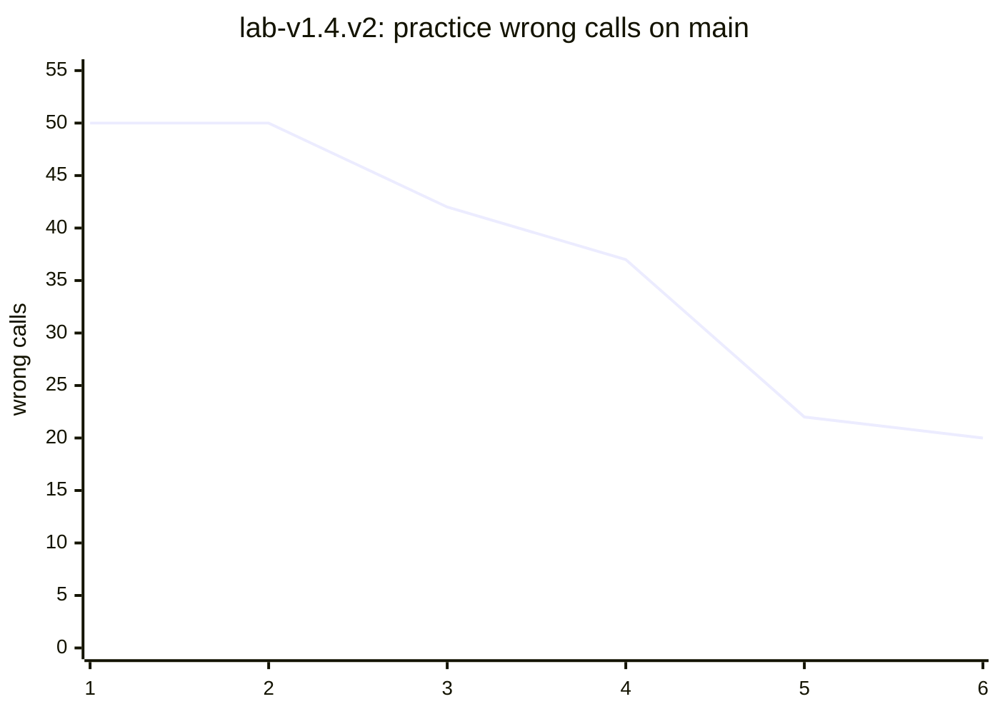
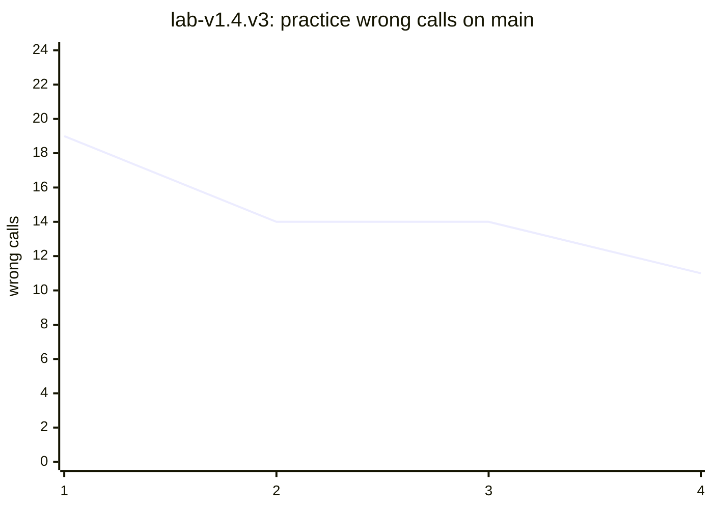
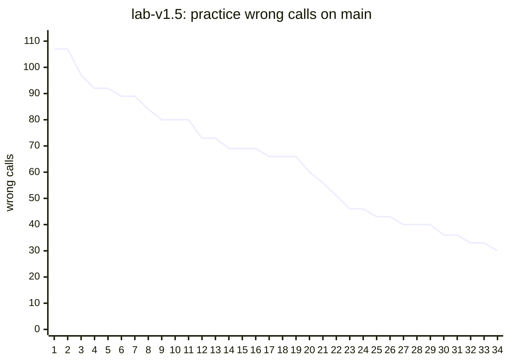
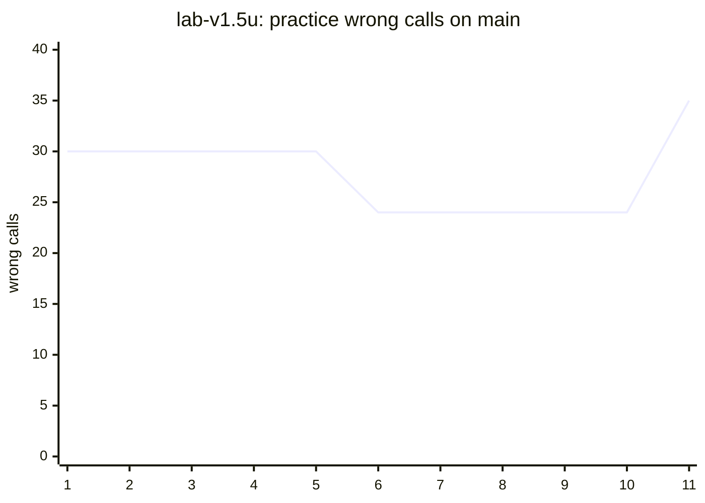

# Lab history

Every lab experiment (hand-run and autolab) and how the main line's wrong calls moved. Generated by `python3 tools/lab_history.py` from the lab ledger on the `tilawa-lab` volume; don't edit by hand. See `.scratch/lab/spec.md` for how experiments are scored.

Ledger test set now: `lab-v1.5u`. 899 experiments, 56 main-line scores, from 2026-10-30 to 2026-11-22. A change of 2 or fewer wrong calls is noise.

| | count |
|---|---:|
| discarded | 579 |
| folded | 29 |
| open | 291 |
| autolab | 867 |
| hand | 32 |
| checker | 84 |
| listener | 658 |
| tracker | 157 |
| scored on practice | 133 |

## Main line over time

Practice wrong calls (missed + false warnings) after each score of `main`. Lower is better. A new test set restarts the count.

| # | date | test set | main | practice (missed / false) | exam | after | note |
|---:|---|---|---|---|---:|---|---|
| 1 | 2026-10-30 | lab-v1.4 | [`34170c0`](https://github.com/yazinsai/tilawa/commit/34170c0) | 50 (34 / 16) | 58 |  | lab-v1.4 main-line baseline (spliced-clean-int8); listening check passed 126/126 reviewed, 3 bad |
| 2 | 2026-10-30 | lab-v1.4.v2 | [`34170c0`](https://github.com/yazinsai/tilawa/commit/34170c0) | 50 (34 / 16) | 58 |  | re-scored on lab-v1.4.v2 |
| 3 | 2026-10-30 | lab-v1.4.v2 | [`f5b1757`](https://github.com/yazinsai/tilawa/commit/f5b1757) | 50 (34 / 16) | 58 |  | re-scored for fold of checker-added-words |
| 4 | 2026-10-30 | lab-v1.4.v2 | [`34be77a`](https://github.com/yazinsai/tilawa/commit/34be77a) | 42 (26 / 16) | 58 | checker-added-words | An added word found inside a word (often a waqf word said alone at an ayah pause) takes that word's edge with it, so th… |
| 5 | 2026-10-30 | lab-v1.4.v2 | [`c1f62e7`](https://github.com/yazinsai/tilawa/commit/c1f62e7) | 37 (26 / 11) | 52 | checker-fewer-false-wrong | A wrong word whose changed sounds the decoder heard at mean confidence below 0.8 must beat the written word by 2x SUPPO… |
| 6 | 2026-10-30 | lab-v1.4.v2 | [`99dc36e`](https://github.com/yazinsai/tilawa/commit/99dc36e) | 22 (17 / 5) | 40 | checker-ayah-start-omissions | Phonemes marked as a non-Quran phrase cost a hair above nothing to insert, so where the written word explains them as w… |
| 7 | 2026-10-30 | lab-v1.4.v2 | [`975702f`](https://github.com/yazinsai/tilawa/commit/975702f) | 20 (16 / 4) | 40 |  | Scorer: a warning on the word just before an added word catches it (misclassified), so one slip there no longer counts… |
| 8 | 2026-10-30 | lab-v1.4.v3 | [`975702f`](https://github.com/yazinsai/tilawa/commit/975702f) | 19 (16 / 3) | 40 |  | re-scored on lab-v1.4.v3 |
| 9 | 2026-10-30 | lab-v1.4.v3 | [`b544715`](https://github.com/yazinsai/tilawa/commit/b544715) | 14 (11 / 3) | 38 | checker-listener-noise | Checker word-gap alignment is brittle to listener noise: charge repeated inserted sounds and shortened doubles as held… |
| 10 | 2026-10-30 | lab-v1.4.v3 | [`5716d49`](https://github.com/yazinsai/tilawa/commit/5716d49) | 14 (11 / 3) |  |  | re-scored for fold of tracker-startup-persistence |
| 11 | 2026-10-30 | lab-v1.4.v3 | [`241c788`](https://github.com/yazinsai/tilawa/commit/241c788) | 11 (11 / 0) |  | tracker-startup-persistence | Canonical Quran text containing a near-repeat must not be collapsed as a reciter repeat. Preserve the full evidence whe… |
| 12 | 2026-10-31 | lab-v1.5 | [`fe4daad`](https://github.com/yazinsai/tilawa/commit/fe4daad) | 107 (82 / 25) | 149 |  | lab-v1.5 registered (ticket 20): 200 sessions, lab-v1.4's 40 frozen, flags carried; spot check 45/45 ok |
| 13 | 2026-10-31 | lab-v1.5 | [`e7b02bc`](https://github.com/yazinsai/tilawa/commit/e7b02bc) | 107 (82 / 25) |  |  | re-scored for fold of checker-joint-additions |
| 14 | 2026-10-31 | lab-v1.5 | [`27ddced`](https://github.com/yazinsai/tilawa/commit/27ddced) | 97 (72 / 25) |  | checker-joint-additions | Jointly align added speech with both neighboring words so an insertion cannot disappear into a reference-word detour. P… |
| 15 | 2026-10-31 | lab-v1.5 | [`3374b91`](https://github.com/yazinsai/tilawa/commit/3374b91) | 92 (67 / 25) |  | checker-independent-consonants | Counting a contiguous doubled-consonant identity change once and requiring compatible lexical pronunciation context ret… |
| 16 | 2026-10-31 | lab-v1.5 | [`da14389`](https://github.com/yazinsai/tilawa/commit/da14389) | 92 (67 / 25) | 136 |  | re-scored for fold of checker-extra-segmentation |
| 17 | 2026-10-31 | lab-v1.5 | [`4001bd6`](https://github.com/yazinsai/tilawa/commit/4001bd6) | 89 (64 / 25) | 132 | checker-extra-segmentation | Remaining oracle additions are absorbed into partial or wrong neighboring visits; recover bounded extra speech while pr… |
| 18 | 2026-11-01 | lab-v1.5 | [`abb918b`](https://github.com/yazinsai/tilawa/commit/abb918b) | 89 (64 / 25) |  |  | autolab start |
| 19 | 2026-11-01 | lab-v1.5 | [`d5303ef8`](https://github.com/yazinsai/tilawa/commit/d5303ef8) | 84 (61 / 23) |  | listener-context-free-gap-decode | Words added after a waqf pause are lost because the model's long left context makes it expect the next verse word, not… |
| 20 | 2026-11-01 | lab-v1.5 | [`37712511`](https://github.com/yazinsai/tilawa/commit/37712511) | 80 (57 / 23) |  | checker-dropped-suffix-wordform | The folded-candidate wordform check abstains when the reciter drops a consonant-bearing suffix (عليهما→عليه, إنهما→إنه)… |
| 21 | 2026-11-01 | lab-v1.5 | [`c36b2daa`](https://github.com/yazinsai/tilawa/commit/c36b2daa) | 80 (57 / 23) |  |  | autolab folds move to main |
| 22 | 2026-11-01 | lab-v1.5 | [`6af0cced`](https://github.com/yazinsai/tilawa/commit/6af0cced) | 80 (57 / 23) |  |  | re-scored for fold of checker-parallel-verse-graph-decode |
| 23 | 2026-11-01 | lab-v1.5 | [`d4ec2103`](https://github.com/yazinsai/tilawa/commit/d4ec2103) | 73 (48 / 25) |  | checker-parallel-verse-graph-decode | Mutashabihat swaps (عليه↔عليهما in the as-Saffat refrains, 26:141, 7:66) are missed because the checker judges them as… |
| 24 | 2026-11-01 | lab-v1.5 | [`70133f91`](https://github.com/yazinsai/tilawa/commit/70133f91) | 73 (48 / 25) |  |  | re-scored for fold of checker-pause-anchored-skip-seams |
| 25 | 2026-11-01 | lab-v1.5 | [`3f140934`](https://github.com/yazinsai/tilawa/commit/3f140934) | 69 (46 / 23) |  | checker-pause-anchored-skip-seams | Surah-26 skips are placed one look-alike word off (heard المؤمنين bound to the skipped ayah's مؤمنين; 26:131:2 instead… |
| 26 | 2026-11-02 | lab-v1.5 | [`9d4bf35e`](https://github.com/yazinsai/tilawa/commit/9d4bf35e) | 69 (46 / 23) |  |  | daily re-score 2026-11-02 |
| 27 | 2026-11-02 | lab-v1.5 | [`a6cc3212`](https://github.com/yazinsai/tilawa/commit/a6cc3212) | 69 (46 / 23) |  |  | re-scored for fold of tracker-hold-tokens-keep-loss-veto |
| 28 | 2026-11-02 | lab-v1.5 | [`d2928594`](https://github.com/yazinsai/tilawa/commit/d2928594) | 66 (45 / 21) |  | tracker-hold-tokens-keep-loss-veto | Hold-lock won 4 incidents but lost 2. Every loss was an issue already open when the lock dropped, and the 26:222 skip i… |
| 29 | 2026-11-02 | lab-v1.5 | [`343322ec`](https://github.com/yazinsai/tilawa/commit/343322ec) | 66 (45 / 21) | 129 |  | autolab exam tripwire |
| 30 | 2026-11-02 | lab-v1.5 | [`29279c57`](https://github.com/yazinsai/tilawa/commit/29279c57) | 66 (45 / 21) |  |  | re-scored for fold of checker-surplus-spelled-lexicon-word-r |
| 31 | 2026-11-02 | lab-v1.5 | [`5dc0efc7`](https://github.com/yazinsai/tilawa/commit/5dc0efc7) | 60 (39 / 21) |  | checker-surplus-spelled-lexicon-word-r | Seam additions are often spelled out whole in the greedy string (قبلهم, قليلا, وقفوهم in the unlocked-gap trace), but e… |
| 32 | 2026-11-02 | lab-v1.5 | [`917f34ab`](https://github.com/yazinsai/tilawa/commit/917f34ab) | 56 (37 / 19) |  | tracker-first-lock-twin-rebased | The guarded first-lock continuation won all 4 tracker targets, but its rebase lost exactly the 6 incidents and 12 studi… |
| 33 | 2026-11-02 | lab-v1.5 | [`3bbe6794`](https://github.com/yazinsai/tilawa/commit/3bbe6794) | 51 (37 / 14) |  | listener-heard-word-must-be-lexical | Phone wrong-word false warnings come from single channel-blurred consonants (ن/م, ف/ك, swallowed or truncated endings),… |
| 34 | 2026-11-02 | lab-v1.5 | [`75fde7d1`](https://github.com/yazinsai/tilawa/commit/75fde7d1) | 46 (31 / 15) |  | checker-ledger-with-without-ayah-fit | The ayah-absence ledger found the right skip candidates (26:109, 55:29, 77:33; checker -4) but lost 4 calls. It judged… |
| 35 | 2026-11-03 | lab-v1.5 | [`e16de82c`](https://github.com/yazinsai/tilawa/commit/e16de82c) | 46 (31 / 15) |  |  | re-scored for fold of checker-inner-waqf-proclitic-onset-visit |
| 36 | 2026-11-03 | lab-v1.5 | [`272db316`](https://github.com/yazinsai/tilawa/commit/272db316) | 43 (28 / 15) |  | checker-inner-waqf-proclitic-onset-visit | The inner-waqf run-end seam wins 37:113:5 and 9:65:8 but misses 38:4:6, because the phone channel erased the proclitic… |
| 37 | 2026-11-03 | lab-v1.5 | [`02f85ae7`](https://github.com/yazinsai/tilawa/commit/02f85ae7) | 43 (28 / 15) | 115 |  | autolab exam tripwire |
| 38 | 2026-11-03 | lab-v1.5 | [`7801f4e9`](https://github.com/yazinsai/tilawa/commit/7801f4e9) | 40 (26 / 14) |  | tracker-excursion-rebinds-ayah-window | The folded with/without-ayah ledger reports false skips at p41 26:144:1 and p46 54:36:1, plausibly because those ayahs… |
| 39 | 2026-11-04 | lab-v1.5 | [`a990cd74`](https://github.com/yazinsai/tilawa/commit/a990cd74) | 40 (26 / 14) |  |  | daily re-score 2026-11-04 |
| 40 | 2026-11-04 | lab-v1.5 | [`f03222e3`](https://github.com/yazinsai/tilawa/commit/f03222e3) | 40 (26 / 14) |  |  | re-scored for fold of checker-channel-odds-omission-place |
| 41 | 2026-11-04 | lab-v1.5 | [`76656430`](https://github.com/yazinsai/tilawa/commit/76656430) | 36 (24 / 12) |  | checker-channel-odds-omission-place | Two planted omissions are placed on the spoken neighbour (44:5 إنا blamed on كنا, 20:25 لي blamed on صدري), giving a mi… |
| 42 | 2026-11-04 | lab-v1.5 | [`4ab022d1`](https://github.com/yazinsai/tilawa/commit/4ab022d1) | 36 (24 / 12) |  |  | re-scored for fold of checker-formula-slot-channel-madd |
| 43 | 2026-11-04 | lab-v1.5 | [`d780997d`](https://github.com/yazinsai/tilawa/commit/d780997d) | 33 (22 / 11) |  | checker-formula-slot-channel-madd | 9:47:17 (planted بالمتقين for بالظالمين after the shared lead والله عليم) is a closed formula-slot swap that string rul… |
| 44 | 2026-11-05 | lab-v1.5 | [`258101a3`](https://github.com/yazinsai/tilawa/commit/258101a3) | 33 (22 / 11) |  |  | re-scored for fold of listener-stack-be988c |
| 45 | 2026-11-05 | lab-v1.5 | [`0f42b825`](https://github.com/yazinsai/tilawa/commit/0f42b825) | 30 (20 / 10) |  | listener-stack-be988c | Stack listener-final-slot-manner-rekey (-2) and listener-pause-bounded-swap-tail-merge (-1): each won different inciden… |
| 46 | 2026-11-05 | lab-v1.5u | [`2b50d856`](https://github.com/yazinsai/tilawa/commit/2b50d856) | 30 (20 / 10) | 113 |  | lab-v1.5u: realuser slice joined (ticket 19) |
| 47 | 2026-11-05 | lab-v1.5u | [`ca40a68c`](https://github.com/yazinsai/tilawa/commit/ca40a68c) | 30 (20 / 10) | 113 |  | re-scored for fold of checker-pause-onset-isolated-form |
| 48 | 2026-11-05 | lab-v1.5u | [`b14ef5f5`](https://github.com/yazinsai/tilawa/commit/b14ef5f5) | 30 (20 / 10) | 105 | checker-pause-onset-isolated-form | Real learners who pause between two words start the second plainly, but the wrong-word check expects the onset doubled… |
| 49 | 2026-11-05 | lab-v1.5u | [`06c04a52`](https://github.com/yazinsai/tilawa/commit/06c04a52) | 30 (20 / 10) | 107 | checker-parallel-verse-illa-inna | checker-parallel-verse-graph-decode added a real-user wrong-word false warning at sob-027 84:25:1 (إلّا heard as إنّ).… |
| 50 | 2026-11-05 | lab-v1.5u | [`977e3311`](https://github.com/yazinsai/tilawa/commit/977e3311) | 30 (20 / 10) |  |  | re-scored for fold of listener-teacher-insert-marginal-gate |
| 51 | 2026-11-05 | lab-v1.5u | [`23e9311d`](https://github.com/yazinsai/tilawa/commit/23e9311d) | 24 (13 / 11) |  | listener-teacher-insert-marginal-gate | Ownership-free seam spelling (excise-certify) recovers heard planted additions (p19, p50, 4:157:24, 9:5:15) but lost 18… |
| 52 | 2026-11-06 | lab-v1.5u | [`d53a5a3c`](https://github.com/yazinsai/tilawa/commit/d53a5a3c) | 24 (13 / 11) | 109 |  | autolab exam tripwire |
| 53 | 2026-11-07 | lab-v1.5u | [`8172f27e`](https://github.com/yazinsai/tilawa/commit/8172f27e) | 24 (13 / 11) |  |  | recover daily manifest/exclusion mismatch using actual current cohort |
| 54 | 2026-11-10 | lab-v1.5u | [`441dddc3`](https://github.com/yazinsai/tilawa/commit/441dddc3) | 24 (13 / 11) |  |  | daily re-score 2026-11-10 |
| 55 | 2026-11-12 | lab-v1.5u | [`644a7199`](https://github.com/yazinsai/tilawa/commit/644a7199) | 24 (13 / 11) |  |  | daily re-score 2026-11-12 |
| 56 | 2026-11-22 | lab-v1.5u | [`5629a4e3`](https://github.com/yazinsai/tilawa/commit/5629a4e3) | 35 (24 / 11) | 106 |  | Re-baseline main (5629a4e3) on shipped streaming spliced-clean-int8 after rc.1 field-bug folds |

## Folded experiments

| date | experiment | component | by | practice change (overall / component) | fold |
|---|---|---|---|---|---|
| 2026-10-30 | checker-fewer-false-wrong | checker | Yazin | -5 / +0 |  |
| 2026-10-30 | checker-added-words | checker | Yazin | -8 / -11 |  |
| 2026-10-30 | checker-ayah-start-omissions | checker | Yazin | -15 / -13 |  |
| 2026-10-30 | checker-listener-noise | checker | Yazin | -5 / +0 |  |
| 2026-10-30 | tracker-startup-persistence | tracker | Yazin | -3 / -3 |  |
| 2026-10-31 | checker-joint-additions | checker | Yazin | -10 / -10 |  |
| 2026-10-31 | checker-independent-consonants | checker | Yazin | -5 / -8 |  |
| 2026-10-31 | checker-extra-segmentation | checker | Yazin | -3 / -3 |  |
| 2026-11-01 | checker-dropped-suffix-wordform | checker | autolab | -4 / -7 |  |
| 2026-11-01 | listener-context-free-gap-decode | listener | autolab | -5 / -5 |  |
| 2026-11-01 | checker-parallel-verse-graph-decode | checker | autolab | -7 / -2 |  |
| 2026-11-01 | checker-pause-anchored-skip-seams | checker | autolab | -4 / -4 |  |
| 2026-11-02 | tracker-hold-tokens-keep-loss-veto | tracker | autolab | -3 / -3 |  |
| 2026-11-02 | checker-surplus-spelled-lexicon-word-r | checker | autolab | -6 / -11 |  |
| 2026-11-02 | tracker-first-lock-twin-rebased | tracker | autolab | -4 / -4 |  |
| 2026-11-02 | listener-heard-word-must-be-lexical | listener | autolab | -5 / -5 |  |
| 2026-11-02 | checker-ledger-with-without-ayah-fit | checker | autolab | -5 / -5 |  |
| 2026-11-03 | checker-inner-waqf-proclitic-onset-visit | checker | autolab | -3 / -5 |  |
| 2026-11-03 | tracker-excursion-rebinds-ayah-window | tracker | autolab | -3 / -3 |  |
| 2026-11-04 | checker-channel-odds-omission-place | checker | autolab | -4 / +0 |  |
| 2026-11-04 | checker-formula-slot-channel-madd | checker | autolab | -3 / -3 |  |
| 2026-11-05 | listener-stack-be988c | listener | autolab | -3 / -3 |  |
| 2026-11-05 | checker-pause-onset-isolated-form | checker | Yazin | +0 / +0 |  |
| 2026-11-05 | checker-parallel-verse-illa-inna | checker | Yazin | +0 / +0 |  |
| 2026-11-05 | listener-teacher-insert-marginal-gate | listener | autolab | -6 / -6 |  |
| 2026-11-22 | tracker-istiadha-lock | tracker | Yazin | +0 / +0 | [`33bb3917`](https://github.com/yazinsai/tilawa/commit/33bb3917) |
| 2026-11-22 | checker-parallel-phrase-collapse | checker | Yazin | +0 / +0 | [`7ba1e8fa`](https://github.com/yazinsai/tilawa/commit/7ba1e8fa) |
| 2026-11-22 | checker-skip-span-dedupe | checker | Yazin | +0 / +0 | [`5629a4e3`](https://github.com/yazinsai/tilawa/commit/5629a4e3) |
| 2026-11-22 | checker-tajweed-nasal-ending | checker | Yazin | +0 / +0 | [`8cb52cb4`](https://github.com/yazinsai/tilawa/commit/8cb52cb4) |

## Every experiment

Oldest first. *Expected* is the card's predicted change in overall wrong calls; *actual* is the branch run against the main line it was measured on. Each experiment's code is on `exp/<id>` (also pushed as `refs/lab/exp/<id>`, with main-line commits that later left `main` under `refs/lab/main/`: `git fetch origin 'refs/lab/*:refs/lab/*'`).

| created | experiment | component | by | state | expected | actual | verdict | branch run | what it tried |
|---|---|---|---|---|---:|---:|---|---|---|
| 2026-10-30 | checker-fewer-false-wrong | checker | Yazin | folded | -5 | -5 | better | [`54d47a1`](https://github.com/yazinsai/tilawa/commit/54d47a1) | When the app half-hears similar sounds like ن and م, it wrongly says you said the wrong word; now it needs much stronger proof before warning. |
| 2026-10-30 | checker-added-words | checker | Yazin | folded | -5 | -8 | better | [`d4399fb`](https://github.com/yazinsai/tilawa/commit/d4399fb) | If you say a word on its own at a verse pause, the app may count it as extra and then misjudge the next word; now it re-splits the sounds so each word fits. |
| 2026-10-30 | checker-ayah-start-omissions | checker | Yazin | folded | -9 | -15 | better | [`99dc36e`](https://github.com/yazinsai/tilawa/commit/99dc36e) | If a verse ends with a word that sounds like 'Ameen', the app calls it extra and misses a skipped next word; now it trusts the real word. |
| 2026-10-30 | checker-listener-noise | checker | Yazin | folded | -5 | -5 | better | [`bcd9cfc`](https://github.com/yazinsai/tilawa/commit/bcd9cfc) | Fuzzy audio, like a stretched or doubled sound, makes the app think you said a wrong word; now it treats those as held sounds and ignores stray blips. |
| 2026-10-30 | checker-noise-gaps | checker | Yazin | discarded | -4 | -5 | better | [`f8900df`](https://github.com/yazinsai/tilawa/commit/f8900df) | Around skipped or extra words, fuzzy audio fools the app into false warnings; now it spots extra words, partly-said gaps, and leftover vowels correctly. |
| 2026-10-30 | tracker-startup-persistence | tracker | Yazin | folded | -3 | -3 | better | [`cf6247e`](https://github.com/yazinsai/tilawa/commit/cf6247e) | When a verse naturally repeats similar words, the app thinks you repeated yourself and warns at the start; now it keeps the full text if it fits as well. |
| 2026-10-30 | checker-contiguous-additions | checker | Yazin | discarded | -1 | -2 | noise | [`9c63558`](https://github.com/yazinsai/tilawa/commit/9c63558) | An extra word you add can lend its ending to the next word, hiding the mistake; now stretched sounds only count when they continue the extra word itself. |
| 2026-10-30 | checker-consonant-edits | checker | Yazin | discarded | -3 | -1 | noise overall, checker better | [`371e74c`](https://github.com/yazinsai/tilawa/commit/371e74c) | When you swap a consonant for a vowel, the app treats it as a tiny slip and gets the verdict wrong; now it counts as a real change, staying gentle on tajweed. |
| 2026-10-31 | checker-joint-additions | checker | Yazin | folded | -8 | -10 | better | [`5601949`](https://github.com/yazinsai/tilawa/commit/5601949) | An extra word you add can get hidden inside the neighboring words, so it's missed; now the app checks it against both neighbors together to catch it. |
| 2026-10-31 | checker-skip-boundaries | checker | Yazin | discarded | -6 | -3 | better | [`9825b57`](https://github.com/yazinsai/tilawa/commit/9825b57) | When you skip a passage, the app demands an exact match of where you jumped and misses or misplaces it; now it compares all likely skip spots to your words. |
| 2026-10-31 | checker-gap-ownership | checker | Yazin | discarded | -4 | -1 | noise | [`500a3df`](https://github.com/yazinsai/tilawa/commit/500a3df) | When you leave out a word, nearby fuzzy sounds can fill its place and hide it; now the app fits the words around the gap together so the gap stays visible. |
| 2026-10-31 | checker-single-accusation | checker | Yazin | discarded | -3 | -2 | noise | [`4d8a4b1`](https://github.com/yazinsai/tilawa/commit/4d8a4b1) | One slip can trigger two warnings, a wrong word and an extra word side by side; now the app gives one explanation per slip, still catching separate mistakes. |
| 2026-10-31 | checker-lexical-consonants | checker | Yazin | discarded | -4 | -3 | better | [`2f14277`](https://github.com/yazinsai/tilawa/commit/2f14277) | A swapped word can hide behind matching vowels; now if the sound fits a real word differing by two clear consonants, the app flags it. |
| 2026-10-31 | checker-independent-consonants | checker | Yazin | folded | -5 | -5 | better | [`4a4c2f5`](https://github.com/yazinsai/tilawa/commit/4a4c2f5) | A doubled consonant said wrong got counted twice; now it counts once and must fit a real word's sound, keeping five caught mistakes with no new false alarms. |
| 2026-10-31 | checker-extra-segmentation | checker | Yazin | folded | -5 | -3 | better | [`b2fe98d`](https://github.com/yazinsai/tilawa/commit/b2fe98d) | Extra words a reciter adds get blamed on nearby half-said words; now the app catches short extra bits but still allows full repeats and self-corrections. |
| 2026-10-31 | listener-prefix-beam | listener | Yazin | discarded | -3 | +5 | worse | [`ca03714`](https://github.com/yazinsai/tilawa/commit/ca03714) | The app picks sounds one slice at a time and grabs stray blips; now it weighs 8 likely sound sequences at once to stop inventing or dropping sounds. |
| 2026-10-31 | listener-channel-adapt | listener | Yazin | discarded | -5 | +1 | noise overall, listener worse | [`5da625d`](https://github.com/yazinsai/tilawa/commit/5da625d) | Recitations through phone mics get misheard; retraining the app's ear on old recordings with random phone-like muffling should help it catch more mistakes. |
| 2026-10-31 | listener-channel-blend | listener | Yazin | discarded | -3 | -1 | noise | [`bd0fe2b`](https://github.com/yazinsai/tilawa/commit/bd0fe2b) (dirty) | The phone-trained ear changed too much; blending only a quarter of it into the original keeps phone robustness with fewer side effects. |
| 2026-10-31 | listener-phone-channel | listener | Yazin | discarded | -6 | -7 | better | [`08c18c3`](https://github.com/yazinsai/tilawa/commit/08c18c3) | Real recordings mix room echo, phone sound and background noise; training on all three together should cut false alarms and missed mistakes. |
| 2026-10-31 | listener-paired-consonants | listener | Yazin | discarded | -5 | +11 | worse | [`2837222`](https://github.com/yazinsai/tilawa/commit/2837222) | Phone audio blurs consonants and causes false alarms; training the app to hear clean and phone copies of a recording the same keeps consonants clear. |
| 2026-10-31 | listener-blank-margin | listener | Yazin | discarded | -3 | +1 | noise | [`13bbbee`](https://github.com/yazinsai/tilawa/commit/13bbbee) (dirty) | On phones the app hears fake consonants or drops real ones; one fix to how it handles silent gaps is tested on short, doubled and paused sounds. |
| 2026-10-31 | listener-targeted-consonants | listener | Yazin | open | -4 | -7 | better | [`f38e588`](https://github.com/yazinsai/tilawa/commit/f38e588) | Phone audio makes the app invent or lose consonants or misread repeats; extra practice on those cases should cut bad calls without missing real mistakes. |
| 2026-10-31 | listener-sparse-consonants | listener | Yazin | open | -4 | -6 | better | [`9a2f095`](https://github.com/yazinsai/tilawa/commit/9a2f095) (dirty) | Some consonants keep getting misheard; giving a few confirmed cases a bit more training weight, keeping the usual balance, should fix them. |
| 2026-10-31 | listener-continuation-control | listener | Yazin | open | +0 | +0 | noise | [`8108214`](https://github.com/yazinsai/tilawa/commit/8108214) (dirty) | Every phone-trained version raised the same ten new false alarms; just training longer on normal audio, with no phone effects, checks if that avoids them. |
| 2026-11-01 | listener-faithful-splice-training | listener | autolab | discarded | -4 | +0 | noise | [`9916eb1`](https://github.com/yazinsai/tilawa/commit/9916eb1) | The app hears what it expects the verse to say, so it misses added or swapped words; training on recordings with planted mistakes teaches it to hear them. |
| 2026-11-01 | listener-ctc-rescore-wrong-words | listener | autolab | discarded | -4 | +0 | noise | [`54bca9d`](https://github.com/yazinsai/tilawa/commit/54bca9d) | The app mishears similar-sounding letters and warns for nothing; now it checks if the right word fits the sound almost as well, and if so stays quiet. |
| 2026-11-01 | checker-boundary-phrase-absorption | checker | autolab | open (autolab: discarded) | -4 | +0 | noise | [`4fda90f`](https://github.com/yazinsai/tilawa/commit/4fda90f) | Extra words at a verse's start are brushed off as filler; now only known phrases like the basmala or Ameen are let through, and anything else gets flagged. |
| 2026-11-01 | checker-quran-wordform-suffixes | checker | autolab | open (autolab: discarded) | -4 | -2 | noise overall, checker better | [`d608a17`](https://github.com/yazinsai/tilawa/commit/d608a17) | Saying a word with the wrong small ending (عليه instead of عليهما) slips by today; now the app checks if another real Quran word matches the sound better. |
| 2026-11-01 | listener-ctc-omission-placement | listener | autolab | discarded | -4 | +0 | noise | [`4d81d55`](https://github.com/yazinsai/tilawa/commit/4d81d55) | When a reciter skips a word, the app often blames the word next to it instead; the change figures out the right one by how the audio actually sounds. |
| 2026-11-01 | listener-local-context-student | listener | autolab | discarded | -3 |  |  |  | When a reciter swaps in the wrong prophet's name in a repeated verse, the app hears the name it expects; retraining it to focus on nearby sounds fixes that. |
| 2026-11-01 | checker-ayah-seam-additions | checker | autolab | discarded | -4 | +0 | noise | [`a864dc2`](https://github.com/yazinsai/tilawa/commit/a864dc2) | Extra words said in the pause between ayahs fall between two per-ayah comparison windows, so no insertion state ever prices them. Extend the folded joint-addit… |
| 2026-11-01 | checker-dropped-suffix-wordform | checker | autolab | folded | -4 | -4 | better | [`a3f5d6db`](https://github.com/yazinsai/tilawa/commit/a3f5d6db) | The folded-candidate wordform check abstains when the reciter drops a consonant-bearing suffix (عليهما→عليه, إنهما→إنه), so 3 targets were never attempted. Re-… |
| 2026-11-01 | checker-unique-anchor-skips | checker | autolab | discarded | -4 | +22 | worse | [`0e819d8b`](https://github.com/yazinsai/tilawa/commit/0e819d8b) | All 6 checker skipped-passage misses start at word 1 next to a refrain ayah repeated within its surah (26:103/108/131, 55:28/30, 77:34), so the heard refrain i… |
| 2026-11-01 | tracker-local-edit-vs-relocation | tracker | autolab | discarded | -3 | +0 | noise | [`32753c0`](https://github.com/yazinsai/tilawa/commit/32753c0) | Mid-session, a one-word mistake next to a look-alike phrase (بالنذر in 54:36, فاعلموا/واعلموا أنكم غير معجزي الله in 9:2-3) makes another verse fit better than… |
| 2026-11-01 | listener-anchored-gap-scoring | listener | autolab | discarded | -4 | -1 | noise | [`4439630`](https://github.com/yazinsai/tilawa/commit/4439630) | Omission warnings are decided on a heard segment cut by greedy alignment, which can split the surviving word (p79: the رِى tail of صَدْرِى scored as لِى) or mi… |
| 2026-11-01 | listener-pause-gap-redecode | listener | autolab | discarded | -3 |  |  |  | Words added in the pause between two confidently matched words (10 of 13 listener added-word misses are at word 1) are lost because greedy argmax picks blank o… |
| 2026-11-01 | tracker-park-issues-through-relock | tracker | autolab | discarded | -3 | -1 | noise overall, tracker better | [`27d278f`](https://github.com/yazinsai/tilawa/commit/27d278f) | A brief lock loss right after a mistake turns its open warning to uncertain even when the tracker relocks just ahead in the same passage (p46 54:36:4, p66 9:3:… |
| 2026-11-01 | listener-parallel-slot-scoring | listener | autolab | discarded | -4 |  |  |  | Refrain name swaps (26:106/142/161 word 5) are missed because the greedy string is the only thing asked, and it collapses to the written name; score the anchor… |
| 2026-11-01 | checker-repeat-visit-skeleton | checker | autolab | discarded | -4 |  |  |  | Seam additions are decoded but their consonants are matched onto word 1, the previous word, or a nearby word as a second visit that repeat/restart tolerance ac… |
| 2026-11-01 | listener-context-free-gap-decode | listener | autolab | folded | -3 | -5 | better | [`d5303ef`](https://github.com/yazinsai/tilawa/commit/d5303ef) | Words added after a waqf pause are lost because the model's long left context makes it expect the next verse word, not because the audio is missing. Re-run the… |
| 2026-11-01 | listener-seam-matched-word-verifier | listener | autolab | discarded | -3 |  |  |  | Three added words (p10, p33, p79) are already decoded and suspected, but they fail the 10-nat support test because the shipped posteriors are a weak judge of p… |
| 2026-11-01 | checker-lattice-word-insertion | checker | autolab | discarded | -3 |  |  |  | Seam additions are lost because the checker judges them on the greedy string, where the inserted speech can be split into valid fragments of nearby short words… |
| 2026-11-01 | tracker-fixed-lag-path-decode | tracker | autolab | discarded | -5 |  |  |  | The online tracker commits to one position before look-alike text is disambiguated, then goes lost or relocates, so skips in refrain text are missed, misplaced… |
| 2026-11-01 | listener-word-presence-verifier | listener | autolab | discarded | -3 |  |  |  | Listener omission false warnings fire because the shipped CTC head has erased the spoken word's consonants: anchored-gap measured the written word losing by 6… |
| 2026-11-01 | listener-cropped-gap-support | listener | autolab | discarded | -4 |  |  |  | Cropped gap decode recovers inserted words, but their support is still scored on in-context posteriors that carry the verse prior, so 3 of 5 heard insertions e… |
| 2026-11-01 | listener-cropped-slot-redecode | listener | autolab | discarded | -3 |  |  |  | Refrain-slot swaps (26:106/142/161 word 5) are heard as the written word because the in-context encoder prior overrides the audio, as the folded gap decode mea… |
| 2026-11-01 | listener-spike-calibrated-student | listener | autolab | discarded | -3 |  |  |  | Phone wrong-word false warnings pass the folded 0.8 mean-confidence gate because the distilled student emits confusable-consonant spikes (ن/م, ف/ك) at near-1.0… |
| 2026-11-01 | listener-cropped-omission-redecode | listener | autolab | discarded | -4 |  |  |  | Omissions of a context-predictable word are placed on the next word, because the in-context encoder hears the spoken successor as the expected word (كنا as إنّ… |
| 2026-11-01 | listener-cold-crop-skip-seams | listener | autolab | discarded | -3 |  |  |  | After a skip, the first word heard does not continue the verse, so the in-context encoder pulls it toward the expected next word. The seam then lands a word ea… |
| 2026-11-01 | listener-adapted-with-own-noise-costs | listener | autolab | discarded | -5 |  |  |  | Channel-adapted listeners hear phone audio better but fail on ~10 recurring new warnings, because the checker's soft costs and tolerances were fitted to the sh… |
| 2026-11-01 | listener-telephone-ssl-teacher | listener | autolab | discarded | -3 |  |  |  | Omissions next to a phone-erased onset (كنا's ك at 44:5, صدري's ص at 20:25) are misplaced because the student and its KD teacher only ever learned narrowband s… |
| 2026-11-01 | checker-omission-residue-placement | checker | autolab | discarded | -2 |  |  |  | When the phone channel erases a word's onset consonant, omission placement goes by edit distance and picks the wrong survivor (كُنّا heard as إنّا at 44:5, صدر… |
| 2026-11-01 | checker-parallel-verse-graph-decode | checker | autolab | folded | -3 | -7 | better | [`7701b295`](https://github.com/yazinsai/tilawa/commit/7701b295) | Mutashabihat swaps (عليه↔عليهما in the as-Saffat refrains, 26:141, 7:66) are missed because the checker judges them as string end-edits, where held-sound and w… |
| 2026-11-01 | listener-retrained-channel-own-costs | listener | autolab | discarded | -5 |  |  |  | The joint listener-plus-noise-costs test was never run because the phone-channel weights were lost. Retrain them from the recorded listener-phone-channel recip… |
| 2026-11-01 | listener-short-crop-gap-student | listener | autolab | discarded | -3 |  |  |  | The folded cropped gap decode runs the shipped student on short cold-started windows it never saw in training, so inserted words come out weak or blank-dominat… |
| 2026-11-01 | checker-pause-gated-restarts | checker | autolab | discarded | -4 |  |  |  | Seam additions are forgiven as repeats or restarts because that forgiveness looks only at phoneme content, and the killed lattice showed content cannot separat… |
| 2026-11-01 | listener-quant-aware-student | listener | autolab | discarded | -3 |  |  |  | Phone wrong-word false warnings may come from int8 post-training quantization, which flips knife-edge ن/م and ف/ك frames, rather than from the float model's ac… |
| 2026-11-01 | listener-articulatory-feature-head | listener | autolab | discarded | -3 |  |  |  | Phone wrong-word false warnings pass every check because a softmax CTC head must give a one- or two-frame ن/م or ف/ك spike to a single phoneme class at near-1.… |
| 2026-11-01 | tracker-posterior-scored-lock | tracker | autolab | discarded | -3 |  |  |  | At session start the tracker picks between near-identical parallel openings using the greedy phoneme string, where phone noise erases the one sound that tells… |
| 2026-11-01 | checker-pause-anchored-skip-seams | checker | autolab | folded | -4 | -4 | better | [`d4ae3eec`](https://github.com/yazinsai/tilawa/commit/d4ae3eec) | Surah-26 skips are placed one look-alike word off (heard المؤمنين bound to the skipped ayah's مؤمنين; 26:131:2 instead of 26:130:1), giving a miss plus a false… |
| 2026-11-01 | listener-whole-word-embedding-adds | listener | autolab | discarded | -3 | +2 | noise | [`02fcacdd`](https://github.com/yazinsai/tilawa/commit/02fcacdd) | Three added words (p10 26:164:1, p07 37:36:1, p33 26:208:1) are already decoded and suspected, but stay uncertain because support is summed phone by phone on a… |
| 2026-11-01 | checker-skip-edge-word-presence | checker | autolab | discarded | -2 |  |  |  | A skip seam lands one word early (26:102:7 instead of 26:103:1) because the skip span absorbs a phone-blurred ayah-final word that was actually spoken, and the… |
| 2026-11-01 | tracker-two-best-phone-tokens | tracker | autolab | discarded | -2 | -4 | better | [`d653ee1c`](https://github.com/yazinsai/tilawa/commit/d653ee1c) (dirty) | At session start the tracker picks between parallel refrain copies on greedy phonemes alone, and the phone-blurred phonemes that would separate the copies tie.… |
| 2026-11-01 | checker-proclitic-skip-edges | checker | autolab | discarded | -4 | +0 | noise | [`ac31f3d6`](https://github.com/yazinsai/tilawa/commit/ac31f3d6) | Skip seams bind a heard word to a look-alike inside the skipped span that differs only by a proclitic, leaving the proclitic's sounds as orphan gap residue (he… |
| 2026-11-01 | checker-morph-unit-alignment | checker | autolab | discarded | -4 | +1 | noise | [`c4a8812e`](https://github.com/yazinsai/tilawa/commit/c4a8812e) (dirty) | The checker aligns heard speech to whole words while letting a visit cover any phoneme span, so a proclitic such as ال can be split from its stem. At surah-26… |
| 2026-11-01 | tracker-pause-gated-skip-emission | tracker | autolab | discarded | -2 |  |  |  | The startup false skips at 25:57:8 (p06, p54) happen because the tracker turns any forward relocation across unread text into a skipped passage, even when the… |
| 2026-11-01 | checker-accusation-to-skip-rekey | checker | autolab | discarded | -3 |  |  |  | Outside the surah-26 seams, a refrain skip is noticed but filed as a different mistake: in p16 the skipped 77:33 comes out as a wrong word at 77:33:1 (warned a… |
| 2026-11-01 | tracker-posterior-plumbed-tiebreak | tracker | autolab | discarded | -3 |  |  |  | At startup the tracker breaks near-ties between parallel refrain copies using the greedy phoneme string, where phone noise has erased the one distinguishing so… |
| 2026-11-01 | checker-visit-duration-budget | checker | autolab | discarded | -3 |  |  |  | Seam additions survive because every test so far judged what the extra speech sounds like, and it always resembles some nearby short word. Pricing each first v… |
| 2026-11-01 | tracker-duplicate-class-commit-margin | tracker | autolab | discarded | -2 |  |  |  | At startup the commit-margin test treats exact text duplicates of the true passage as each other's runner-up. When a reciter opens on 26:127, five identical co… |
| 2026-11-01 | tracker-tie-scoped-runnerup | tracker | autolab | discarded | -3 |  |  |  | At startup the tracker breaks the near-tie between parallel Noah-refrain copies on greedy phonemes, where phone noise has erased the one distinguishing sound.… |
| 2026-11-02 | listener-syllable-nucleus-gap-head | listener | autolab | discarded | -3 |  |  |  | 8 of 11 listener added-word misses are never decoded, even by the folded cropped gap decode, because phone-band audio erases the consonant identity that every… |
| 2026-11-02 | listener-frame-phase-stability | listener | autolab | discarded | -3 |  |  |  | Phone wrong-word false warnings are confident one- or two-frame consonant spikes (ن/م, ف/ك) that the fp32 model reproduces exactly. They depend on where the en… |
| 2026-11-02 | checker-weak-evidence-added-words | checker | autolab | discarded | -2 |  |  |  | Three listener-charged added-word false warnings (22:13:3, 26:5:1, 7:198:7) are confirmed on many mid-confidence phonemes whose support adds up past SUPPORT. T… |
| 2026-11-02 | checker-unlocked-gap-token-replay | checker | autolab | discarded | -4 |  |  |  | Words added at an ayah start are heard while the tracker is briefly not locked (the extra speech fits no position), and the checker drops tokens from non-locke… |
| 2026-11-02 | tracker-hold-lock-through-misfit | tracker | autolab | discarded | -3 | -2 | noise overall, tracker better | [`7072d8d2`](https://github.com/yazinsai/tilawa/commit/7072d8d2) | When heard words stop fitting the next expected word (an added word after an ayah pause, or a swap such as فاعلموا/واعلموا), the tracker drops out of `locked`… |
| 2026-11-02 | checker-blind-word-decode-diff | checker | autolab | discarded | -3 |  |  |  | Word-1 additions reach the checker intact inside the locked word-1 window, but phoneme-level alignment lets visits of nearby short words buy the inserted phone… |
| 2026-11-02 | listener-session-channel-fit-gaps | listener | autolab | discarded | -3 |  |  |  | Inserted words after a waqf pause stay blank or weak in the folded cropped gap decode because this session's phone channel is out of distribution for the shipp… |
| 2026-11-02 | checker-best-visit-owns-word | checker | autolab | discarded | -3 |  |  |  | Speculative: when a reciter inserts a word at an ayah start, the tracker steps onto word 1 during the insertion, so the checker makes the inserted speech the o… |
| 2026-11-02 | listener-stream-scale-gap-reencode | listener | autolab | discarded | -3 |  |  |  | The folded gap decode judges inserted words on cold-crop posteriors whose per-clip normalisation and fresh encoder state put their nll on a different scale fro… |
| 2026-11-02 | listener-untranscribed-speech-relabel | listener | autolab | discarded | -3 | +0 | noise | [`22dc4511`](https://github.com/yazinsai/tilawa/commit/22dc4511) | The student was trained on gold-excluded recitations whose canonical transcripts give nothing to real off-text speech (restarts, repeated phrases, isti'adha, c… |
| 2026-11-02 | tracker-provisional-hold-retract | tracker | autolab | discarded | -4 |  |  |  | The hold-lock branch won 4 incidents but lost 2, plausibly because tokens delivered during a hold stay in the old window even when the search ends in a far rel… |
| 2026-11-02 | tracker-onset-anchored-first-lock | tracker | autolab | discarded | -2 |  |  |  | The first lock is scored on a trailing suffix window that drops the session's opening words. That throws away the only text that separates the true opening fro… |
| 2026-11-02 | listener-real-phone-pseudolabel | listener | autolab | discarded | -3 |  |  |  | Phone wrong-word false warnings are stable consonant confusions of the shipped weights (fp32 confirms all 8), learned because the student has only ever seen sy… |
| 2026-11-02 | checker-session-recurring-confusions | checker | autolab | discarded | -3 |  |  |  | Phone wrong-word false warnings are single-consonant channel confusions (ن/م, ف/ك) that the same session's channel also produces inside words the checker alrea… |
| 2026-11-02 | checker-ayah-absence-ledger | checker | autolab | discarded | -3 | +0 | noise overall, checker better | [`c909fa28`](https://github.com/yazinsai/tilawa/commit/c909fa28) | Unique ayahs skipped between refrain copies (26:109, 55:29, 77:33, 26:130) are never accused, because skip detection only judges text the alignment bound, and… |
| 2026-11-02 | tracker-onset-prefix-first-lock-veto | tracker | autolab | discarded | -4 |  |  |  | The first lock is committed on a suffix window where a worse-fitting unique look-alike (25:57) beats the true opening, which the full onset-anchored prefix rej… |
| 2026-11-02 | tracker-hold-relock-seam-merge | tracker | autolab | discarded | -4 |  |  |  | On hold-lock, the 2 losses (p33 26:221:5, p46 54:37:2) are false wrong words on the ayah seam beside each win, plausibly because held tokens are split between… |
| 2026-11-02 | listener-lexical-gated-relabel | listener | autolab | discarded | -3 |  |  |  | Relabelling untranscribed training speech recovered 4 of 7 added-word targets but taught the student to emit phones in 3 clean studio pauses, because teacher-c… |
| 2026-11-02 | checker-omission-speech-time-budget | checker | autolab | discarded | -2 |  |  |  | Listener omission false warnings fire on words that were spoken but whose consonants the phone channel erased, and every try so far has judged phoneme content.… |
| 2026-11-02 | tracker-hold-tokens-keep-loss-veto | tracker | autolab | folded | -3 | -3 | better | [`d2928594`](https://github.com/yazinsai/tilawa/commit/d2928594) | Hold-lock won 4 incidents but lost 2. Every loss was an issue already open when the lock dropped, and the 26:222 skip it won was born after the drop. Deliver h… |
| 2026-11-02 | listener-relabel-pause-hard-negatives | listener | autolab | discarded | -3 |  |  |  | Relabelling untranscribed training speech won 4 of 7 added-word targets, but it was killed because the student learned to emit phones in true pauses (3 clean s… |
| 2026-11-02 | checker-session-exemplar-word-spotting | checker | autolab | discarded | -3 |  |  |  | Seam additions are forgiven because every test judged the inserted speech against generic phone strings, a generic lexicon or a model trained on other readers,… |
| 2026-11-02 | listener-parallel-competitor-mmi | listener | autolab | discarded | -2 |  |  |  | Planted wrong words are heard as the written word because CTC and KD training never makes the student separate a word from its attested mushaf look-alikes, so… |
| 2026-11-02 | checker-neighbour-exemplar-add-veto | checker | autolab | discarded | -2 |  |  |  | Listener-charged added-word false warnings (22:13:3, 26:5:1, 7:198:7) are phone-blurred repeats or restarts of nearby words: their greedy phones no longer fit… |
| 2026-11-02 | listener-pausal-form-labels | listener | autolab | discarded | -2 |  |  |  | Skip seams land one word early (p26 41:19:7 warned, 41:20:1 missed; p31 4:162:15) because the ayah-final word, said in pausal form right before the reciter sto… |
| 2026-11-02 | tracker-issue-explains-drop | tracker | autolab | discarded | -2 | -2 | noise | [`3c6edbc6`](https://github.com/yazinsai/tilawa/commit/3c6edbc6) | The folded hold fix downgrades every issue that is open at the lock drop, so the planted omission 54:36:4 (p46) and swap 9:3:21 (p66) stay uncertain alongside… |
| 2026-11-02 | checker-ledger-speech-time-veto | checker | autolab | discarded | -3 |  |  |  | The ayah-absence ledger caught 26:109, 55:29 and 77:33 (checker -4) but lost 4 calls to false skips on recited ayahs whose evidence the phone channel blurred u… |
| 2026-11-02 | checker-pausal-seam-wordforms | checker | autolab | discarded | -3 |  |  |  | Five of the 8 phone wrong-word false warnings sit on an ayah seam: 26:106:1, 55:48:1 and 22:9:1 are ayah-initial words, and 26:174:8 (مؤمنين) and 35:40:33 (غرو… |
| 2026-11-02 | listener-relabel-gap-blank-cost-and | listener | autolab | discarded | -3 |  |  |  | The relabelled student hears added words that the shipped model blanks: it won 4 of 7 targets, but it also emits phones in true pauses. The shipped model is th… |
| 2026-11-02 | tracker-continuation-resolves-twin-copy | tracker | autolab | discarded | -3 |  |  |  | At startup p25 recites the Lut refrain, but the tracker locks the Noah copy. Phone audio has blurred the name, so the two copies tie, and the name slots are wa… |
| 2026-11-02 | checker-surplus-spelled-lexicon-word | checker | autolab | discarded | -2 |  |  |  | Seam additions are often spelled out whole in the greedy string (قبلهم, قليلا, وقفوهم in the unlocked-gap trace), but every judge so far re-scored them on dilu… |
| 2026-11-02 | checker-voiced-time-ayah-ledger | checker | autolab | discarded | -2 |  |  |  | The ayah-absence ledger caught 26:109, 55:29 and 77:33 but lost 4 calls on recited, phone-blurred ayahs; its time veto failed because CTC spike counts are not… |
| 2026-11-02 | listener-voiced-dual-ear-word1-adds | listener | autolab | discarded | -2 |  |  |  | The relabelled student hears 4 of 7 added words that the shipped model blanks or folds into word 1, but it also emits phones in silent pauses, and gap-only con… |
| 2026-11-02 | listener-multi-ayah-real-phone-corpus | listener | autolab | discarded | -3 | +0 | noise | [`10134b7a`](https://github.com/yazinsai/tilawa/commit/10134b7a) (dirty) | Phone wrong-word false warnings are stable consonant confusions in the shipped weights, which have only ever seen synthetic band-limiting. The one real-narrowb… |
| 2026-11-02 | listener-20ms-frame-rate-student | listener | autolab | discarded | -2 |  |  |  | Omissions next to a short onset stop are put on the wrong word because the student's 40 ms output frames make a 10-30 ms burst (the ك of كنا) share a frame wit… |
| 2026-11-02 | checker-partial-edge-word-read | checker | autolab | discarded | -2 |  |  |  | Skips are keyed one word early because skip emission treats an ayah-final edge word as unread unless it has a complete visit, even when the alignment already m… |
| 2026-11-02 | tracker-first-lock-twin-continuation | tracker | autolab | discarded | -4 | -4 | better | [`8e35a600`](https://github.com/yazinsai/tilawa/commit/8e35a600) | The continuation resolver fixed both p25 name warnings but lost 3 practice incidents and 3 studio calls, plausibly because it also held and re-judged slot-diff… |
| 2026-11-02 | tracker-retimed-word1-step | tracker | autolab | discarded | -3 |  |  |  | After a waqf pause the tracker steps onto the next ayah's word 1 on the first heard token, so inserted speech is delivered as part of word 1's window, where ch… |
| 2026-11-02 | listener-wider-student-capacity | listener | autolab | discarded | -2 | +41 | worse | [`2690d8ae`](https://github.com/yazinsai/tilawa/commit/2690d8ae) | Phone wrong-word false warnings are stable ن/م and ف/ك confusions baked into the shipped weights: the fp32 parent confirms all 8, and no re-read, veto or calib… |
| 2026-11-02 | checker-two-way-unowned-spelled-word | checker | autolab | discarded | -3 |  |  |  | Seam additions are spelled whole in the greedy string on 6 of 16 misses, but surplus-spelling was killed by one clean speller (p15 38:7:1 تبع). That rule only… |
| 2026-11-02 | listener-phone-mic-rerecorded-corpus | listener | autolab | discarded | -2 |  |  |  | Phone wrong-word false warnings are stable ن/م and ف/ك confusions in the shipped weights. Those weights have seen only synthetic band-limiting, never the real… |
| 2026-11-02 | listener-crowd-phone-mic-recitations | listener | autolab | discarded | -2 |  |  |  | Omission false warnings fire on spoken words whose onset consonants (the ك of كنا, the ص of صدري) the shipped student has never learned to hear through a real… |
| 2026-11-02 | tracker-retimed-step-repeat-guard | tracker | autolab | discarded | -4 |  |  |  | Re-timing the word-1 step put all 5 planted seam additions into the seam gap, but it also put clean p02's restart of the previous ayah there. Re-time only when… |
| 2026-11-02 | checker-learned-seam-token-tagger | checker | autolab | discarded | -3 | +33 | worse | [`03f08771`](https://github.com/yazinsai/tilawa/commit/03f08771) | Seam additions keep the inserted word spelled whole in the engine's greedy tokens (10 of 16; 5 of 5 in the retimed-step trace). Every hand rule using that fact… |
| 2026-11-02 | checker-spelled-surplus-before-w1w2-fit | checker | autolab | discarded | -3 | +0 | noise | [`86a6c595`](https://github.com/yazinsai/tilawa/commit/86a6c595) | Two separately killed rules each caught seam additions on engine input, and each was killed by a different clean seam: surplus spelling won 10 of 16 but flagge… |
| 2026-11-02 | checker-surplus-spelled-lexicon-word-r | checker | autolab | folded | -2 | -6 | better | [`3d79aab8`](https://github.com/yazinsai/tilawa/commit/3d79aab8) (dirty) | Seam additions are often spelled out whole in the greedy string (قبلهم, قليلا, وقفوهم in the unlocked-gap trace), but every judge so far re-scored them on dilu… |
| 2026-11-02 | tracker-retimed-word1-step-r | tracker | autolab | discarded | -3 | +2 | noise | [`c5565bc6`](https://github.com/yazinsai/tilawa/commit/c5565bc6) (dirty) | After a waqf pause the tracker steps onto the next ayah's word 1 on the first heard token, so inserted speech is delivered as part of word 1's window, where ch… |
| 2026-11-02 | checker-mid-ayah-spelled-surplus | checker | autolab | discarded | -3 |  |  |  | All 5 remaining checker added-word misses are mid-ayah (38:4:6, 37:102:16, 37:113:5, 9:65:8, 11:10:11), and the just-folded spelled-surplus rule only fires bef… |
| 2026-11-02 | tracker-first-lock-twin-rebased | tracker | autolab | folded | -4 | -4 | better | [`2458b8aa`](https://github.com/yazinsai/tilawa/commit/2458b8aa) (dirty) | The guarded first-lock continuation won all 4 tracker targets, but its rebase lost exactly the 6 incidents and 12 studio calls that the just-folded seam spelle… |
| 2026-11-02 | listener-cropped-gap-lexical-spell | listener | autolab | discarded | -3 |  |  |  | Inserted words that the folded cropped gap decode already hears (p07 37:36:1 and p33 26:208:1, plus the 3 seam misses recharged to the listener by the spelled-… |
| 2026-11-02 | listener-heard-word-must-be-lexical | listener | autolab | folded | -2 | -5 | better | [`3bbe6794`](https://github.com/yazinsai/tilawa/commit/3bbe6794) | Phone wrong-word false warnings come from single channel-blurred consonants (ن/م, ف/ك, swallowed or truncated endings), and those blurs turn the written word i… |
| 2026-11-02 | checker-ayah-final-slot-graph | checker | autolab | discarded | -2 |  |  |  | Four of the six remaining wrong-word misses swap an ayah-final rhyme word (9:47:17, 2:284:28, 11:11:10, 37:84:5), and their leads are too short for the folded… |
| 2026-11-02 | checker-ledger-with-without-ayah-fit | checker | autolab | folded | -3 | -5 | better | [`06a7f716`](https://github.com/yazinsai/tilawa/commit/06a7f716) (dirty) | The ayah-absence ledger found the right skip candidates (26:109, 55:29, 77:33; checker -4) but lost 4 calls. It judged absence by whole-ayah spotting against a… |
| 2026-11-02 | tracker-added-word-explains-drop | tracker | autolab | discarded | -3 |  |  |  | The folded issue-explains-drop rule keeps an open issue through a lock drop only for omission and substitution edits, so an added word whose own extra speech c… |
| 2026-11-02 | listener-retimed-gap-spell-guard | listener | autolab | discarded | -3 |  |  |  | Re-timing the word-1 step won listener-charged additions that the context-free gap decode recovers (p49 26:123:1, p50 37:99:1, plus p16 77:39:1), but it lost 5… |
| 2026-11-02 | checker-skip-edge-whole-ayah-fit | checker | autolab | discarded | -3 | +9 | worse | [`0c94bbc5`](https://github.com/yazinsai/tilawa/commit/0c94bbc5) | A proposed skip can start too late when a unique ayah just before its start is counted as read only because a refrain word after it is bound to the source. In… |
| 2026-11-02 | listener-added-word-must-be-lexical | listener | autolab | discarded | -2 |  |  |  | Listener-charged added-word false warnings (22:13:3, 26:5:1, 7:198:7) are phone-blurred repeats or noise bursts that pass the 3-phone/2-consonant shape test an… |
| 2026-11-02 | tracker-one-word-excursion-is-insertion | tracker | autolab | discarded | -2 |  |  |  | Main misses both tracker-charged added words because the tracker has no insertion explanation. At p63 37:69:1 the planted وقفوهم is verbatim 37:24:2, so the tr… |
| 2026-11-02 | listener-lexical-gate-edge-lending | listener | autolab | discarded | -3 |  |  |  | The folded lexical gate lets a non-word heard span confirm at today's margin when it has more consonants than the written word. The 3 surviving phone wrong-wor… |
| 2026-11-02 | listener-two-ear-consonant-agreement | listener | autolab | discarded | -3 |  |  |  | The relabel ear already spells the planted word whole at p07 37:36:1 (فبم) and p33 26:208:1 (كريم), but p07 fails on 0.58 confidence and p33 is sealed uncertai… |
| 2026-11-02 | checker-inner-waqf-seams | checker | autolab | discarded | -2 |  |  |  | Four of the 5 checker mid-ayah added-word misses (38:4:6, 37:113:5, 9:65:8, 11:10:11) insert the word right after an inner mushaf waqf mark (منهم ۖ, إسحاق ۚ, و… |
| 2026-11-02 | checker-ledger-span-from-visits | checker | autolab | discarded | -3 |  |  |  | The folded with/without-ayah fit created two false skips (p41 26:144:1, p46 54:36:1), plausibly because its frame span is bounded by tracker commit times. Thos… |
| 2026-11-03 | listener-pause-onset-glottal-artifact | listener | autolab | discarded | -2 | +0 | noise | [`8c10ec3e`](https://github.com/yazinsai/tilawa/commit/8c10ec3e) | After a pause, the listener emits a hamza (ء) at the start of any resumed word whose onset burst the phone channel erased. In p14 that is كُنّا heard as ءُنننَ… |
| 2026-11-03 | checker-inner-waqf-run-end-pause | checker | autolab | discarded | -3 |  |  |  | The inner-waqf seam rule isolates spelled additions at 38:4:6 and 9:65:8, but 37:113:5 is lost because the pause test counts the previous token's own held run… |
| 2026-11-03 | listener-inner-waqf-gap-anchors | listener | autolab | discarded | -2 |  |  |  | Four listener-charged added words sit right after an inner mushaf waqf mark (4:157:24, 4:170:12, 9:5:15, 20:40:25), where the folded cold-crop gap decode plaus… |
| 2026-11-03 | checker-inner-waqf-cold-crop-spell | checker | autolab | discarded | -2 |  |  |  | Four listener-charged mid-ayah additions (4:157:24, 4:170:12, 9:5:15, 20:40:25) appear to sit right after an inner mushaf waqf mark, where the in-context strin… |
| 2026-11-03 | checker-ikhfaa-nun-spell-realization | checker | autolab | discarded | -2 |  |  |  | At inner-waqf seams the planted وإن/فإن are heard as `وَءِںںں`. The spell test treats the hidden-nūn nasal ں as a waqf tail and strips it, so `وَءِ` spells not… |
| 2026-11-03 | tracker-shared-word-insertion-support | tracker | autolab | discarded | -2 | -2 | noise | [`523f7ab1`](https://github.com/yazinsai/tilawa/commit/523f7ab1) | At p63 the planted وقفوهم plus the next word إنهم match 37:24:1-2, so the tracker relocates on 2 words even though إنهم is also the anchor's 37:69:1. Count rel… |
| 2026-11-03 | checker-inner-waqf-proclitic-onset-visit | checker | autolab | folded | -3 | -3 | better | [`9f523ab2`](https://github.com/yazinsai/tilawa/commit/9f523ab2) (dirty) | The inner-waqf run-end seam wins 37:113:5 and 9:65:8 but misses 38:4:6, because the phone channel erased the proclitic و of the next word وقال, so its visit is… |
| 2026-11-03 | checker-surplus-owned-nasal-tail | checker | autolab | discarded | -3 |  |  |  | At inner-waqf seams the planted وإن/فإن/من are heard as `وَءِںںں`/`فَءِںںں`/`مَںںں` before a pause, and the waqf-tail strip deletes the `ں` as if it were the p… |
| 2026-11-03 | listener-wide-ear-omission-recheck | listener | autolab | open (autolab: abandoned) | -3 |  |  |  | Omissions next to a phone-erased onset are misplaced or hidden because only the shipped student's string is consulted, and the wide student already won the p14… |
| 2026-11-03 | listener-wide-ear-refit-calibration | listener | autolab | discarded | -4 | +5 | worse | [`96185de6`](https://github.com/yazinsai/tilawa/commit/96185de6) | The 2x-width student hears added words the shipped student blanks (won p31, p50, p55, p56, p79), but it lost 58 incidents because every listener-dependent chec… |
| 2026-11-03 | listener-wide-ear-shaky-word-swaps | listener | autolab | discarded | -2 |  |  |  | Planted wrong words reach the checker as the written word because the shipped student loses the consonants that tell them apart, and every try on this cluster… |
| 2026-11-03 | listener-nonspeech-class-relabel | listener | autolab | discarded | -2 | +0 | noise | [`2d9fdb3f`](https://github.com/yazinsai/tilawa/commit/2d9fdb3f) (dirty) | Added words after a pause come out as blank because training labels every off-text frame as blank. Relabelling them as phones recovered 4 of 7 targets, but the… |
| 2026-11-03 | listener-wide-ear-seam-spelled-adds | listener | autolab | discarded | -2 |  |  |  | Added words at ayah and inner-waqf seams reach the checker as blank or fragments because the shipped student never hears them. The 2x-width student did hear p3… |
| 2026-11-03 | tracker-excursion-rebinds-ayah-window | tracker | autolab | folded | -3 | -3 | better | [`6064b9ba`](https://github.com/yazinsai/tilawa/commit/6064b9ba) | The folded with/without-ayah ledger reports false skips at p41 26:144:1 and p46 54:36:1, plausibly because those ayahs were heard while the tracker sat on a lo… |
| 2026-11-03 | listener-inner-waqf-twin-visit-hum | listener | autolab | discarded | -3 |  |  |  | At inner-waqf stops the reciter halts on a planted particle (وإن, فإن, من). Its held final nūn ں is stripped as the previous word's ghunna, or the whole partic… |
| 2026-11-03 | listener-wide-ear-seam-support-adds | listener | autolab | discarded | -2 |  |  |  | The 2x-width student won the listener-charged seam additions at p50, p55, p56 and p79 as the global decoder, through the ordinary support path rather than spel… |
| 2026-11-03 | listener-runnerup-spelled-suspect-adds | listener | autolab | discarded | -2 |  |  |  | Several added words already reach the checker as suspected but uncertain spans that miss the planted word by one phone-blurred consonant (p50 ت for ق, p56 ق fo… |
| 2026-11-03 | listener-variant-pooled-token-confidence | listener | autolab | open (autolab: discarded) | -2 |  |  |  | Suspected added words that the listener already heard (p56 قِۦن at 0.59, p55 قَلِۦلُن, p79) stay uncertain under the 0.6 confirmation cut, plausibly because th… |
| 2026-11-03 | checker-skip-tail-words-forward-fit | checker | autolab | discarded | -2 |  |  |  | Skips are keyed too early when the phone channel blurs the last words of the ayah the reciter left. p26 41:19:7 فهم decodes as a low-confidence ه plus the tail… |
| 2026-11-03 | listener-session-gated-pause-onset | listener | autolab | discarded | -2 |  |  |  | The pause-onset glottal fix won the p14 44:5 pair but lost 2 and added 1 clean false warning, because it treated every post-pause ء as fake. Apply that neutral… |
| 2026-11-03 | listener-wpe-dereverb-front-end | listener | autolab | discarded | -2 |  |  |  | Practice phone audio passes through a simulated room, and its reverberation tail carries the previous word's held waqf vowel across the pause and over the onse… |
| 2026-11-03 | listener-pause-frozen-feature-stats | listener | autolab | discarded | -2 |  |  |  | Speculative: the sdk's streaming feature normalisation keeps updating its running statistics through waqf pauses, so the first word after a pause is normalised… |
| 2026-11-03 | checker-return-borrowed-edge-consonant | checker | autolab | discarded | -2 |  |  |  | Two of the 3 surviving phone wrong-word false warnings clear 2x SUPPORT only by a few nats: 55:48:1 ذواتا, heard د و ف, at 20.4 nats; 26:106:1 إذ, heard يَاا,… |
| 2026-11-03 | listener-pause-reset-stream-cache | listener | autolab | discarded | -2 |  |  |  | Words added right after a waqf pause are blanked or folded into word 1 because the streaming encoder carries its attention and conv caches across the pause, an… |
| 2026-11-03 | listener-warm-crop-wide-ear-omissions | listener | autolab | discarded | -2 |  |  |  | Omissions next to a phone-erased onset are misplaced or hidden because only the shipped student is consulted. The 2x-width student won the p14 44:5 and p16 54:… |
| 2026-11-03 | checker-seam-borrowed-proclitic-onset | checker | autolab | discarded | -2 |  |  |  | When a planted word starts with the same proclitic letter as the ayah's word 1 (وقفوهم before وقال, a و-word before وبالأسحار or وفي), word 1's visit takes tha… |
| 2026-11-03 | listener-wide-ear-omission-vote | listener | autolab | discarded | -2 |  |  |  | Two planted omissions are placed on the surviving neighbour (44:5 إنا blamed on كنا, 20:25 صدري blamed on لي) because the shipped student never emits the survi… |
| 2026-11-03 | listener-restart-prefix-rejoins-surplus | listener | autolab | discarded | -2 |  |  |  | Where a planted seam word begins with the same onset as the next ayah's word 1 (p49 ك before كذبت, p50 وق of وقفوهم before وقال, p57 وب of وابل before وبالأسحا… |
| 2026-11-03 | listener-word-onset-head-gap-sites | listener | autolab | discarded | -2 |  |  |  | Added words after a pause are lost because the engine never asks about the frames where the extra word sits: the gap selector and the tracker's word-1 step def… |
| 2026-11-03 | listener-short-rhyme-slot-duration | listener | autolab | discarded | -2 |  |  |  | Planted من swapped in for a long ayah-final rhyme word (11:11:10 كبير, 37:84:5 سليم) is already heard as مَںں, but it stays uncertain because the 0.6 confirm c… |
| 2026-11-03 | checker-session-null-uncertain-adds | checker | autolab | discarded | -3 |  |  |  | Heard-but-uncertain added words (p07 0.58 confidence, p33 +7.93 nats, p55, p56 0.59) fail fixed absolute bars tuned to studio-scale evidence. Confirm an uncert… |
| 2026-11-03 | listener-session-exemplar-rank-veto | listener | autolab | discarded | -2 |  |  |  | The 3 surviving phone wrong-word false warnings are written words the reciter actually said, but the channel blurred them past every margin and lexical gate. E… |
| 2026-11-03 | listener-nsp-ear-seam-window-spell | listener | autolab | discarded | -2 |  |  |  | The non-speech-class student already decodes phones on 6 of 7 oracle-timed planted spans, but it was consulted only inside shipped gap sites, which never cover… |
| 2026-11-03 | listener-runnerup-omission-onsets | listener | autolab | discarded | -2 |  |  |  | Omission placement and presence read only argmax tokens. A phone-erased onset such as the ك of كنا keeps about 0.2 posterior mass as the top non-blank runner-u… |
| 2026-11-03 | listener-student-aware-speech-enhancer | listener | autolab | discarded | -2 |  |  |  | Phone added-word misses come from a degraded input that no tried lever undid: WPE was linear, the session affine was a per-band gain, and the channel arms retr… |
| 2026-11-03 | listener-wide-ear-drives-tracker | listener | autolab | discarded | -2 |  |  |  | The 2x-width student won the seam additions at p50, p55, p56 and p79 as the global decoder but confirms 0 of 4 when its tokens are swapped in only inside seam… |
| 2026-11-03 | checker-waqf-strip-keeps-final-phone | checker | autolab | discarded | -2 |  |  |  | Two of the 4 listener omission false warnings are on ayah-final words said in pausal form (p79 20:25:5 صدري, p50 37:113:10 مبين). Plausibly the waqf-tail strip… |
| 2026-11-03 | listener-blank-frame-shadow-consonants | listener | autolab | discarded | -2 | -2 | noise | [`585d8345`](https://github.com/yazinsai/tilawa/commit/585d8345) | Omission false warnings fire on spoken words whose phone-blurred consonants survive only as non-blank mass on frames that blank wins: ك of كنا at 0.219 on 36.8… |
| 2026-11-03 | listener-onset-peak-bounded-nsp-crops | listener | autolab | discarded | -2 |  |  |  | The <nsp> ear spells planted post-pause words only when its crop matches the planted span. Every engine window so far was defined by text fit (visits, anchors,… |
| 2026-11-03 | listener-blank-shadow-wrong-word-veto | listener | autolab | discarded | -2 |  |  |  | Two of the 3 surviving phone wrong-word false warnings (26:106:1 إذ heard يَاا, 55:48:1 ذواتا heard د و ف) are real readings whose missing written consonants p… |
| 2026-11-03 | listener-erasure-head-omission-placement | listener | autolab | discarded | -2 |  |  |  | Omission placement fails because the phone channel erases a survivor's distinguishing consonant and the student fills the gap with a confident fake one. In p14… |
| 2026-11-03 | listener-wide-ear-add-corroboration | listener | autolab | discarded | -1 |  |  |  | Listener-charged added-word false warnings (22:13:3, 26:5:1, 7:198:7) are consonants the shipped student invents in phone noise or blurred re-reads, and they c… |
| 2026-11-03 | checker-connected-madd-vowel-drops | checker | autolab | discarded | -1 | -1 | noise | [`e94ff55c`](https://github.com/yazinsai/tilawa/commit/e94ff55c) | A twin-verse swap that only drops a word-final long vowel in connected speech (اذهبا read as اذهب at 20:43:1, which is 20:24's text) is always abstained as waq… |
| 2026-11-03 | listener-pausal-final-manner-mismatch | listener | autolab | discarded | -2 |  |  |  | Three of the 4 listener wrong-word misses swap an ayah-final word: 11:11:10 كبير heard مَںں, 37:84:5 سليم heard مِل, and 2:284:28 قدير against a planted كثيرة.… |
| 2026-11-03 | listener-fbank-vot-masked-stop-onset | listener | autolab | discarded | -2 |  |  |  | After a pause, p14 says كنا, but its /k/ is decoded as a fake ء. That ء matches the omitted إنا exactly, so the omission lands on كنا. A real ء starts voicing… |
| 2026-11-03 | listener-final-slot-manner-rekey | listener | autolab | discarded | -2 | -2 | noise | [`cd54354e`](https://github.com/yazinsai/tilawa/commit/cd54354e) | Two planted ayah-final swaps (11:11:10 كبير→من heard مَںں, 37:84:5 سليم→من heard مِل) are missed for two different reasons. In the first the slot is judged on… |
| 2026-11-03 | tracker-edit-aware-excursion-rebind | tracker | autolab | discarded | -1 |  |  |  | In p46 the reciter omits فتماروا at 54:36:4, so the remaining words of 54:36 fit a look-alike بالنذر copy at no edit cost, while the in-order 54:36 pays one om… |
| 2026-11-03 | checker-deletion-test-spelled-seam-span | checker | autolab | discarded | -2 |  |  |  | On raw phone audio the shipped greedy tokens already spell 4 or more planted seam words whole (p50 وقفوهم, p19 ومن, p33 and p49 كرم/كريم). They are lost becaus… |
| 2026-11-03 | listener-excision-restores-seam-fit | listener | autolab | discarded | -2 |  |  |  | On 5 of 10 targets the shipped listener already decodes the planted word whole (p50 وقفوهم, p19 ومن, p49 and p33 كرم), but the alignment lends its phones to th… |
| 2026-11-03 | listener-nsp-ear-seam-pause-labels | listener | autolab | discarded | -2 |  |  |  | At ayah and inner-waqf seams, planted words fall inside spans that are labelled as pause from shipped-blank runs. Every downstream rule, and every second ear,… |
| 2026-11-03 | listener-shadow-names-neighbour-guard | listener | autolab | discarded | -3 | -2 | noise | [`48cadfd8`](https://github.com/yazinsai/tilawa/commit/48cadfd8) | Blank-frame shadow names fixed the 44:5 placement and vetoed p50 37:113:10, but lost 2 incidents, plausibly because some vetoing shadow consonants are smear fr… |
| 2026-11-03 | checker-skip-start-after-read-tail | checker | autolab | discarded | -2 | +1 | noise | [`50aac54e`](https://github.com/yazinsai/tilawa/commit/50aac54e) | Skips are keyed one word early (p26 warns at 41:19:7, misses 41:20:1) because the destination's first visit owns heard tokens from before its own word 1+2 fit,… |
| 2026-11-03 | listener-recited-run-explains-add | listener | autolab | discarded | -2 | +1 | noise | [`845e47fe`](https://github.com/yazinsai/tilawa/commit/845e47fe) | Listener added-word false warnings at 26:5:1 and 7:198:7 are real speech: the wide ear holds 4 of 26:5:1's consonants in order, and 7:198:7 spells كم, as in نص… |
| 2026-11-03 | listener-stack-1720e6 | listener | autolab | discarded | -3 |  |  |  | Stack checker-connected-madd-vowel-drops (-1) and listener-final-slot-manner-rekey (-2): each won different incidents and lost none, so together they should cl… |
| 2026-11-03 | tracker-nearest-forward-step | tracker | autolab | discarded | -1 | +0 | noise | [`cbd1168b`](https://github.com/yazinsai/tilawa/commit/cbd1168b) | In p46, after the planted omission of فتماروا (54:36:4), the heard بالنذر (54:36:5) is bound by an in-lock forward step to the rhyme look-alike ونذر (54:37:9).… |
| 2026-11-03 | listener-held-final-run-in-support | listener | autolab | discarded | -3 |  |  |  | The verified manner-rekey branch catches 11:11:10 and 37:84:5, but 2:284:28 (planted كثيرة, pausal ة heard as ه) stays 1.1 nats under SUPPORT. A plausible caus… |
| 2026-11-03 | listener-stack-1720e6-m | listener | autolab | discarded | -3 | -1 | noise | [`501d431a`](https://github.com/yazinsai/tilawa/commit/501d431a) | Stack checker-connected-madd-vowel-drops (-1) and listener-final-slot-manner-rekey (-2): each won different incidents and lost none, so together they should cl… |
| 2026-11-03 | listener-onset-count-exceeds-text | listener | autolab | discarded | -2 |  |  |  | Seam additions are lost because every rule judges which written word owns the inserted phones, and word 1 or its neighbour always owns them. The already-traine… |
| 2026-11-03 | listener-particle-omission-tiebreak | listener | autolab | discarded | -2 |  |  |  | Two planted omissions of short particles (44:5 إنّا, 20:25 لي) are placed on the adjacent content word (كنا, صدري), because phone blur makes both placements ti… |
| 2026-11-03 | listener-lent-phone-visit-hides-omission | listener | autolab | discarded | -1 |  |  |  | Two planted omissions (p16 54:28:6 كل, p14 44:23:1 فأسر) are never proposed because the absent word gets a counting visit made only of phones borrowed from its… |
| 2026-11-03 | checker-onset-count-extra-word | checker | autolab | discarded | -2 |  |  |  | Seam additions are missed because every rule asks what the extra speech is: its spelling, likelihood, owner, duration or second-ear phones, and phone blur defe… |
| 2026-11-03 | listener-stack-1720e6-m-m | listener | autolab | discarded | -3 | -3 | better | [`773d4609`](https://github.com/yazinsai/tilawa/commit/773d4609) | Stack checker-connected-madd-vowel-drops (-1) and listener-final-slot-manner-rekey (-2): each won different incidents and lost none, so together they should cl… |
| 2026-11-03 | listener-stack-1720e6-m-m-m | listener | autolab | discarded | -3 |  |  |  | Stack checker-connected-madd-vowel-drops (-1) and listener-final-slot-manner-rekey (-2): each won different incidents and lost none, so together they should cl… |
| 2026-11-03 | listener-hard-edits-first-omission-place | listener | autolab | discarded | -2 | +9 | worse | [`2ad0329d`](https://github.com/yazinsai/tilawa/commit/2ad0329d) | Two-candidate omission placement ranks by total edit cost, so a one-point soft-cost difference overrides a clear hard-edit preference. At p79 20:25, omitting ص… |
| 2026-11-03 | tracker-continuation-revokes-far-step | tracker | autolab | discarded | -1 | +1 | noise | [`17c12a97`](https://github.com/yazinsai/tilawa/commit/17c12a97) | In p46 the in-lock step after the planted omission at 54:36:4 binds heard بالنذر to the look-alike ونذر at 54:37:9, so 54:36 never gets its own window and the… |
| 2026-11-03 | listener-real-ear-spells-written-veto | listener | autolab | discarded | -1 |  |  |  | The 3 surviving phone wrong-word false warnings (26:106:1 إذ heard يَاا, 55:48:1 ذواتا heard د و ف, 26:174:8 مؤمنين plus glued قليل) are written words that the… |
| 2026-11-03 | checker-word-manner-skeleton-swaps | checker | autolab | discarded | -2 | -2 | noise | [`b266e4d7`](https://github.com/yazinsai/tilawa/commit/b266e4d7) | Checker wrong-word misses (9:47:17 بالمتقين for بالظالمين; 20:43:1 اذهب for اذهبا) are judged on consonant identity or phrase likelihood, which phone blur eras… |
| 2026-11-03 | listener-ctc-word-separator-seams | listener | autolab | discarded | -2 |  |  |  | On 5 of 10 seam targets the shipped greedy tokens already hold the planted consonants in order, but phone-level alignment lends them to word 1 or the previous… |
| 2026-11-03 | listener-noisy-channel-seam-spelling | listener | autolab | discarded | -2 |  |  |  | On 5 of 10 word-1 targets the shipped tokens already hold the planted word with 2 or more consonants in order (p50 وقفوهم, p19 ومن, p33/p49 كرم). The spell rul… |
| 2026-11-03 | tracker-seam-word2-step-keeps-omission | tracker | autolab | discarded | -1 |  |  |  | The planted ayah-initial omission at p14 44:23:1 (فأسر) is proposed but still missed. Speculative cause: with word 1 missing, the tracker crosses the 44:22\|44… |
| 2026-11-04 | listener-excise-span-neighbour-fit | listener | autolab | discarded | -1 |  |  |  | On p50, p19, p33 and p49 the shipped tokens already spell the planted seam word, but it is lost because both neighbours must have a zero-hard-edit greedy visit… |
| 2026-11-04 | listener-seam-consonant-balance | listener | autolab | discarded | -1 |  |  |  | On about half the seam additions the shipped tokens already hold the planted consonants (p50 وقفوهم, p19 ومن, p33/p49 كرم), but every rule asks which written w… |
| 2026-11-04 | tracker-revoke-replay-explains-issues | tracker | autolab | discarded | -1 |  |  |  | Every correct rebind of 54:36 in p46 removes the false skip at 54:36:1, but it also exposes a false wrong word at 54:37:2 that main hides only because the lock… |
| 2026-11-04 | checker-pause-bounded-seam-slots | checker | autolab | discarded | -3 |  |  |  | At ayah ends, a wrong-word slot can reach across the waqf pause and take in the next ayah's speech: at 26:174:8 the word مؤمنين gets a glued قليل and is falsel… |
| 2026-11-04 | listener-attested-rival-forward-veto | listener | autolab | discarded | -1 |  |  |  | The phone wrong-word false warnings at 26:106:1 (إذ heard يَاا) and 55:48:1 (ذواتا heard د و ف) fail the lexical gate, but they still confirm at 2x SUPPORT bec… |
| 2026-11-04 | checker-attested-rival-add-veto | checker | autolab | discarded | -1 |  |  |  | Listener-charged added-word false warnings on the support path are judged against the greedy heard string, which is fitted to its own frames, so a blurred non-… |
| 2026-11-04 | tracker-certified-anchor-seam-spans | tracker | autolab | discarded | -2 |  |  |  | Seam spell rules fail on p19, p33, p49 and p50 because their neighbour words never get a clean visit. The tracker, however, stays locked across all of these se… |
| 2026-11-04 | listener-tail-run-omission-clarity | listener | autolab | discarded | -3 |  |  |  | The planted ayah-initial omission at p14 44:23:1 is proposed but ends uncertain at clarity 0.58. The likely cause is leftover gap residue that is really the he… |
| 2026-11-04 | listener-reference-recitation-dtw-stalls | listener | autolab | discarded | -2 |  |  |  | Seam additions are lost because every judge asks which written word owns the inserted phones. Blurred neighbours always claim some of them, and the clean word-… |
| 2026-11-04 | listener-word-unit-ctc-head-seams | listener | autolab | discarded | -2 |  |  |  | On 5 of 10 seam additions the shipped string already holds the planted word, but phone-level alignment hands its sounds to neighbouring words. A CTC head that… |
| 2026-11-04 | listener-label-prior-ctc-doubt-ear | listener | autolab | discarded | -1 |  |  |  | Omission false warnings fire on spoken words whose phone-blurred consonants keep 0.2-0.46 posterior mass but never win a frame against blank (the ك of كنا at 4… |
| 2026-11-04 | listener-prompt-dropout-seam-decoder | listener | autolab | discarded | -1 |  |  |  | Planted seam words are lost because every listener read-out either ignores the text or learned from canonical-only or spliced data, so it either copies the exp… |
| 2026-11-04 | listener-step-span-noisy-channel-rank | listener | autolab | discarded | -2 | +1 | noise overall, listener better | [`bb7d9619`](https://github.com/yazinsai/tilawa/commit/bb7d9619) | On p50, p19, p33 and p49 the shipped tokens already hold the planted seam word, but zero-hard-edit spell tests reject one-consonant phone blur, and the noisy-c… |
| 2026-11-04 | listener-fwdsum-neighbours-channel-spell | listener | autolab | discarded | -3 | +11 | worse | [`55918907`](https://github.com/yazinsai/tilawa/commit/55918907) (dirty) | Seam additions the shipped tokens already hold are lost twice over: blurred neighbours fail visit tests, and one-consonant blur fails the exact spell test (p33… |
| 2026-11-04 | checker-merge-ledger-and-seam-skips | checker | autolab | discarded | -1 | -1 | noise | [`d7b7106b`](https://github.com/yazinsai/tilawa/commit/d7b7106b) | p24 still gets a false skip warning at 26:131:2, even though the folded ayah-absence ledger now catches the real skip of 26:130 (that miss is gone from the clu… |
| 2026-11-04 | tracker-shadow-coverage-not-rebind | tracker | autolab | discarded | -1 | +0 | noise | [`b98982ba`](https://github.com/yazinsai/tilawa/commit/b98982ba) | p46 gets a false skip at 54:36:1 because, after the planted 54:36:4 omission, an in-lock step binds بالنذر to 54:37:9 and 54:36 never gets a window. Rebinding… |
| 2026-11-04 | listener-chunked-4s-crop-onset-restore | listener | autolab | discarded | -3 |  |  |  | Two planted omissions are put on the spoken neighbour (44:5 كنا, 20:25 صدري) because in-context decoding erases that word's onset. The shipped student on a 4 s… |
| 2026-11-04 | listener-stack-c63ce0 | listener | autolab | discarded | -3 | -2 | noise | [`9e760d0a`](https://github.com/yazinsai/tilawa/commit/9e760d0a) | Stack listener-final-slot-manner-rekey (-2) and checker-merge-ledger-and-seam-skips (-1): each won different incidents and lost none, so together they should c… |
| 2026-11-04 | listener-long-form-stream-training | listener | autolab | discarded | -1 |  |  |  | The student was trained on short single-ayah clips but is deployed on minutes-long sessions with a carried streaming cache, so posteriors drift out of distribu… |
| 2026-11-04 | listener-4s-sliding-attention | listener | autolab | discarded | -1 |  |  |  | Onset consonants are erased because the deployed stream lets the encoder attend over minutes of carried history, which it never saw in training; the shipped st… |
| 2026-11-04 | checker-channel-odds-omission-place | checker | autolab | folded | -2 | -4 | better | [`6184a201`](https://github.com/yazinsai/tilawa/commit/6184a201) (dirty) | Two planted omissions are placed on the spoken neighbour (44:5 إنا blamed on كنا, 20:25 لي blamed on صدري), giving a miss plus a false warning each. Two-candid… |
| 2026-11-04 | listener-in-ayah-skip-continuation-veto | listener | autolab | discarded | -1 | +0 | noise | [`b720d70d`](https://github.com/yazinsai/tilawa/commit/b720d70d) | p31 gets a false skip at 4:162:15 because the phone-blurred والمقيمين (ق heard as ء) binds to the look-alike والمؤمنون at 4:162:19, four words ahead. The words… |
| 2026-11-04 | listener-fwdsum-uncertain-omission | listener | autolab | discarded | -1 | -1 | noise | [`1e45b5f8`](https://github.com/yazinsai/tilawa/commit/1e45b5f8) | The planted ayah-initial omission at p14 44:23:1 is proposed but ends uncertain at clarity 0.58, because clarity is computed from greedy residue that includes… |
| 2026-11-04 | listener-real-deviant-insertion-labels | listener | autolab | discarded | -1 |  |  |  | The shipped student blanks or blurs extra words after a pause because it has never been trained on a real reciter adding a real word: its training uses canonic… |
| 2026-11-04 | tracker-shadow-deletion-hands-omission | tracker | autolab | discarded | -1 |  |  |  | Every p46 fix removed the false 54:36:1 skip but scored +0 or worse. The likely cause is that the skip is currently what catches the planted 54:36:4 omission,… |
| 2026-11-04 | listener-stack-d47946 | listener | autolab | discarded | -3 | -2 | noise | [`8ad09b78`](https://github.com/yazinsai/tilawa/commit/8ad09b78) | Stack listener-final-slot-manner-rekey (-2) and listener-fwdsum-uncertain-omission (-1): each won different incidents and lost none, so together they should cl… |
| 2026-11-04 | listener-channel-odds-omission-presence | listener | autolab | discarded | -1 |  |  |  | Single-candidate omission false warnings (p50 37:113:10 مبين, p65 4:12:40 الثمن) fire because presence is judged by hand-set edit costs, or by the listener's o… |
| 2026-11-04 | listener-engine-risk-mbr-training | listener | autolab | discarded | -2 |  |  |  | Every listener retrain so far optimised CTC, KD, MMI or data coverage, so each one moved the decoded string in ways the checker punishes (channel arms about +1… |
| 2026-11-04 | listener-nsp-student-main-decoder | listener | autolab | discarded | -2 |  |  |  | The <nsp> student hears planted post-pause words on 6 of 7 oracle crops but confirms 0, because it was only consulted inside gap sites that the shipped string… |
| 2026-11-04 | listener-stack-fwdsum-madd-merge | listener | autolab | discarded | -3 | -1 | noise | [`d9a36693`](https://github.com/yazinsai/tilawa/commit/d9a36693) | Three gate-measured zero-loss riders each sit at −1 on disjoint code paths and readers. Stacked byte-identical on current main they should give listener −1, ch… |
| 2026-11-04 | checker-channel-odds-wrong-word-veto | checker | autolab | discarded | -2 |  |  |  | Two surviving phone wrong-word false warnings (26:106:1 إذ heard يَاا, 55:48:1 ذواتا heard د و ف) fail the lexical gate but still clear 2x SUPPORT, because eve… |
| 2026-11-04 | checker-close-nonlexical-wrong-word-path | checker | autolab | discarded | -2 |  |  |  | All three phone wrong-word false warnings (26:106:1, 55:48:1, 26:174:8) reach confirmation only through the folded lexical gate's non-lexical 2x SUPPORT fallba… |
| 2026-11-04 | listener-manner-slot-channel-odds | listener | autolab | discarded | -1 |  |  |  | 2:284:28 (planted كثيرة, heard pausal ه against written قدير's ر) is already accused by the manner-rekey rule but stalls at 8.9 nats under SUPPORT. On manner-a… |
| 2026-11-04 | listener-excise-certify-seam-waqf-adds | listener | autolab | discarded | -3 | +11 | worse | [`781d9f5a`](https://github.com/yazinsai/tilawa/commit/781d9f5a) | Two killed cards each found planted words already spelled in the shipped tokens. One was lost because blurred neighbours fail zero-hard visit tests (p19, p50 a… |
| 2026-11-04 | listener-shipped-wide-posterior-product | listener | autolab | discarded | -1 | +1 | noise | [`7d912def`](https://github.com/yazinsai/tilawa/commit/7d912def) | The 2x-width student hears seam additions the shipped student blanks, but every way of using it so far failed. Deployed alone it moved the string everywhere (+… |
| 2026-11-04 | checker-whole-written-word-not-swap | checker | autolab | discarded | -1 |  |  |  | The 26:174:8 phone false warning (مؤمنين plus a glued قليل, 22.6 nats) confirms through the lexical gate's more-consonants escape even though every written con… |
| 2026-11-04 | checker-formula-slot-channel-madd | checker | autolab | folded | -2 | -3 | better | [`749780da`](https://github.com/yazinsai/tilawa/commit/749780da) | 9:47:17 (planted بالمتقين for بالظالمين after the shared lead والله عليم) is a closed formula-slot swap that string rules lose to phone blur. Decide it as a cl… |
| 2026-11-04 | listener-erasable-written-fallback | listener | autolab | discarded | -1 | +1 | noise | [`2ec31fa3`](https://github.com/yazinsai/tilawa/commit/2ec31fa3) | The two phone wrong-word false warnings left on the non-lexical 2x SUPPORT fallback (26:106:1 إذ heard يَاا at 24.0 nats; 55:48:1 ذواتا heard وَاافَا at 20.4)… |
| 2026-11-04 | listener-visited-words-leave-skip-span | listener | autolab | discarded | -1 |  |  |  | p31 gets a false skip at 4:162:15 because the skip span keeps words 16-18 even though they were heard, as a 'back-repeat' after the misbound visit to the look-… |
| 2026-11-04 | listener-post-pause-onset-neutral-swaps | listener | autolab | discarded | -1 |  |  |  | Two phone wrong-word false warnings are ayah-initial words right after a waqf pause: 26:106:1 إذ heard يَاا (24 nats) and 55:48:1 ذواتا heard د و ف (20.4 nats)… |
| 2026-11-04 | listener-real-insertion-presence-gate | listener | autolab | discarded | -2 |  |  |  | Ownership-free seam spelling (excise-certify) recovered 7 added words but lost 18, because clean seams also contain exact whole-word spellings, and every learn… |
| 2026-11-04 | listener-run-end-manner-channel-slot | listener | autolab | discarded | -2 |  |  |  | The zero-loss manner rekey catches 11:11:10 and 37:84:5 but misses 2:284:28. That slot is never accused because its pause test counts the held ه's own argmax r… |
| 2026-11-04 | listener-channel-odds-short-skip-span | listener | autolab | discarded | -1 |  |  |  | p31 gets a false skip at 4:162:15 because the one word left in the in-ayah skip span (والمقيمين, heard و ل م ء ي م ي ن with ق→ء) fails the hand-cost presence t… |
| 2026-11-04 | tracker-stepped-ayah-not-skipped | tracker | autolab | discarded | -1 | -1 | noise | [`4c6413c6`](https://github.com/yazinsai/tilawa/commit/4c6413c6) | In p46 the tracker steps through 54:36 word by word, but the ayah-absence ledger still calls 54:36 skipped, because a far in-lock step binds بالنذر to 54:37:9… |
| 2026-11-04 | listener-tracker-candidate-closed-add | listener | autolab | discarded | -1 |  |  |  | Heard seam additions (p50, p19, p33, p49) are lost because the channel-table judge was asked to pick from the whole lexicon, where clean seams also reach 15 na… |
| 2026-11-04 | listener-ssl-teacher-redistill-adds | listener | autolab | discarded | -2 |  |  |  | Five post-pause added words (p07, p48, p56, p57 x2) are fragments in every in-stream decode, because every student so far was distilled from the same Quran-onl… |
| 2026-11-04 | listener-scripted-insertion-phone-corpus | listener | autolab | discarded | -1 |  |  |  | The listener blanks or fragments words added after a pause because no corpus has real phone-mic insertions with exact labels. Record scripted ones (identity an… |
| 2026-11-04 | listener-tracker-step-witness-omission | listener | autolab | discarded | -1 |  |  |  | Two omission false warnings (p50 37:113:10 مبين, p65 4:12:40) are judged on an anchored stretch that holds other material (interior ءِ, interior كُ), not the w… |
| 2026-11-04 | listener-half-chunk-shifted-second-pass | listener | autolab | discarded | -1 |  |  |  | Faint words added after a pause come out blank or fragmented in the stream, yet the same student hears them on oracle cold crops (6 of 7) and a 4 s chunk-maske… |
| 2026-11-04 | listener-stack-cc5da9 | listener | autolab | discarded | -3 | -2 | noise | [`5715d9ee`](https://github.com/yazinsai/tilawa/commit/5715d9ee) | Stack listener-final-slot-manner-rekey (-2) and tracker-stepped-ayah-not-skipped (-1): each won different incidents and lost none, so together they should clea… |
| 2026-11-04 | listener-help-train-swap-evidence-gate | listener | autolab | discarded | -1 | +3 | worse | [`390c007b`](https://github.com/yazinsai/tilawa/commit/390c007b) (dirty) | Three phone false wrong words (26:106:1, 55:48:1, 26:174:8) confirm on the non-lexical 2x SUPPORT fallback or the more-consonants escape, and no rival, channel… |
| 2026-11-04 | listener-help-train-false-add-ceiling | listener | autolab | discarded | -1 |  |  |  | Listener added-word false warnings (26:5:1 non-lexical at 28.7 nats, 7:198:7 spelling كم at 17.6) pass the 10-nat support margin, a bar set by hand without eve… |
| 2026-11-04 | listener-help-train-omission-judge | listener | autolab | discarded | -2 |  |  |  | Omission false warnings (p50 37:113:10, p65 4:12:40) fire on spoken but phone-blurred words because every presence rule has used a hand-set cut or a cut set on… |
| 2026-11-04 | listener-help-train-real-swap-finetune | listener | autolab | discarded | -1 |  |  |  | Planted wrong words reach the checker as the written word because the student has never been trained on a real learner substituting a word on a real phone. All… |
| 2026-11-04 | listener-help-train-manner-pair-table | listener | autolab | discarded | -2 |  |  |  | The pausal-final manner rekey catches 11:11:10 and 37:84:5 but leaks a loss in every stack on current main, because it trusts every manner contradiction, inclu… |
| 2026-11-04 | tracker-deletion-step-confirms-omission | tracker | autolab | discarded | -2 |  |  |  | The planted omission at p14 44:23:1 is proposed but ends uncertain at clarity 0.58, because clarity is read from greedy residue that includes 44:23:2's own blu… |
| 2026-11-04 | listener-parallel-slot-slip-add-veto | listener | autolab | discarded | -1 |  |  |  | Some listener added-word false warnings are a reciter briefly starting the twin verse's wording and then going on correctly: at 7:198:7 the heard كم after لا ي… |
| 2026-11-04 | listener-rescued-skip-word-lexical-only | listener | autolab | discarded | -1 |  |  |  | p31 4:162:15 still warns because the one-word skip remnant والمقيمين (heard و ل م ء ي م ي ن, ق→ء) is accused again through the non-lexical 2x SUPPORT wrong-wor… |
| 2026-11-04 | tracker-rhyme-idf-run-restart | tracker | autolab | discarded | -1 |  |  |  | In p46, after the planted 54:36:4 omission, the tracker restarts its local run on 54:37:9 (ونذر) instead of continuing at 54:36:5 (بالنذر). The likely cause is… |
| 2026-11-04 | listener-real-phone-word-renderings | listener | autolab | discarded | -2 |  |  |  | Heard seam additions (p33 فريم for كريم, p50 ifuhu, p57 wabl, p56 ق/ط) fail the folded spell rule because it accepts only the canonical spelling and one-phone… |
| 2026-11-04 | listener-accusation-conditioned-rejudge | listener | autolab | discarded | -2 |  |  |  | Some phone wrong-word false warnings are spillover from a real planted mistake nearby: p11 26:106:1 sits in the same ayah as a planted name swap, and the 7:198… |
| 2026-11-04 | listener-help-train-text-drop-seam-judge | listener | autolab | discarded | -1 |  |  |  | Seam additions the engine already half-hears (p07, p33, p55, p56, p50, p49 and two inner-waqf sites) fail hand-set bars or judges trained on synthetic splices.… |
| 2026-11-04 | tracker-stepped-words-leave-skip-span | tracker | autolab | discarded | -2 |  |  |  | Three false skips (p31 4:162:15, p26 41:19:7, p46 54:36:1) start on source words the reciter said, phone-blurred, because skip spans come from checker binding… |
| 2026-11-04 | listener-split-swap-tail-absorb | listener | autolab | discarded | -1 |  |  |  | At 7:198:7 the false added word كم is the tail of a planted long substitution: the swap is accused on its own slot, and its last phones leak out as a separate… |
| 2026-11-04 | listener-ayah-lattice-skip-marginal | listener | autolab | discarded | -1 |  |  |  | Omission false warnings at p50 37:113:10 (مبين) and p65 4:12:40 are judged on a stretch cut between greedy neighbour anchors, and that stretch holds other word… |
| 2026-11-04 | listener-manner-rekey-channel-confirm | listener | autolab | discarded | -2 | -2 | noise | [`9caab489`](https://github.com/yazinsai/tilawa/commit/9caab489) | The pausal-final manner rekey catches 11:11:10 and 37:84:5, but in every stack on current main it also accuses at least one clean ayah end, because a single ma… |
| 2026-11-04 | tracker-help-train-step-transition-costs | tracker | autolab | discarded | -1 |  |  |  | In p46, after the planted omission of 54:36:4, the in-lock step search binds the heard بالنذر to the rhyme look-alike ونذر at 54:37:9. It does so because its f… |
| 2026-11-04 | listener-kd-teacher-seam-ear | listener | autolab | discarded | -1 | +0 | noise | [`a18d9926`](https://github.com/yazinsai/tilawa/commit/a18d9926) | Eight listener-charged word-1 additions reach the checker blank or fragmented. Every student traced so far (shipped, wide, relabel, nsp, long-form, re-distille… |
| 2026-11-04 | listener-pause-bounded-swap-tail-merge | listener | autolab | discarded | -1 | -1 | noise | [`11cccac4`](https://github.com/yazinsai/tilawa/commit/11cccac4) | At 7:198:7 one planted long substitution is reported twice, as a wrong word plus a false added word كم made from its tail; the earlier merge failed only becaus… |
| 2026-11-04 | tracker-run-restart-witnesses-omission | tracker | autolab | discarded | -2 |  |  |  | The planted omission at p14 44:23:1 ends uncertain, at clarity 0.58, even though the tracker's own record already shows the word is absent. The tracker enters… |
| 2026-11-04 | tracker-batch-step-backdated-windows | tracker | autolab | discarded | -1 |  |  |  | All three surviving phone wrong-word false warnings sit in or next to text duplicated within the surah: 26:174:8 ends the repeated إن في ذلك لآية refrain, 55:4… |
| 2026-11-04 | listener-stack-be988c | listener | autolab | folded | -3 | -3 | better | [`83f35cd1`](https://github.com/yazinsai/tilawa/commit/83f35cd1) | Stack listener-final-slot-manner-rekey (-2) and listener-pause-bounded-swap-tail-merge (-1): each won different incidents and lost none, so together they shoul… |
| 2026-11-04 | listener-slowed-seam-crop-spell | listener | autolab | discarded | -1 |  |  |  | Short words added after a pause reach the checker blank or fragmented because a 40 ms frame grid gives them too few frames. No change to context, label, ear or… |
| 2026-11-04 | listener-rescued-remnant-in-ayah-twin | listener | autolab | discarded | -1 |  |  |  | p31's false skip at 4:162:15 survives two separate fixes. The channel-odds choice already rules the one-word remnant والمقيمين as read, but the hand-off then c… |
| 2026-11-04 | listener-prompt-decoder-lexicon-beam | listener | autolab | discarded | -1 |  |  |  | The prompt-dropout seam decoder already emitted two or more planted consonants in 3 of 8 absent spans, but its free phone output never matched a mushaf word's… |
| 2026-11-04 | listener-mc-dropout-seam-spell | listener | autolab | discarded | -1 |  |  |  | On p19, p33, p49 and p50 the shipped student already hears the planted seam word, but greedy argmax picks a one-consonant blur (فريم for كريم, وَمِںںں for ومن)… |
| 2026-11-04 | listener-glide-onset-not-from-madd-tail | listener | autolab | discarded | -1 |  |  |  | p26 warns a false skip at 41:19:7 because the destination's first visit opens with a soft match of its written glide onset (و) to a heard long vowel (ū) that i… |
| 2026-11-04 | listener-end-of-stream-lookahead-flush | listener | autolab | discarded | -2 |  |  |  | Several surviving listener incidents sit in the last seconds of their sessions (p31 4:170:12 at 288.67, p26 41:19:7 at 282.48, p36 55:48:1 at 282.64, p50 37:11… |
| 2026-11-04 | listener-surplus-echoes-confirmed-add | listener | autolab | discarded | -1 |  |  |  | At p55 26:174:8 the false wrong word on مؤمنين is the whole written word plus a glued قليل surplus, and the next ayah already carries the caught planted additi… |
| 2026-11-04 | listener-tracker-word1-restart-witness | listener | autolab | discarded | -2 |  |  |  | Seam additions the engine already suspects but leaves uncertain (p07, p33, p55, p56) fail on low confidence or margin. The tracker already shows the extra spee… |
| 2026-11-04 | listener-teacher-confirms-channel-spell | listener | autolab | discarded | -2 |  |  |  | The channel-cost spell with forward-sum neighbour checks already confirmed the planted seam words at p19, p33 and p50. It failed (+11) only because a single cl… |
| 2026-11-04 | listener-teacher-calibrated-seam-blank | listener | autolab | discarded | -1 |  |  |  | The KD teacher holds 2+ planted consonants on 6 of 8 word-1 seam targets, but the student blanks them, plausibly because distillation left the student's blank… |
| 2026-11-04 | listener-lexicon-beam-step-span | listener | autolab | discarded | -2 |  |  |  | The whole-word lexicon beam names the planted seam word on 4 of 8 oracle-timed windows but only 1 of 8 engine windows, because the in-order word-1+word-2 seam… |
| 2026-11-05 | listener-text-drop-continuous-seam-head | listener | autolab | discarded | -1 |  |  |  | Heard-but-unconfirmed seam additions fail hand bars or judges trained on synthetic splices, and the help-train text-drop judge died only because single-ayah cl… |
| 2026-11-05 | listener-horizon-conditioned-rejudge | listener | autolab | discarded | -2 |  |  |  | Two phone false wrong words are spillover from a real planted mistake next to them: p11 26:106:1 sits in the same ayah as the planted name swap, and p55 26:174… |
| 2026-11-05 | listener-ledger-absorbs-source-tail-skip | listener | autolab | discarded | -1 |  |  |  | p26 reports one memorisation jump twice. The folded ayah-absence ledger already keys the real skip at 41:20:1, but the older seam emitter also keys a skip at 4… |
| 2026-11-05 | tracker-posterior-seam-word1-deletion | tracker | autolab | discarded | -2 |  |  |  | The planted omission at p14 44:23:1 ends uncertain because the tracker, judging blurred greedy tokens by string cost, enters فأسر at cost 1 and then restarts o… |
| 2026-11-05 | listener-rhyme-final-nasal-reach-over | listener | autolab | discarded | -2 |  |  |  | Many seam additions end in a nasal (كريم, ومن, وقفوهم, فبم) and follow an ayah that ends in a rhyme ن/م. The alignment can let the previous word's final nasal… |
| 2026-11-05 | listener-ledger-absorbs-overlapping-seam | listener | autolab | discarded | -1 |  |  |  | p26's false skip at 41:19:7 is a seam-emitter skip (41:19:7 to 41:20:11) that overlaps the ledger's whole-ayah skip of 41:20 (41:20:1 to 41:20:12), so one jump… |
| 2026-11-05 | listener-tracker-absorbed-add-veto | listener | autolab | discarded | -1 |  |  |  | Two listener added-word false warnings remain (22:13:3, 26:5:1). Every veto tried so far re-read their span with the checker's own alignment, spelling, rivals,… |
| 2026-11-05 | listener-same-ayah-reference-dtw-veto | listener | autolab | discarded | -1 |  |  |  | The 3 phone wrong-word false warnings (26:106:1, 55:48:1, 26:174:8) are written words the reciter said, blurred by the phone, but they are judged against token… |
| 2026-11-05 | listener-ayah-marginal-swap-veto | listener | autolab | discarded | -1 |  |  |  | The 3 surviving phone false wrong words (26:106:1, 55:48:1, 26:174:8) are judged on one slot whose edges the greedy split fixed. Veto a non-lexical string-path… |
| 2026-11-05 | listener-add-conditioned-omission-refit | listener | autolab | discarded | -1 |  |  |  | Omission false warnings at p50 37:113:10 and p65 4:12:40 are judged on stretches holding other words' interiors (ءِ, كُ), plausibly because a confirmed nearby… |
| 2026-11-05 | listener-eof-flush-uses-horizon-rules | listener | autolab | discarded | -2 |  |  |  | Several surviving listener warnings sit in the last seconds of their sessions (p36 55:48:1 at 282.64, p26 41:19:7 at 282.48, p50 37:113:10 at 279.32), plausibl… |
| 2026-11-05 | listener-ref-dtw-omission-veto | listener | autolab | discarded | -1 |  |  |  | Two omission false warnings (p50 37:113:10, p65 4:12:40) fire on spoken words that this listener blurs on phone audio. Every presence test has compared the str… |
| 2026-11-05 | listener-ctc-path-sample-seam-vote | listener | autolab | discarded | -1 |  |  |  | Seam additions are lost because every read-out commits to one string, either the argmax or a blank-shifted re-collapse, and at the planted frames that string h… |
| 2026-11-05 | listener-cross-reader-word-rank-adds | listener | autolab | discarded | -1 | +0 | noise | [`40c81e27`](https://github.com/yazinsai/tilawa/commit/40c81e27) | Heard seam additions (p19, p33, p50, p49) are spelled by the channel-cost candidate search, but its single clean-seam log-odds cut cannot separate them from cl… |
| 2026-11-05 | tracker-step-bounded-ledger-span | tracker | autolab | discarded | -1 |  |  |  | p46's false skip at 54:36:1 survives because the ayah ledger's read-versus-skip fit ends its span at the first checker visit of 54:37, and that visit is the mi… |
| 2026-11-05 | listener-isolated-word-onset-corpus | listener | autolab | discarded | -1 |  |  |  | Words added after a waqf come out blank or fragmented because the student has never heard a real mushaf word spoken from silence without verse context. Its tra… |
| 2026-11-05 | listener-fbank-floor-final-pause-slot | listener | autolab | discarded | -1 |  |  |  | 2:284:28 (planted كثيرة for قدير) is never accused by the now-folded manner rekey because its pause test reads only shipped blank ownership, and one frame of a… |
| 2026-11-05 | listener-replayed-slot-error-veto | listener | autolab | discarded | -2 |  |  |  | The 3 surviving phone false wrong words (26:106:1, 55:48:1, 26:174:8) are systematic mishearings by the shipped listener, not mistakes by the reciter. Same-aya… |
| 2026-11-05 | listener-speed-perturb-anchored-finetune | listener | autolab | discarded | -1 |  |  |  | Short words added after a waqf come out blank or fragmented, plausibly because the shipped student was trained with no speed perturbation (the slowed-crop kill… |
| 2026-11-05 | listener-midlayer-same-ayah-ref-veto | listener | autolab | discarded | -1 |  |  |  | Same-ayah reference DTW on posteriors vetoed 2 of the 3 phone false wrong words but lost إذ (26:106:1), which sat nearer يُرَا, because softmax collapses the p… |
| 2026-11-05 | tracker-issue-edits-in-ledger-read-path | tracker | autolab | discarded | -1 |  |  |  | p46's false skip at 54:36:1 plausibly comes from the ledger's H_read path being forced to place the spliced-out فتماروا (54:36:4) in frames that hold none of i… |
| 2026-11-05 | listener-ref-divergence-swap-accuse | listener | autolab | discarded | -1 |  |  |  | Two planted swaps are still missed: 2:284:28 قدير→كثيرة, which stalls under SUPPORT, and 12:78:8 شيخا. Every accusation path asks what the heard word is, and p… |
| 2026-11-05 | tracker-attested-repeats-in-ledger-skip | tracker | autolab | open (autolab: discarded) | -1 |  |  |  | p46's false skip at 54:36:1 survives because the ledger's skip hypothesis can buy 54:36's own speech through free contiguous repeat arcs over rhyme-sharing nei… |
| 2026-11-05 | listener-energy-floor-swap-tokens | listener | autolab | open (autolab: discarded) | -2 |  |  |  | Five of the 7 phone wrong-word false warnings are the first word after a pause: 26:106:1, 55:48:1, 84:25:1, 92:13:1, and 2:29:16 after the inner waqf before وه… |
| 2026-11-05 | listener-first-lock-replay-lexical-bar | listener | autolab | discarded | -1 |  |  |  | Two realuser wrong-word false warnings fire within 10 s of session start (sob-053 88:2:2 at 4.84 s, tlo-127 2:29:16 at 9.60 s), on tokens buffered before the f… |
| 2026-11-05 | listener-tracker-insert-span-spell | listener | autolab | discarded | -1 |  |  |  | Seam additions that the shipped tokens already hold (p50, p19, p49, p33) are lost because every spell-rule window is cut by visit ownership or by a word-1+word… |
| 2026-11-05 | listener-dropped-proclitic-not-swap | listener | autolab | discarded | -2 |  |  |  | Three realuser phone false wrong words (92:13:1 وإن, 2:29:16 وهو, 84:25:1 إلا) plausibly confirm on the lexical-spelling path. The phone erased only a leading… |
| 2026-11-05 | tracker-seam-insertion-unownable | tracker | autolab | discarded | -1 |  |  |  | At ayah seams the tracker steps onto word 1 during an inserted word, so the checker lets word 1's and the previous word's visits own the planted phones and the… |
| 2026-11-05 | listener-graph-win-heard-contradiction | listener | autolab | discarded | -2 |  |  |  | Several realuser phone false wrong words (84:25:1, 92:13:1, 2:29:16, 88:2:2) plausibly confirm on the folded parallel-graph path. A whole-phrase forward sum th… |
| 2026-11-05 | listener-help-train-lexical-pair-veto | listener | autolab | discarded | -1 |  |  |  | The realuser phone false wrong words (84:25:1, 92:13:1, 88:2:2, 2:29:16) confirm on the lexical path: the heard span spells a real attested word, but that spel… |
| 2026-11-05 | listener-prelock-ayahs-leave-ledger | listener | autolab | discarded | -1 |  |  |  | realuser ret-017 gets a false skip at 110:2:1 at 17.20 s, plausibly because 110:2 was recited while the tracker was still searching before its first lock in th… |
| 2026-11-05 | listener-wide-ear-spells-skip-edge | listener | autolab | discarded | -1 |  |  |  | Three false skips (p26 41:19:7, p31 4:162:15, realuser ret-017 110:2:1) start on edge words the reciter said but the shipped student blurred (فهم as ه, ق heard… |
| 2026-11-05 | tracker-help-train-skip-evidence-judge | tracker | autolab | discarded | -2 |  |  |  | Three listener-charged false skips (p26 41:19:7, p31 4:162:15, realuser ret-017 110:2:1) pass skip emission because every skip decision is one hand-set test or… |
| 2026-11-05 | listener-mined-false-accuse-finetune | listener | autolab | discarded | -2 | +0 | noise | [`e9278f97`](https://github.com/yazinsai/tilawa/commit/e9278f97) | Phone wrong-word false warnings, 3 on practice and 4 on realuser lexical and graph paths, are stable confusions in the shipped student's weights. Every retrain… |
| 2026-11-05 | listener-perturbed-replay-swap-consensus | listener | autolab | discarded | -1 |  |  |  | Phone wrong-word false warnings, on all three confirmation paths (lexical, graph and non-lexical), rest on knife-edge consonant decisions that a tiny change in… |
| 2026-11-05 | listener-riwayah-variant-renderings | listener | autolab | discarded | -2 |  |  |  | The realuser phone wrong-word false warnings (2:29:16 وهو, 92:13:1 وإن, 84:25:1 إلا, 88:2:2 يومئذ) may be real learners reciting a legitimate non-Hafs reading,… |
| 2026-11-05 | listener-lexical-swap-boundary-shift | listener | autolab | discarded | -1 |  |  |  | Realuser phone wrong words on the lexical path (84:25:1, 92:13:1, 88:2:2, 2:29:16) likely confirm because the greedy word split moved one edge token between th… |
| 2026-11-05 | listener-tracker-run-fits-written-veto | listener | autolab | discarded | -1 | +8 | worse | [`bdb61aba`](https://github.com/yazinsai/tilawa/commit/bdb61aba) | Phone wrong-word false warnings (the 4 realuser ones on lexical or graph paths, plus 26:106:1, 55:48:1 and 26:174:8) are judged only on the checker's own slot… |
| 2026-11-05 | listener-fbank-nucleus-count-step-span | listener | autolab | discarded | -1 |  |  |  | Word-1 seam additions are lost because every judge either reads phone identity, which blur breaks and neighbours absorb, or measures time, which madd and waqf… |
| 2026-11-05 | listener-neutral-prefix-seam-reencode | listener | autolab | discarded | -1 |  |  |  | Words added after a waqf reach the checker blank or fragmented because every re-decode either carries the verse prior (the stream, warm crops) or has no warm-u… |
| 2026-11-05 | tracker-top-ranked-ayah-off-ledger | tracker | autolab | discarded | -2 |  |  |  | Realuser sob-034 gets false whole-ayah skips at 79:29:1 and 79:44:1, plausibly because these short rhyme-dense ayahs (-ها endings) were recited while the track… |
| 2026-11-05 | listener-session-tta-seam-redecode | listener | autolab | discarded | -2 |  |  |  | Heard-but-blurred seam additions (p33 كريم heard as فريم, p50, p19, p49, p55, p56, p07) fail because the shipped weights have never adapted to this speaker's p… |
| 2026-11-05 | tracker-position-margin-wrong-word-doubt | tracker | autolab | discarded | -3 | +41 | worse | [`58e9b83f`](https://github.com/yazinsai/tilawa/commit/58e9b83f) (dirty) | Phone false wrong words cluster in duplicated or refrain text (26:106:1, 26:174:8, 55:48:1, 88:2:2), where the tracker committed its step onto the accused word… |
| 2026-11-05 | listener-midlayer-ctc-head-seam-spell | listener | autolab | discarded | -1 |  |  |  | Words added after a waqf are blanked or fragmented in the stream, plausibly because the encoder's upper layers apply the verse prior, while lower layers keep w… |
| 2026-11-05 | checker-pause-onset-isolated-form | checker | Yazin | folded | +0 | +0 | noise | [`c0488271`](https://github.com/yazinsai/tilawa/commit/c0488271) | Real learners who pause between two words start the second plainly, but the wrong-word check expects the onset doubled from the previous word's tanween (يييَوم… |
| 2026-11-05 | checker-parallel-verse-illa-inna | checker | Yazin | folded | +0 | +0 | noise | [`e8ebf4ba`](https://github.com/yazinsai/tilawa/commit/e8ebf4ba) | checker-parallel-verse-graph-decode added a real-user wrong-word false warning at sob-027 84:25:1 (إلّا heard as إنّ). Find why the parallel-verse graph accept… |
| 2026-11-05 | checker-ledger-fit-real-audio-skips | checker | Yazin | discarded | +0 |  |  |  | checker-ledger-with-without-ayah-fit reports recited ayahs as skipped on real learner audio (ret-017 110:2:1, sob-034 79:29:1 and 79:44:1; sob-034's two are al… |
| 2026-11-05 | listener-same-text-replay-add-veto | listener | autolab | discarded | -2 | +8 | worse | [`1b58297a`](https://github.com/yazinsai/tilawa/commit/1b58297a) | Ownership-free seam spelling recovers heard planted words: excise-certify won 7, including p19, p50, 4:157:24 and 9:5:15. It lost 18 because clean seams also s… |
| 2026-11-05 | listener-audio-ablated-context-contrast | listener | autolab | discarded | -2 |  |  |  | Word-1 seam additions come out blank or as the expected next word because the warm stream mixes audio evidence with what the verse context alone predicts, and… |
| 2026-11-05 | tracker-rhyme-restart-not-ledger-anchor | tracker | autolab | discarded | -1 |  |  |  | p46 gets a false skip at 54:36:1 plausibly because the ayah-absence fit takes its right-hand neighbour from the tracker's mid-ayah run restart onto 54:37:9. Th… |
| 2026-11-05 | listener-help-train-offtext-add-judge | listener | autolab | discarded | -1 |  |  |  | Ownership-free seam spelling (excise-certify) recovered heard planted additions (p19, p50, 4:157:24, 9:5:15) but lost 18. Every judge tried on that precision g… |
| 2026-11-05 | listener-teacher-ear-skip-read-fit | listener | autolab | discarded | -2 |  |  |  | The 3 listener false skips (p26 41:19:7, p31 4:162:15, ret-017 110:2:1) are words or a whole ayah that the student blurred until skipping fit better than readi… |
| 2026-11-05 | listener-grid-stable-seam-spellings | listener | autolab | discarded | -1 | +12 | worse | [`44618b87`](https://github.com/yazinsai/tilawa/commit/44618b87) | Ownership-free seam spelling (excise-certify) recovered 7 heard added words but lost 18, because clean seams also yield exact whole-word spellings. Those are p… |
| 2026-11-05 | listener-tempo-normalised-slot-replay | listener | autolab | discarded | -1 |  |  |  | Phone wrong-word false warnings may come from reciters speaking at a pace the student never trained on: the slowed-crop kill showed the augmentation chain has… |
| 2026-11-05 | tracker-fit-onset-ledger-span-realuser | tracker | autolab | discarded | -2 |  |  |  | sob-034's false whole-ayah skips at 79:29:1 and 79:44:1 are raised even with oracle evidence, so the ledger fit's frame span likely excludes the ayahs' own spe… |
| 2026-11-05 | listener-spelled-span-duration-plausible | listener | autolab | discarded | -1 |  |  |  | Ownership-free seam spelling (excise-certify) recovered 7 heard planted additions but lost 18, because clean seams also spell whole words, plausibly stitched f… |
| 2026-11-05 | listener-session-vtln-warp | listener | autolab | discarded | -2 |  |  |  | Four of the 7 phone wrong-word false warnings are realuser learners (sob-027 84:25:1, sob-049 92:13:1, sob-053 88:2:2, tlo-127 2:29:16). The student was traine… |
| 2026-11-05 | tracker-clean-reread-forgives-accusation | tracker | autolab | open (autolab: discarded) | -1 |  |  |  | Some real-user phone false wrong words (84:25:1, 92:13:1, 88:2:2, 2:29:16) may be stumbled first attempts that the reciter then re-reads cleanly. The checker s… |
| 2026-11-05 | listener-half-chunk-grid-swap-agreement | listener | autolab | discarded | -1 |  |  |  | Phone wrong-word false warnings, on the lexical, graph and non-lexical paths, plausibly come from consonant spikes that depend on where each frame sits in the… |
| 2026-11-05 | listener-help-train-post-silence-onset | listener | autolab | discarded | -2 |  |  |  | Six of the 7 phone wrong-word false warnings are the first word heard after a pause (26:106:1, 55:48:1, 84:25:1, 92:13:1, 2:29:16, 88:2:2). Every confirmation… |
| 2026-11-05 | listener-mined-offtext-phrase-lexicon | listener | autolab | discarded | -1 |  |  |  | The two listener added-word false warnings (26:5:1, about 9 real off-text tokens heard by both ears; 22:13:3) may be ordinary non-Quran utterances, such as a t… |
| 2026-11-05 | tracker-adjacent-ayah-echo-forward-bind | tracker | autolab | discarded | -1 |  |  |  | The listener added-word false warning at 22:13:3 (ضره) plausibly comes from the tracker binding the opening of 22:13 (يدعو لمن ضره) back onto the near-identica… |
| 2026-11-05 | listener-prompt-decoder-swap-veto | listener | autolab | discarded | -1 |  |  |  | Four phone wrong-word false warnings on the string paths (26:106:1, 55:48:1, 26:174:8, 92:13:1) are blurred readings of the written word. Each veto so far used… |
| 2026-11-05 | tracker-word1-progress-reset-spell-span | tracker | autolab | discarded | -1 |  |  |  | At seam additions the tracker steps onto word 1 during the inserted speech, and its match pointer inside word 1 plausibly falls back to word 1's first phones w… |
| 2026-11-05 | listener-prompt-dec-retrain-swap-veto | listener | autolab | discarded | -1 |  |  |  | Four phone wrong-word false warnings on the string paths (26:106:1, 55:48:1, 26:174:8, 92:13:1) are blurred readings of the written word, and no text-blind vet… |
| 2026-11-05 | listener-f0-continuous-seam-spell | listener | autolab | discarded | -1 | +13 | worse | [`f2806b92`](https://github.com/yazinsai/tilawa/commit/f2806b92) | Ownership-free seam spelling (excise-certify) recovered heard additions (p19, p50, 4:157:24, 9:5:15) but lost 18, plausibly because clean-seam spellings are st… |
| 2026-11-05 | listener-slot-duration-written-vs-rival | listener | autolab | discarded | -1 |  |  |  | Phone wrong-word false warnings are blurred written words. Consonant blur changes what a word sounds like but not how long it takes, while a planted swap is th… |
| 2026-11-05 | listener-cold-crop-agrees-seam-spell | listener | autolab | discarded | -1 | +5 | worse | [`29c6ed23`](https://github.com/yazinsai/tilawa/commit/29c6ed23) | Ownership-free seam spelling (excise-certify) finds heard planted words (p19, p50, 4:157:24, 9:5:15) but loses on clean seams, plausibly because in-context pos… |
| 2026-11-05 | tracker-midayah-restart-needs-pause | tracker | autolab | discarded | -1 |  |  |  | In p46 the planted omission at 54:36:4 is followed by a mid-ayah run restart onto the rhyme look-alike 54:37:9. That restart leaves 54:36 unwindowed, and the l… |
| 2026-11-05 | listener-spell-span-nucleus-match | listener | autolab | discarded | -1 |  |  |  | Ownership-free seam spelling (excise-certify) recovers heard planted words but lets through clean-seam spellings stitched from neighbour tails and onsets; emit… |
| 2026-11-05 | tracker-restart-explains-paid-span | tracker | autolab | discarded | -1 |  |  |  | The listener added-word false warning at 26:5:1 is real speech: the tracker pays about 9 tokens there and then restarts its run, and those paid tokens are plau… |
| 2026-11-05 | listener-resynth-counterfactual-adds | listener | autolab | discarded | -2 |  |  |  | Extra words said after a pause come out blank or as fragments because the student has never heard a real-sounding off-text word without seam cues. Fine-tune it… |
| 2026-11-05 | listener-session-embedding-conditioned | listener | autolab | discarded | -1 | +25 | worse | [`9de281c6`](https://github.com/yazinsai/tilawa/commit/9de281c6) | Phone false wrong words are confusions specific to one speaker and one phone, but the student decodes each frame without knowing which speaker or channel it is… |
| 2026-11-05 | listener-tentative-detour-names-add | listener | autolab | discarded | -1 |  |  |  | Planted seam additions are mushaf words, so the tracker briefly tries a local detour to that word's own location and then rejects it when the reciter returns t… |
| 2026-11-05 | listener-separator-head-one-word-span | listener | autolab | discarded | -1 | +13 | worse | [`ab1abea2`](https://github.com/yazinsai/tilawa/commit/ab1abea2) | Ownership-free seam spelling (excise-certify) recovered heard additions (p19, p50, 4:157:24, 9:5:15) but lost 18. The likely cause is that clean-seam spellings… |
| 2026-11-05 | listener-excise-span-scoped-hum-keep | listener | autolab | discarded | -1 |  |  |  | Two unrelated gates on excise-certify (half-chunk grid stability, F0 continuity) both scored exactly +12, near the ungated +11, so its losses plausibly come fr… |
| 2026-11-05 | listener-session-phone-centroid-veto | listener | autolab | discarded | -1 |  |  |  | Phone wrong-word false warnings (26:106:1, 55:48:1, 92:13:1) rest on one or two consonants the channel blurred, such as ذ heard as د or ت heard as ف. Every vet… |
| 2026-11-05 | listener-teacher-lattice-omit-veto | listener | autolab | open (autolab: discarded) | -1 |  |  |  | Omission false warnings at p50 37:113:10 (مبين) and p65 4:12:40 fire because every presence test reads the shipped student or a model distilled from it, and th… |
| 2026-11-05 | listener-own-voice-resynth-swap-veto | listener | autolab | discarded | -1 |  |  |  | Phone false wrong words (26:106:1, 55:48:1, 26:174:8, 92:13:1) are this listener's habitual mishearing of the written word in this reciter's voice, but every v… |
| 2026-11-05 | listener-fbank-manner-landmark-veto | listener | autolab | discarded | -1 |  |  |  | Phone false wrong words such as 55:48:1 (ذواتا heard د و ف) and 26:106:1 (إذ heard يَاا) can rest on consonants the student puts in the wrong manner class, suc… |
| 2026-11-05 | listener-spell-span-edge-run-break | listener | autolab | discarded | -1 |  |  |  | Ownership-free seam spelling (excise-certify) recovers heard additions (p19, p50, 4:157:24, 9:5:15) but loses on clean seams, plausibly because those spellings… |
| 2026-11-05 | listener-teacher-ayah-marginal-swap-veto | listener | autolab | discarded | -1 |  |  |  | Phone wrong-word false warnings (26:106:1, 55:48:1, 26:174:8, 92:13:1) survive because every closed test reads the shipped student, which itself favours the ri… |
| 2026-11-05 | listener-full-lookahead-swap-rejudge | listener | autolab | discarded | -1 |  |  |  | Phone false wrong words (26:106:1, 55:48:1, 26:174:8, 92:13:1) are confirmed from a streaming decode that sees only a short right lookahead, so a blurred conso… |
| 2026-11-05 | tracker-rejected-detour-reread-add-veto | tracker | autolab | discarded | -1 |  |  |  | The phone added-word false warning at 26:5:1 is real speech: the tracker pays about 9 tokens there and makes a tentative local detour that it then rejects, whi… |
| 2026-11-05 | listener-ayah-local-blur-null-swaps | listener | autolab | discarded | -1 |  |  |  | Phone wrong-word false warnings (26:106:1, 55:48:1, 26:174:8, 92:13:1) are judged against fixed absolute bars, even though the same channel blur pushes nearby… |
| 2026-11-05 | tracker-entry-span-omission-fit | tracker | autolab | discarded | -2 |  |  |  | Two omission false warnings (p50 37:113:10 مبين, p65 4:12:40) are judged on a greedy-anchored stretch that holds other words' interiors, while the tracker comm… |
| 2026-11-05 | listener-teacher-insert-marginal-gate | listener | autolab | folded | -1 | -6 | better | [`23e9311d`](https://github.com/yazinsai/tilawa/commit/23e9311d) | Ownership-free seam spelling (excise-certify) recovers heard planted additions (p19, p50, 4:157:24, 9:5:15) but lost 18 calls, because clean seams also spell w… |
| 2026-11-05 | listener-seam-stitch-substring-excl | listener | autolab | discarded | -1 |  |  |  | Ownership-free seam spelling (excise-certify) won 7 heard additions but lost 18, plausibly because clean seams spell 'words' stitched from the previous word's… |
| 2026-11-05 | tracker-runnerup-priced-edge-steps | tracker | autolab | open (autolab: discarded) | -1 |  |  |  | Two false skips (p31 4:162:15 والمقيمين heard with ق→ء; p26 41:19:7 فهم heard as a weak ه) start on words the reciter said, but the tracker prices its in-lock… |
| 2026-11-05 | listener-spell-span-fwdsum-lexical-rank | listener | autolab | discarded | -1 |  |  |  | Ownership-free seam spelling (excise-certify) finds heard planted words (p19, p50, 4:157:24, 9:5:15) but loses on clean seams, plausibly because those greedy s… |
| 2026-11-05 | tracker-future-detour-anticipation-veto | tracker | autolab | discarded | -2 |  |  |  | The phone added-word false warning at 26:5:1 is real speech in which the reciter jumped ahead. The rejected-detour kill measured that the tracker's tentative l… |
| 2026-11-05 | listener-teacher-skip-marginal-propose | listener | autolab | discarded | -1 |  |  |  | Two planted omissions stay hidden because only the student's evidence judges them. At 54:28:6 كل, a one-lam visit counts the word as read; at 44:23:1 فأسر, the… |
| 2026-11-05 | listener-pause-noise-subtract-swap-veto | listener | autolab | discarded | -1 |  |  |  | Three phone false wrong words are the first word after a pause (26:106:1, 55:48:1, 92:13:1). The phone's background noise, heard alone in that pause, probably… |
| 2026-11-05 | tracker-undone-inayah-jump-reads-start | tracker | autolab | discarded | -1 |  |  |  | p31 warns a false skip at 4:162:15 because the tracker jumps from the blurred والمقيمين (ق heard as ء) forward to its in-ayah look-alike والمؤمنون (4:162:19),… |
| 2026-11-05 | listener-spell-recurs-in-session-veto | listener | autolab | discarded | -1 |  |  |  | Ownership-free seam spelling (excise-certify) recovers heard planted words but loses about 18 calls on clean seams, plausibly because those false spellings are… |
| 2026-11-05 | listener-channel-spell-teacher-arc-gate | listener | autolab | discarded | -1 |  |  |  | Heard seam additions blurred by one consonant (p33 كريم heard فريم, p56 ق/ط, p55 near قليلا) fail the exact spelling that the folded excise-certify plus teache… |
| 2026-11-05 | tracker-reverse-pass-skip-coverage | tracker | autolab | discarded | -2 |  |  |  | False skips start on words the reciter said but the forward tracker misbound to a look-alike just ahead (p31 والمقيمين to 4:162:19, p46 بالنذر to 54:37:9), so… |
| 2026-11-05 | listener-teacher-arc-add-false-veto | listener | autolab | discarded | -1 |  |  |  | Listener added-word false warnings (p43 22:13:3, p53 26:5:1) are confirmed on student-only support evidence; veto a support-path addition when the folded teach… |
| 2026-11-05 | listener-teacher-aligned-swap-slot | listener | autolab | discarded | -1 |  |  |  | Several phone false wrong words are judged on slots whose edges the student's greedy split drew wrong: a glued قليل at 26:174:8, and seam onsets at 26:106:1 an… |
| 2026-11-05 | listener-teacher-aligned-skip-edges | listener | autolab | discarded | -2 |  |  |  | False skips at p26 41:19:7 and p31 4:162:15 start on words the reciter said, because student visits gave their audio to the destination or to a look-alike. Tea… |
| 2026-11-05 | listener-teacher-phone-loop-seam-adds | listener | autolab | discarded | -2 | +538 | worse | [`e0b0f44c`](https://github.com/yazinsai/tilawa/commit/e0b0f44c) | Six word-1 additions never get a candidate, because every proposer needs a spelled word, and lexicon-wide decodes fragment. The scorer keys the slot, not the w… |
| 2026-11-05 | listener-teacher-loop-sub-arc-swaps | listener | autolab | discarded | -1 |  |  |  | The two remaining planted swaps (2:284:28 قدير→كثيرة stuck at 8.9 nats, 12:78:8) are missed because every proposer needs the student to spell the planted word,… |
| 2026-11-05 | listener-formant-place-swap-veto | listener | autolab | discarded | -1 |  |  |  | Phone false wrong words (26:106:1, 55:48:1, 26:174:8, 92:13:1) rest on consonants heard at the wrong place of articulation, such as ت heard as ف or ء as ي, eve… |
| 2026-11-05 | listener-teacher-seam-span-final-omit | listener | autolab | discarded | -2 |  |  |  | p50's false omission at 37:113:10 is on the ayah-final مبين. Its audio plausibly sits past the student-derived end of 37:113 and is absorbed into 37:114's open… |
| 2026-11-05 | listener-teacher-neighbour-cert-swap | listener | autolab | discarded | -1 |  |  |  | The folded teacher arc gate only ever sees excise-certify spellings that already passed the student's forward-sum neighbour certification, so a planted word th… |
| 2026-11-05 | listener-teacher-loop-every-shaky-seam | listener | autolab | discarded | -1 |  |  |  | The teacher phone-loop seam rule recovered 6/6 added words in SDK replay but left practice at 24. A likely cause is that, on the scored path, the teacher is de… |
| 2026-11-05 | listener-teacher-loop-misfit-boundaries | listener | autolab | discarded | -1 |  |  |  | Mid-ayah added words away from any waqf mark (p08 37:102:16) never become candidates. Exact student spellings fail on blur, and the teacher phone-loop arc only… |
| 2026-11-05 | tracker-reverse-pass-forward-exclusion | tracker | autolab | discarded | -2 |  |  |  | Skip spans keep words the reciter said because the forward tracker misbinds a blurred word to a look-alike just ahead. The reverse-pass coverage card already r… |
| 2026-11-05 | listener-knn-vc-studio-voice-swap-veto | listener | autolab | discarded | -1 |  |  |  | Phone false wrong words (26:106:1, 55:48:1, 26:174:8, 92:13:1) are this speaker and phone's blur of the written word. Every veto so far either re-read the fixe… |
| 2026-11-05 | listener-loop-viterbi-word-arc-gate | listener | autolab | discarded | -1 |  |  |  | On a fresh decode, the identity-free teacher phone-loop arc localised 8 of 9 missed seam additions but fired at nearly every clean seam (+538). The folded inse… |
| 2026-11-05 | listener-position-temp-margins | listener | autolab | discarded | -1 |  |  |  | Phone wrong-word false warnings sit at positions next to a pause: post-pause word 1 (26:106:1, 55:48:1, 92:13:1) and the pre-pause ayah-final word (26:174:8).… |
| 2026-11-05 | listener-teacher-loop-vs-breath-filler | listener | autolab | discarded | -1 |  |  |  | On a fresh decode the identity-free teacher phone-loop arc won 8 of 9 seam additions but flooded clean seams (+538). The likely cause is that the written-only… |
| 2026-11-05 | listener-teacher-pausal-arc-omit-veto | listener | autolab | discarded | -2 |  |  |  | Omission false warnings (p50 37:113:10, p65 4:12:40, p65 4:15:6) survive the teacher skip-marginal lattice because its written arcs use connected (wasl) forms.… |
| 2026-11-05 | tracker-clean-flank-gates-phone-loop | tracker | autolab | discarded | -2 |  |  |  | The teacher phone-loop arc found 8 of 9 added-word misses but flooded clean seams (+538), because it ran at every seam. Fire it only where the tracker's own co… |
| 2026-11-06 | listener-teacher-loop-student-agree | listener | autolab | discarded | -1 |  |  |  | The teacher phone-loop arc found 8 of 9 seam additions but flooded clean seams (+538), because a free loop invents consonants on breath and held vowels. Emit a… |
| 2026-11-06 | listener-reread-run-covers-omission | listener | autolab | discarded | -1 |  |  |  | Omission false warnings (p50 37:113:10, p65 4:12:40, p65 4:15:6) may fire on words the reciter did say, in a re-read of the phrase that the checker counts only… |
| 2026-11-06 | tracker-skip-span-bounded-best-path | tracker | autolab | discarded | -1 |  |  |  | False skips at p31 4:162:15 and p26 41:19:7 keep source words the reciter said, because the tracker's greedy forward step (or its greedy reverse rerun) commits… |
| 2026-11-06 | listener-universal-phone-ear-seam-adds | listener | autolab | discarded | -1 |  |  |  | Extra words after a pause stay blank or fragmented in every ear we have scored, because each one was trained or distilled on canonical Quran text, which labels… |
| 2026-11-06 | listener-loop-same-seam-reader-null | listener | autolab | discarded | -1 |  |  |  | The teacher phone-loop seam arc finds 8 of 9 added-word misses but also fires at clean seams (+538 on a fresh decode). Those clean firings are plausibly caused… |
| 2026-11-06 | listener-teacher-names-contradicted-cons | listener | autolab | discarded | -1 |  |  |  | Phone false wrong words (26:106:1, 55:48:1, 26:174:8, 92:13:1) rest on one or two consonants the student turned into a rival, such as ذ heard as د, ت as ف, or… |
| 2026-11-06 | listener-separator-count-omission-veto | listener | autolab | discarded | -1 |  |  |  | Three omission false warnings (p50 37:113:10, p65 4:12:40, p65 4:15:6) fire on spoken but phone-blurred words, and every presence test so far asked whether the… |
| 2026-11-06 | listener-seam-joint-explanation-lattice | listener | autolab | discarded | -1 |  |  |  | Seam wrong-word false warnings (p55 26:174:8 with a glued قليل, p11 26:106:1, p36 55:48:1, sob-049 92:13:1) are judged in a lattice that gives the swap no comp… |
| 2026-11-06 | tracker-clean-flank-confirms-swap | tracker | autolab | discarded | -1 |  |  |  | The planted swap at 2:284:28 (كثيرة for قدير) is heard and accused, but it stalls 1.1 nats under SUPPORT, because student blur leaves only a partial consonant… |
| 2026-11-06 | listener-hold-add-until-type-settles | listener | autolab | discarded | -1 |  |  |  | The p43 22:13:3 added-word false warning is plausibly emitted before its issue settles: the census showed the same span later turns into an omission before con… |
| 2026-11-06 | listener-tajweed-junction-presence-veto | listener | autolab | discarded | -1 |  |  |  | Omission false warnings (p50 37:113:10, p65 4:12:40, p65 4:15:6) fire on spoken but phone-blurred words, because every presence test checks the word's own cons… |
| 2026-11-06 | tracker-intra-ayah-twin-phrase-omits | tracker | autolab | discarded | -1 |  |  |  | Omission false warnings at p65 4:12:40 and 4:15:6 may come from the tracker binding a heard phrase to the wrong copy of a phrase that repeats inside the same l… |
| 2026-11-06 | listener-heard-skeleton-root-plausible | listener | autolab | discarded | -1 | +12 | worse | [`7970bd58`](https://github.com/yazinsai/tilawa/commit/7970bd58) (dirty) | Three phone wrong-word false warnings confirm on the non-lexical paths with heard strings that no Arabic word could form: 26:106:1 heard يَاا (one consonant),… |
| 2026-11-06 | listener-teacher-loop-session-seam-null | listener | autolab | discarded | -1 |  |  |  | The teacher phone-loop seam arc found 8 of 9 added-word misses but also fired at nearly every clean seam (+538), plausibly because each reciter's own breaths,… |
| 2026-11-06 | listener-relabel-ear-teacher-arc-gate | listener | autolab | discarded | -1 |  |  |  | The relabel ear already spells planted seam words whole (p07 فبم, p33 كريم; it won 4 of 7 targets as a global decoder), but each use failed on precision: phone… |
| 2026-11-06 | listener-loop-cons-vs-neighbour-conf | listener | autolab | discarded | -1 |  |  |  | The teacher's identity-free extra-word arc wins 8 of 9 added-word seams but also floods clean seams (+538), because it takes breath, held madd and waqf tails.… |
| 2026-11-06 | tracker-contested-tokens-lexical-only | tracker | autolab | open (autolab: discarded) | -1 |  |  |  | Rebinding p46's 54:36 removes the false skip at 54:36:1 but exposes a false 54:37:2 wrong word, a blurred راودوه judged on tokens the tracker had first bound t… |
| 2026-11-06 | listener-teacher-loop-ayah-rank-swaps | listener | autolab | open (autolab: discarded) | -1 |  |  |  | The two remaining planted swaps (2:284:28 قدير→كثيرة, 12:78:8) are lost even though the fp32 teacher's phone-loop substitution arc already takes both doubtful… |
| 2026-11-06 | listener-vowel-pattern-swap-veto | listener | autolab | discarded | -1 |  |  |  | Some phone wrong-word false warnings on the non-lexical paths are written words whose consonants the channel blurred while their vowels came through intact. 55… |
| 2026-11-06 | listener-vowel-projected-omit-veto | listener | autolab | discarded | -1 | +0 | noise | [`f46d1a10`](https://github.com/yazinsai/tilawa/commit/f46d1a10) | Omission false warnings (p50 37:113:10, p65 4:12:40, p65 4:15:6) fire on words that were spoken but whose consonants the phone channel blurred, and every prese… |
| 2026-11-06 | listener-ssl-ctc-undistilled-ear | listener | autolab | discarded | -1 |  |  |  | Six post-pause added words (p07, p48, p55, p56, p57 x2) are blank in the stream of every model we have scored, and all of those models descend from, or are anc… |
| 2026-11-06 | listener-pcen-onset-front-end | listener | autolab | discarded | -1 |  |  |  | Words added after a waqf come out blank because the fixed log-mel front end gives a weak post-silence onset almost no contrast against the phone noise floor. R… |
| 2026-11-06 | listener-short-crop-word-ear-seams | listener | autolab | discarded | -1 |  |  |  | Extra words after a waqf reach the checker as blank, fragments or one-consonant blurs, because every ear we have decodes phones and every judge must rebuild th… |
| 2026-11-06 | listener-unlabeled-phone-masked-pretrain | listener | autolab | discarded | -1 |  |  |  | Every student and teacher we have learned only from text-labelled audio, where off-text speech after a pause is labelled blank or not at all, so post-pause add… |
| 2026-11-06 | listener-branch-ensemble-swap-veto | listener | autolab | discarded | -1 |  |  |  | The 4 phone false wrong words (26:106:1, 55:48:1, 26:174:8, 92:13:1) are one model's confident guesses where its training data says little. Each veto so far ei… |
| 2026-11-06 | listener-offline-bidir-seam-ear | listener | autolab | discarded | -1 | +291 | worse | [`dc760f1c`](https://github.com/yazinsai/tilawa/commit/dc760f1c) | The six blank post-pause additions are decoded by a streaming student that sees only a short right lookahead, so a weak post-silence onset is committed before… |
| 2026-11-06 | listener-lattice-marginal-kd-student | listener | autolab | discarded | -1 |  |  |  | The fp32 teacher's whole-ayah lattice already makes the right call on omissions the student gets wrong (teacher marginal flipped p65 4:12:40; student skip marg… |
| 2026-11-06 | listener-teacher-insert-lattice-kd | listener | autolab | discarded | -1 |  |  |  | Six post-pause added words (p07, p48, p55, p56, p57 x2) reach the engine blank in every student stream, so no gate, including the folding teacher insert-margin… |
| 2026-11-06 | listener-teacher-feature-hint-kd | listener | autolab | discarded | -1 |  |  |  | Post-pause added words reach the checker blank or fragmented because the student's internal representation never learned the teacher's onset features: all KD s… |
| 2026-11-06 | listener-session-ssl-ttt-lower-blocks | listener | autolab | discarded | -1 |  |  |  | Words added after a waqf come out blank because the student's lower encoder blocks never adapted to this speaker and phone. Every adaptation so far used text l… |
| 2026-11-06 | listener-inserted-pause-onset-training | listener | autolab | discarded | -1 |  |  |  | Three of the 4 phone wrong-word false warnings (26:106:1, 55:48:1, 92:13:1) are first words after a pause whose onset consonant the student garbles: the onset-… |
| 2026-11-06 | listener-wildcard-ctc-offtext-training | listener | autolab | discarded | -1 |  |  |  | Extra words after a pause come out blank because CTC training on canonical text makes blank the only legal label for any speech the transcript lacks. The fixes… |
| 2026-11-06 | listener-cv-syllable-ctc-head-swap-veto | listener | autolab | discarded | -1 |  |  |  | Phone false wrong words after a pause (26:106:1 إذ heard يَاا, 55:48:1 ذواتا heard د و ف, 92:13:1 وإن, plus 26:174:8) rest on a one-frame onset consonant spike… |
| 2026-11-06 | listener-hat-ilm-subtracted-seam-ear | listener | autolab | discarded | -1 |  |  |  | Words added after a waqf come out blank, plausibly because the verse-sequence prior is entangled in the CTC encoder's frames and no inference trick can remove… |
| 2026-11-06 | listener-pause-mask-trained-stream | listener | autolab | discarded | -1 | +15 | worse | [`866aefee`](https://github.com/yazinsai/tilawa/commit/866aefee) | Inference-time masking failed because the student never saw post-pause frames cut off from pre-pause attention, so masking put it out of distribution. Train it… |
| 2026-11-06 | listener-reader-adversarial-encoder | listener | autolab | discarded | -1 |  |  |  | Phone false wrong words (26:106:1, 55:48:1, 26:174:8, 92:13:1) are confusions specific to one voice: the encoder files speaker-specific spectral cues under con… |
| 2026-11-06 | listener-pitch-energy-input-student | listener | autolab | discarded | -1 |  |  |  | Six words added right after a waqf (p07, p48, p55, p56, p57 x2) stay blank in every stream because the student only ever sees log-mel input, where a weak voice… |
| 2026-11-06 | listener-forced-span-omission-squeeze | listener | autolab | discarded | -1 |  |  |  | Omission false warnings (p50 37:113:10, p65 4:12:40, p65 4:15:6) fire on spoken words that phone audio blurs. Every presence test so far asked how well the wor… |
| 2026-11-06 | listener-teacher-forced-span-squeeze | listener | autolab | discarded | -2 |  |  |  | Omission false warnings (p50 37:113:10, p65 4:12:40, p65 4:15:6) fire on spoken but phone-blurred words. The student forced-span squeeze cleared two of them, b… |
| 2026-11-06 | listener-forced-span-skip-edge-squeeze | listener | autolab | discarded | -1 |  |  |  | p26 warns a false skip at 41:19:7 because the phone-blurred source tail فهم يوزعون has no counting visit, and every presence test on it read consonants or like… |
| 2026-11-06 | listener-energy-pause-forced-squeeze | listener | autolab | discarded | -2 |  |  |  | The forced-span squeeze leaves p65 4:15:6 squeezed in both the student and teacher alignments. The likely cause is that 'pause' frames are labelled from studen… |
| 2026-11-06 | listener-loop-above-pause-energy | listener | autolab | discarded | -1 |  |  |  | The teacher's identity-free phone-loop seam arc localises 8 of 9 added-word misses but floods clean seams (+538). The likely cause is that it buys consonants o… |
| 2026-11-06 | listener-loop-pause-onset-cold-agree | listener | autolab | discarded | -1 | +7 | worse | [`570c1644`](https://github.com/yazinsai/tilawa/commit/570c1644) | The teacher phone-loop seam arc finds 8 of 9 word-1 additions but floods clean seams, plausibly by buying the previous word's held tail and breath. Emit a loop… |
| 2026-11-06 | listener-loop-swap-helptrain-null | listener | autolab | discarded | -1 |  |  |  | The two remaining planted swaps (2:284:28 قدير→كثيرة, 12:78:8) are missed even though the fp32 teacher's identity-free loop arc already takes both doubtful slo… |
| 2026-11-06 | listener-word-ear-teacher-arc-adds | listener | autolab | discarded | -1 | +5 | worse | [`debb577d`](https://github.com/yazinsai/tilawa/commit/debb577d) | The short-crop word-level ear already writes the planted extra word whole on 6 seam targets, but it was killed only because its own confidence could not beat c… |
| 2026-11-06 | listener-loop-swap-same-slot-reader-null | listener | autolab | discarded | -1 |  |  |  | The two remaining planted swaps (2:284:28 قدير→كثيرة, 12:78:8) are lost even though the fp32 teacher's phone-loop substitution arc takes both slots: the help-t… |
| 2026-11-06 | tracker-stumble-footprint-student-loop | tracker | autolab | discarded | -1 |  |  |  | The phone-loop extra-word arc localised 8 of 9 seam additions, but its teacher version never reached the scored path, and its stored-student version floods bec… |
| 2026-11-06 | listener-word-ear-swap-veto | listener | autolab | discarded | -1 |  |  |  | Phone false wrong words (26:106:1, 55:48:1, 26:174:8, 92:13:1) are accused from phone tokens that blur into rival spellings. Every veto so far re-spelled phone… |
| 2026-11-06 | listener-idgham-realized-written-veto | listener | autolab | discarded | -1 |  |  |  | The realuser false wrong word at 92:13:1 (وإن before لنا) plausibly is the written word said with tajweed idgham, ن merged into the next ل (وإلّنا), and the ch… |
| 2026-11-06 | listener-word-ear-ssl-ear-agree-adds | listener | autolab | discarded | -1 | +239 | worse | [`629f0c48`](https://github.com/yazinsai/tilawa/commit/629f0c48) | Post-pause added words (p07, p48, p56, p57 x2) are lost because every judge that needs a word's identity reads one model, and that model either cannot spell th… |
| 2026-11-06 | listener-fbank-occupancy-omit-veto | listener | autolab | discarded | -1 |  |  |  | Omission false warnings (p50 37:113:10, p65 4:12:40, p65 4:15:6) fire on spoken words that phone blur erased from every network-derived signal. Raw log-mel con… |
| 2026-11-06 | listener-pause-mask-seam-scoped-asset | listener | autolab | discarded | -1 | +6 | worse | [`804c8472`](https://github.com/yazinsai/tilawa/commit/804c8472) | The pause-mask-trained student heard 4 of 7 post-pause added words, but its run silently replaced the shared decode (+15, studio +14). Re-land that checkpoint… |
| 2026-11-06 | listener-swap-rival-surah-locality | listener | autolab | discarded | -1 | +2 | noise | [`1ec1b0c8`](https://github.com/yazinsai/tilawa/commit/1ec1b0c8) | Phone wrong-word false warnings (26:106:1, 55:48:1, 26:174:8, 92:13:1) accuse the reciter of saying a word that has no memorisation link to where they are read… |
| 2026-11-06 | tracker-thin-entry-frames-deletion | tracker | autolab | discarded | -1 |  |  |  | Planted omissions p16 54:28:6 كل and p14 44:23:1 فأسر stay missed. The tracker enters each absent word on a few stray tokens and treats that as reading it, and… |
| 2026-11-06 | listener-session-channel-ref-replay-veto | listener | autolab | discarded | -1 |  |  |  | Phone false wrong words (26:106:1, 55:48:1, 26:174:8, 92:13:1) are this listener's confusions under this session's particular phone channel. Replays through th… |
| 2026-11-06 | listener-pause-mask-ear-swap-agree | listener | autolab | discarded | -1 | +6 | worse | [`5c41951b`](https://github.com/yazinsai/tilawa/commit/5c41951b) | Three phone wrong-word false warnings (26:106:1, 55:48:1, 26:174:8) all disappeared when the pause-mask-trained student was the decoder, but that run swapped t… |
| 2026-11-06 | listener-swap-rival-pos-agreement | listener | autolab | discarded | -1 |  |  |  | Phone wrong-word false warnings name rivals of a different word class from the written word: إذ (particle) becomes يرى (verb), ذواتا (noun) becomes أمات or يخا… |
| 2026-11-06 | listener-bidir-ear-swap-rejudge | listener | autolab | discarded | -1 |  |  |  | Phone false wrong words (26:106:1, 55:48:1, 26:174:8, 92:13:1) are committed by a streaming student that sees only a short right lookahead, so a blurred onset… |
| 2026-11-06 | listener-separator-head-word-count-fit | listener | autolab | discarded | -1 | +14 | worse | [`1bb67470`](https://github.com/yazinsai/tilawa/commit/1bb67470) | Extra words said after a pause are lost because every rule must name the word or decide who owns its sounds. A closed choice on the trained word-separator head… |
| 2026-11-06 | tracker-teacher-token-shadow-insert-span | tracker | autolab | discarded | -1 | +0 | noise | [`698ee1f4`](https://github.com/yazinsai/tilawa/commit/698ee1f4) | Word-1 additions are missed because the tracker reads the student's blanked seam tokens and finds no extra word. A read-only shadow tracker on the teacher's se… |
| 2026-11-06 | listener-three-engine-warning-majority | listener | autolab | discarded | -2 |  |  |  | Two differently trained students, the 2x-width and the pause-mask, both hear some planted added words (p56 32:21:1, p79 20:40:25) when each runs whole-session,… |
| 2026-11-06 | listener-pause-mask-ear-omission-veto | listener | autolab | discarded | -1 |  |  |  | Omission false warnings (p50 37:113:10, p65 4:12:40, p65 4:15:6) fire on spoken words that the shipped student blurs. As a whole-session decoder, the pause-mas… |
| 2026-11-06 | listener-pausemask-engine-upgrades-adds | listener | autolab | discarded | -2 |  |  |  | Shipped already suspects several seam additions but leaves them uncertain (p07 0.58 confidence, p56 0.59, p79 at -1.18 nats), and the pause-mask student confir… |
| 2026-11-06 | listener-coarticulation-omission-veto | listener | autolab | discarded | -1 |  |  |  | Omission false warnings (p50 37:113:10, p65 4:12:40, p65 4:15:6) fire on spoken words whose own consonants the phone channel blurred. The previous word's final… |
| 2026-11-06 | listener-session-exemplar-omission-veto | listener | autolab | discarded | -1 |  |  |  | Omission false warnings (p50 37:113:10, p65 4:12:40, p65 4:15:6) fire on spoken words whose blurred consonants fail every text-, channel- or other-reader test.… |
| 2026-11-06 | listener-real-tune-weight-merge | listener | autolab | discarded | -1 |  |  |  | Two shipped-architecture fine-tunes each cleared these phone false wrong words when used whole-session: pause-mask cleared 3 of 4, multi-ayah real phone cleare… |
| 2026-11-06 | tracker-blurred-run-swap-doubt | tracker | autolab | discarded | -1 |  |  |  | Phone false wrong words (26:106:1, 55:48:1, 26:174:8, 92:13:1) plausibly sit inside stretches where the channel blurs every word, while planted swaps sit among… |
| 2026-11-06 | tracker-reverse-pass-omission-witness | tracker | autolab | discarded | -2 |  |  |  | Omission false warnings (p50 37:113:10, p65 4:12:40, p65 4:15:6) fire on spoken words because every presence test reads the forward alignment, and its neighbou… |
| 2026-11-07 | tracker-ayah-final-word-before-skip | tracker | autolab | discarded | -1 |  |  |  | p26 still warns a false skip at 41:19 because the source ayah's last word يوزعون (41:19:8) has a committed tracker step but no in-order successor, since its su… |
| 2026-11-07 | listener-word-ear-real-seam-negatives | listener | autolab | discarded | -1 |  |  |  | The short-crop word ear names planted seam words whole: with the teacher arc gate it won 5 but lost 10 and put warnings on 4 clean sessions. It plausibly hallu… |
| 2026-11-07 | listener-warning-level-ear-arbiter | listener | autolab | discarded | -3 |  |  |  | Alternative students (2x-width, pause-mask) catch added words that the shipped engine misses (p07, p31, p56, p57 51:18:1, p79), but only as whole-session decod… |
| 2026-11-07 | listener-alt-engines-confirm-skips | listener | autolab | discarded | -1 |  |  |  | Listener false skips (p26 41:19:7, p31 4:162:15) come from the shipped student blurring words the reciter read, and every fix so far re-judged those edge words… |
| 2026-11-07 | listener-formant-warp-trained-student | listener | autolab | discarded | -1 |  |  |  | Phone false wrong words (26:106:1, 55:48:1, 26:174:8, 92:13:1) may be consonants whose place cues drift with vocal-tract length, which the student never saw va… |
| 2026-11-07 | listener-pausemask-engine-omit-read-cert | listener | autolab | discarded | -1 | -1 | noise | [`27a89221`](https://github.com/yazinsai/tilawa/commit/27a89221) | Omission false warnings (p65 4:15:6, p50 37:113:10, p65 4:12:40) are judged only on shipped evidence. The pause-mask student, run as a whole-session engine, al… |
| 2026-11-07 | listener-wide-engine-omission-upgrade | listener | autolab | open (autolab: abandoned) | -1 |  |  |  | Two planted omissions stay hidden on shipped evidence: 44:23:1 فأسر ends uncertain, and 54:28:6 كل is kept read by one stray lam. The 2x-width student won the… |
| 2026-11-07 | tracker-splice-learned-absence-witness | tracker | autolab | discarded | -1 |  |  |  | Two planted omissions stay missed: 54:28:6 كل is held 'read' by a stray lam, and 44:23:1 فأسر ends uncertain. Every tracker witness so far was one hand rule (d… |
| 2026-11-07 | listener-normalized-loop-evidence | listener | autolab | open (autolab: discarded) | -2 |  |  |  | The teacher insertion loop may win by summing an enormous number of alternatives rather than hearing extra speech; normalize its sequence-prior mass before com… |
| 2026-11-07 | listener-swap-causal-source-test | listener | autolab | discarded | -1 |  |  |  | Some false wrong-word warnings depend on surrounding audio rather than the accused word itself; paired audio interventions can identify that unsupported eviden… |
| 2026-11-07 | tracker-immutable-run-evidence | tracker | autolab | discarded | -1 |  |  |  | A local run restart may mutate evidence already exported for an earlier ayah; immutable, generation-stamped run snapshots should prevent one false whole-ayah s… |
| 2026-11-07 | listener-mel-floor-order-parity | listener | autolab | discarded | -2 |  |  |  | A suspected training/SDK mismatch in spectral-floor placement erases weak post-pause consonants; matching the training feature computation should recover 2 mis… |
| 2026-11-07 | listener-sample-clock-span-contract | listener | autolab | discarded | -2 |  |  |  | Some seam additions may lose their evidence when crop-local token times and streaming posterior indices are mixed; use explicit sample-clock mappings for cropp… |
| 2026-11-07 | listener-versioned-acoustic-evidence | listener | autolab | discarded | -1 |  |  |  | Seam re-decoding may replace acoustic evidence without invalidating interval-keyed derived scores; versioning those scores could recover 1 missed addition, pre… |
| 2026-11-07 | listener-run-overlap-graft | listener | autolab | discarded | -2 |  |  |  | Seam evidence may discard consonant runs whose emission timestamp lies outside the graft despite overlapping it; interval-preserving run grafting should recove… |
| 2026-11-07 | listener-preserve-ctc-boundary-state | listener | autolab | discarded | -1 |  |  |  | Seam evidence may lose distinct phoneme runs when already-collapsed chunk or crop tokens are collapsed again without intervening blank information; preserve CT… |
| 2026-11-07 | listener-ctc-word-boundary-state | listener | autolab | discarded | -1 |  |  |  | The seam lattice may reset CTC collapse state at word-arc boundaries, letting neighbours absorb extra speech through invalid paths; preserve that state across… |
| 2026-11-07 | tracker-lossless-transition-batch | tracker | autolab | discarded | -1 |  |  |  | A run restart may overwrite an earlier progress notification produced by the same push; delivering both transitions in order could remove 1 false skip, predict… |
| 2026-11-07 | listener-human-segment-transducer | listener | autolab | discarded | -2 |  |  |  | Inserted words are fragmented because word segmentation is learned from text-forced boundaries; train a segmental decoder on independently human-marked spoken… |
| 2026-11-07 | listener-lossless-subframe-bypass | listener | autolab | discarded | -2 |  |  |  | Lossy acoustic subsampling may erase weak consonant transitions before decoding; a lossless subframe bypass should recover 2 of 9 missed additions, predicting… |
| 2026-11-07 | listener-idempotent-pronunciation-union | listener | autolab | discarded | -1 |  |  |  | Duplicate derivations of the same pronunciation may inflate the neighbour-only seam hypothesis; canonicalizing equivalent alternatives should recover 1 missed… |
| 2026-11-07 | listener-crossfit-word-evidence | listener | autolab | discarded | -1 |  |  |  | Seam-word searches reuse the evidence that selected their candidate as confirmation; cross-fitted predictive scoring should recover 1 missed addition with no l… |
| 2026-11-07 | tracker-common-horizon-path-cost | tracker | autolab | discarded | +0 |  |  |  | A restart may beat continuation by discarding difficult prefix tokens from its score; compare paths over identical heard intervals, predicting tracker -1 but o… |
| 2026-11-07 | listener-censored-waveform-repair | listener | autolab | discarded | -1 |  |  |  | Suspected waveform clipping creates persistent consonant confusions that posterior rescoring cannot undo; reconstruct only demonstrably saturated samples befor… |
| 2026-11-07 | tracker-history-complete-recombination | tracker | autolab | discarded | +0 |  |  |  | Speculatively, search recombination merges paths whose repeat or partial-word histories give different continuation costs; preserving those distinctions predic… |
| 2026-11-07 | listener-realization-aware-trie | listener | autolab | discarded | -1 |  |  |  | Lexical candidate pruning may reject held-sound renderings before soft-equivalent matching runs; realization-aware trie traversal should recover 1 missed addit… |
| 2026-11-07 | listener-log-domain-evidence | listener | autolab | discarded | -1 |  |  |  | Probability-domain materialization may erase weak consonant evidence before sequence scoring; preserve acoustic evidence in log space, predicting 1 fewer liste… |
| 2026-11-07 | listener-lookahead-cache-commit | listener | autolab | discarded | -1 |  |  |  | Speculatively, streaming caches commit lookahead frames before those frames become current input, processing their context twice and suppressing weak post-paus… |
| 2026-11-07 | listener-duration-label-topology | listener | autolab | discarded | -1 |  |  |  | Written-word acoustic scoring may treat duration-expanded vowels and geminates as separate articulations requiring intervening blanks; compile them as sustaine… |
| 2026-11-07 | tracker-branch-diverse-search | tracker | autolab | discarded | +0 |  |  |  | Rhyme-equivalent candidates may crowd the in-order continuation out of the search before distinguishing speech arrives; bundle equivalent expansions, predictin… |
| 2026-11-07 | listener-burst-channel-evidence | listener | autolab | discarded | -1 |  |  |  | Independent phone-edit scoring may count one correlated acoustic corruption as several independent reasons to accuse a word; model contiguous corruption bursts… |
| 2026-11-07 | listener-coherent-tone-cancellation | listener | autolab | discarded | -1 |  |  |  | Persistent narrowband interference may mask weak post-pause consonants; phase-coherent cancellation before feature extraction predicts 1 recovered addition, 0… |
| 2026-11-07 | listener-correlated-run-evidence | listener | autolab | discarded | -1 |  |  |  | False substitutions may accumulate repeated, correlated acoustic evidence as independent proof; a phone-conditioned temporal likelihood should remove 2 false w… |
| 2026-11-07 | tracker-burst-correlated-edit-channel | tracker | autolab | discarded | +0 |  |  |  | Independent edit costs may mistake a burst of acoustic corruption for movement to a rhyme look-alike; model correlated corruption within a run, predicting trac… |
| 2026-11-07 | listener-silence-padding-contract | listener | autolab | discarded | -1 |  |  |  | Cold seam crops may represent padding differently from training, corrupting weak boundary consonants; matching the training padding contract predicts 1 recover… |
| 2026-11-07 | tracker-realized-phone-composition | tracker | autolab | discarded | +0 |  |  |  | The near continuation may lose because tracker reference phones charge obligatory pronunciation changes as edits; context-composed pronunciation paths should r… |
| 2026-11-07 | listener-phase-cue-residual-ear | listener | autolab | discarded | -2 |  |  |  | Magnitude-only acoustic features may discard phase-transition cues needed to distinguish weak post-pause consonants; train a phase-feature residual branch, pre… |
| 2026-11-07 | listener-resample-before-crop | listener | autolab | discarded | -1 |  |  |  | Speculatively, independently resampling short seam crops introduces filter-edge transients that erase weak consonants; crop a continuously resampled signal ins… |
| 2026-11-07 | listener-verify-before-span-suppression | listener | autolab | discarded | -1 | -1 | noise | [`f461d9bb`](https://github.com/yazinsai/tilawa/commit/f461d9bb) | Speculatively, overlapping seam candidates suppress one another before acoustic verification, so rejecting the retained candidate also loses a valid alternativ… |
| 2026-11-07 | listener-frame-local-preemphasis | listener | autolab | discarded | -1 |  |  |  | A possible training/SDK difference in pre-emphasis state at analysis-frame boundaries distorts weak post-pause consonants; matching the training filter semanti… |
| 2026-11-07 | listener-preemphasis-crop-state | listener | autolab | discarded | -1 |  |  |  | Cold-crop feature extraction may inherit pre-emphasis history from unrelated audio, distorting weak opening consonants; explicit crop-local filter state predic… |
| 2026-11-07 | tracker-marginal-edit-alignments | tracker | autolab | discarded | +0 | +0 | noise | [`a7507e7c`](https://github.com/yazinsai/tilawa/commit/a7507e7c) | The rhyme-look-alike restart may win through one unusually cheap token alignment rather than stronger aggregate evidence; marginalizing alternative edit alignm… |
| 2026-11-07 | listener-factorial-phone-streams | listener | autolab | discarded | -2 |  |  |  | A single mutually exclusive phone head may suppress weak consonants beneath sustained vowels or nasals; jointly decoding overlapping sound streams predicts 3 r… |
| 2026-11-07 | listener-enrichment-completion-barrier | listener | autolab | discarded | -1 |  |  |  | Speculatively, seam evidence is finalized before already-requested acoustic enrichment completes; explicit completion barriers should recover 1 missed addition… |
| 2026-11-07 | listener-lossless-phone-symbol-transport | listener | autolab | discarded | -1 |  |  |  | Speculatively, rendering and reparsing phoneme strings changes symbol identity before seam spelling; lossless symbol transport should recover 1 missed addition… |
| 2026-11-07 | listener-tokenless-interval-evidence | listener | autolab | discarded | -1 |  |  |  | Completed insertion evidence may disappear when attached to phoneme tokens that collapse to blank; transporting evidence by acoustic interval instead predicts… |
| 2026-11-07 | listener-inference-input-ownership | listener | autolab | discarded | -1 |  |  |  | Speculatively, concurrent seam re-encodes reuse mutable inference-input buffers, corrupting weak-word evidence; request-owned tensors should recover 1 missed a… |
| 2026-11-07 | tracker-tempo-continuous-paths | tracker | autolab | discarded | +0 |  |  |  | Token-only restart scoring may discard timing evidence that distinguishes a shortened reading from a rhyme look-alike; jointly model phone durations and contin… |
| 2026-11-07 | listener-acoustic-label-prior-odds | listener | autolab | discarded | -1 |  |  |  | False wrong-word warnings may reflect phone-class prevalence embedded in acoustic posteriors rather than the recording; separate that prior from acoustic evide… |
| 2026-11-07 | listener-impulse-contamination-repair | listener | autolab | discarded | -1 |  |  |  | Sparse, non-saturating waveform impulses may create the persistent consonant evidence behind false substitutions; reconstructing only acoustically isolated imp… |
| 2026-11-07 | listener-multitaper-spectral-evidence | listener | autolab | discarded | -1 |  |  |  | Speculatively, single-window spectral leakage corrupts weak consonant cues; a multitaper acoustic recheck removes 1 false warning with 0 predicted losses: list… |
| 2026-11-07 | listener-inference-output-snapshots | listener | autolab | discarded | -1 |  |  |  | Speculatively, retained acoustic outputs alias reusable inference buffers and change before seam processing consumes them; snapshotting outputs at inference re… |
| 2026-11-07 | listener-vocalized-lexicon-fibers | listener | autolab | discarded | -1 |  |  |  | Seam candidates may disappear when an orthographic lookup key collapses distinct vocalized word forms; preserve their separate pronunciations, predicting 1 rec… |
| 2026-11-07 | listener-early-reflection-inverse | listener | autolab | discarded | -1 |  |  |  | A short coherent room reflection may notch out distinguishing consonant frequencies before recognition; removing its comb filtering should clear 1 false wrong-… |
| 2026-11-07 | tracker-once-only-match-support | tracker | autolab | discarded | +0 |  |  |  | Overlapping partial-word fits may count the same heard tokens repeatedly toward restart commitment; token-provenance support accounting predicts tracker -1 and… |
| 2026-11-07 | listener-generative-acoustic-ratio | listener | autolab | discarded | -1 |  |  |  | Persistent false substitutions may reflect recognition-model bias rather than acoustic support; a separately trained generative acoustic likelihood should remo… |
| 2026-11-07 | listener-hypothesis-complete-score-keys | listener | autolab | discarded | -1 |  |  |  | Speculatively, distinct seam hypotheses share a cached verification result because their score key omits pronunciation or neighbouring text; hypothesis-complet… |
| 2026-11-07 | listener-word-support-conflicts | listener | autolab | discarded | -2 |  |  |  | Seam candidates may suppress one another because their context windows overlap even when their extra-word evidence does not; verification followed by word-supp… |
| 2026-11-07 | tracker-word-deletion-event-model | tracker | autolab | discarded | +0 |  |  |  | A whole-word omission may be priced as several acoustic failures inside local matching; model it as one explicit missing-word event, predicting tracker -1 and… |
| 2026-11-07 | listener-missing-band-marginal | listener | autolab | discarded | -1 |  |  |  | Phone-band attenuation may be treated as confidently observed spectral absence; marginalizing unobserved bands rather than filling them with their floor should… |
| 2026-11-07 | listener-reading-scoped-exclusion | listener | autolab | discarded | -1 |  |  |  | Speculatively, seam candidates inherit neighbour exclusions from a different pronunciation of the same spelling; retaining pronunciation-specific exclusion wit… |
| 2026-11-07 | listener-phone-order-lattice | listener | autolab | discarded | -1 |  |  |  | Delayed consonant emissions may appear after the following vowel, making spoken words lose every monotonic presence test; a bounded emission-order lattice pred… |
| 2026-11-07 | tracker-observation-normalized-cost | tracker | autolab | discarded | +0 |  |  |  | Candidate-specific reference-length normalization may favour the rhyme-look-alike restart despite equal heard intervals; compare costs in common observation un… |
| 2026-11-07 | listener-open-set-acoustic-support | listener | autolab | discarded | -1 |  |  |  | Closed-set phone confidence may remain high on acoustics unlike any supported rendition of the accused sounds; an absolute acoustic-support veto should remove… |
| 2026-11-07 | listener-model-alphabet-projection | listener | autolab | discarded | -1 |  |  |  | Auxiliary acoustic outputs may use a different symbol ordering despite matching inventory sizes; explicit model-to-engine alphabet projection should recover 1… |
| 2026-11-07 | tracker-open-word-frontier | tracker | autolab | discarded | +0 |  |  |  | Speculatively, local restart comparisons charge an unfinished word's remaining phones as deletions before the reciter finishes it; prefix-complete scoring pred… |
| 2026-11-07 | listener-acoustic-reconstruction-anchor | listener | autolab | discarded | -2 |  |  |  | Weak inserted-word cues may be discarded by transcript-trained encoder layers; auxiliary reconstruction of the actual input spectrum should preserve them, pred… |
| 2026-11-07 | listener-reopen-incomplete-seam-search | listener | autolab | discarded | -1 |  |  |  | Speculatively, an early seam search with incomplete following speech is treated as permanently exhausted; reopening discovery when that speech arrives should r… |
| 2026-11-07 | listener-sequence-risk-consensus | listener | autolab | discarded | -1 |  |  |  | Greedy decoding can combine individually winning phone spikes into a poorly supported word sequence; choosing the minimum expected phone-edit-risk sequence fro… |
| 2026-11-07 | listener-harmonic-residual-seam-view | listener | autolab | discarded | -1 |  |  |  | Sustained vowel and nasal harmonics may mask weak inserted-word consonants in magnitude features; an independently decoded harmonic-suppressed acoustic view sh… |
| 2026-11-07 | listener-repeated-block-concealment | listener | autolab | discarded | -1 |  |  |  | Speculatively, repeated waveform blocks from recording drop-out concealment create false consonant evidence; reconstructing demonstrably repeated blocks should… |
| 2026-11-07 | tracker-contiguous-hold-state | tracker | autolab | discarded | +0 |  |  |  | Speculatively, local matching carries held-sound forgiveness across intervening edits, making a rhyme-look-alike restart artificially cheap; explicit contiguou… |
| 2026-11-07 | listener-selection-aware-swap-evidence | listener | autolab | discarded | -1 |  |  |  | Wrong-word confidence ignores that the rival was selected from the same noisy evidence used to confirm it; calibrating the complete selection procedure should… |
| 2026-11-07 | listener-batch-isolated-crop-inference | listener | autolab | discarded | -1 |  |  |  | Speculatively, padded auxiliary batches let unrelated crops alter a seam's acoustic output through shared masking or reductions; per-item inference semantics s… |
| 2026-11-07 | tracker-normalized-location-evidence | tracker | autolab | discarded | +0 |  |  |  | Restart search may favour a lucky rhyme match among many destinations over one local continuation; normalized evidence over destination locations predicts trac… |
| 2026-11-07 | listener-acoustic-transition-memory | listener | autolab | discarded | -1 |  |  |  | Weak inserted-word consonants may retain recognizable spectral transitions that the neural phone representation discards; a nonparametric acoustic-transition m… |
| 2026-11-07 | listener-topology-conditioned-evidence | listener | autolab | discarded | -1 |  |  |  | Wrong-word comparisons may reward a rival's number of admissible acoustic paths rather than sound identity; subtract a blank-conditioned, identity-neutral part… |
| 2026-11-07 | listener-speech-gate-frame-conservation | listener | autolab | discarded | -1 |  |  |  | Speculatively, a silence-detection inference shortcut substitutes blank evidence for weak post-pause speech; evaluating those frames acoustically should recove… |
| 2026-11-07 | tracker-skip-witness-lineage | tracker | autolab | discarded | -1 |  |  |  | A pending skip may outlive the tentative location hypothesis that justified it; explicit transition lineage and withdrawal of retired witnesses should remove 1… |
| 2026-11-07 | listener-channel-phase-equalization | listener | autolab | discarded | -1 |  |  |  | Frequency-dependent channel delay may smear consonant transitions relative to vowels; a phase-only channel correction should remove 1 false wrong-word warning,… |
| 2026-11-07 | listener-edit-witness-intersection | listener | autolab | discarded | -1 |  |  |  | False wrong-word warnings may count consonants as replacement evidence only because one arbitrarily selected edit script assigns them that role; require script… |
| 2026-11-07 | listener-weaklabel-segment-presence | listener | autolab | open (autolab: needs-human) | -1 | +0 | noise | [`d1f510e8`](https://github.com/yazinsai/tilawa/commit/d1f510e8) (dirty) | Forced word boundaries may teach presence models the same segmentation errors they should correct; learn segment presence from whole-recording omission labels… |
| 2026-11-07 | tracker-traceback-history-transaction | tracker | autolab | discarded | +0 |  |  |  | Speculatively, the selected continuation and accepted transition history can diverge after a restart; transactional traceback reconciliation could remove 1 tra… |
| 2026-11-07 | listener-multiresolution-onset-view | listener | autolab | discarded | -1 |  |  |  | Long analysis windows may smear weak consonant bursts into adjacent vowels before recognition; a short-window high-frequency acoustic view should recover 2 mis… |
| 2026-11-07 | tracker-directed-edit-contract | tracker | autolab | discarded | +0 |  |  |  | Speculatively, restart and continuation scoring reverse the roles of heard and written phones in an asymmetric edit model; a consistent directed scoring contra… |
| 2026-11-07 | listener-nasal-antiresonance-evidence | listener | autolab | discarded | -1 |  |  |  | The remaining interior-noon false warning may lose nasal antiresonance cues in log-mel compression; an independent pole-zero acoustic scorer should remove 1 wa… |
| 2026-11-07 | listener-modulation-domain-front-end | listener | autolab | discarded | -1 |  |  |  | Slow spectral drift and rapid noise fluctuations may obscure inserted-word transitions; modulation-domain filtering predicts 2 recovered additions and 1 collat… |
| 2026-11-07 | listener-occurrence-bound-exclusions | listener | autolab | discarded | -1 |  |  |  | Timeless local-text substring exclusions may discard genuinely extra acoustic occurrences; bind exclusion witnesses to spoken occurrences, predicting 1 recover… |
| 2026-11-07 | tracker-reference-prefix-entry | tracker | autolab | discarded | +0 |  |  |  | A local restart may receive free entry inside its first reference word, avoiding that word's unmatched onset; explicit reference-prefix accounting predicts tra… |
| 2026-11-07 | listener-acoustic-multiemit-transducer | listener | autolab | open (autolab: discarded) | -2 |  |  |  | CTC's one-label-per-frame topology may collapse compressed consonant transitions in short added words; an acoustic-only multi-emission transducer predicts 3 re… |
| 2026-11-07 | listener-within-band-spectral-detail | listener | autolab | open (autolab: needs-human) | -1 | +0 | noise | [`07b85399`](https://github.com/yazinsai/tilawa/commit/07b85399) | Mel-band aggregation may discard narrow spectral distinctions needed to reject false word substitutions; score the discarded within-band detail independently,… |
| 2026-11-07 | tracker-factorized-passage-word-state | tracker | autolab | open (autolab: discarded) | +0 |  |  |  | A local word-cursor restart may incorrectly replace the passage origin used to construct windows; separating passage localization from word progress predicts 1… |
| 2026-11-07 | listener-terminal-complete-span-search | listener | autolab | discarded | -1 |  |  |  | Seam discovery may stop extending a token span when it first spells a short word, hiding longer valid additions; preserve terminal and continuing lexical state… |
| 2026-11-07 | listener-phone-order-null-evidence | listener | autolab | open (autolab: needs-human) | -1 |  |  |  | Some false substitutions win from sound inventory and duration rather than evidence of an ordered word; an order-destroying acoustic null predicts 2 false warn… |
| 2026-11-07 | tracker-single-consumption-edit-dp | tracker | autolab | discarded | +0 |  |  |  | Speculatively, local matching reuses an observed token across multiple match transitions, underpricing the rhyme restart; explicit token-consumption states pre… |
| 2026-11-07 | listener-pitch-synchronous-envelope | listener | autolab | open (autolab: needs-human) | -1 |  |  |  | Harmonic sampling may make the same articulation look like different phones at different pitches; a pitch-synchronous spectral-envelope scorer should remove 2… |
| 2026-11-07 | listener-crossband-phase-coupling | listener | autolab | open (autolab: needs-human) | -1 |  |  |  | Phone-noise spectral peaks may support false substitutions without speech-like cross-frequency coupling; a bispectral acoustic recheck predicts 2 warnings remo… |
| 2026-11-07 | listener-reassigned-transient-spectrum | listener | autolab | open (autolab: needs-human) | -1 |  |  |  | Weak inserted-word consonants may be smeared into neighbouring sustained sounds by spectral analysis; energy-conserving spectrogram reassignment predicts 1 rec… |
| 2026-11-07 | tracker-pathwise-skip-consensus | tracker | autolab | open (autolab: needs-human) | -1 |  |  |  | A committed location is treated as proof of a whole-passage skip even when another viable trajectory explains the same speech without that skip; retain traject… |
| 2026-11-08 | listener-blankfree-acoustic-state-model | listener | autolab | open (autolab: needs-human) | -2 |  |  |  | CTC's alignment blank may let weak inserted speech disappear without an explicit silence explanation; train a blank-free acoustic-state recognizer, predicting… |
| 2026-11-08 | listener-pause-transparent-word-search | listener | autolab | open (autolab: needs-human) | -1 |  |  |  | Hard pause boundaries may split one weakly decoded added word into individually unspellable fragments; allowing lexical search to bridge those boundaries predi… |
| 2026-11-08 | listener-pause-noise-covariance | listener | autolab | open (autolab: needs-human) | -1 |  |  |  | Correlated background noise may mimic consonant transitions that per-band noise subtraction preserves; covariance-aware acoustic denoising predicts 2 false war… |
| 2026-11-08 | listener-envelope-coupling-evidence | listener | autolab | open (autolab: needs-human) | -1 |  |  |  | False substitutions may preserve the written word's cross-band amplitude-modulation pattern despite misleading phone scores; independently scoring that pattern… |
| 2026-11-08 | tracker-partial-ayah-obligations | tracker | autolab | open (autolab: needs-human) | -1 |  |  |  | Whole-ayah absence proposals may discard already-established partial progress; represent remaining reference obligations explicitly, predicting 1 tracker false… |
| 2026-11-08 | listener-latent-realization-training | listener | autolab | open (autolab: needs-human) | -2 |  |  |  | Single-pronunciation training targets may teach the listener to blank acoustically valid consonants when recitation realizations differ; marginalizing lawful p… |
| 2026-11-08 | listener-contextual-phone-realizations | listener | autolab | open (autolab: needs-human) | -1 |  |  |  | Context-independent phone scoring may mistake ordinary coarticulated realizations for substitutions; a context-conditioned acoustic recheck predicts 2 false wa… |
| 2026-11-08 | listener-breath-overlap-separation | listener | autolab | discarded | -1 |  |  |  | Nonstationary breath overlapping a resumed word may mask its consonants rather than merely occupy the preceding pause; separating overlapping breath from speec… |
| 2026-11-08 | listener-gain-trajectory-compensation | listener | autolab | discarded | -1 |  |  |  | A time-varying gain transient may attenuate speech after pauses despite stable average channel colouring; compensating a gain trajectory inferred from backgrou… |
| 2026-11-08 | listener-soft-compression-inverse | listener | autolab | open (autolab: needs-human) | -1 |  |  |  | Smooth amplitude compression may distort consonant spectra without producing clipping rails; a training-calibrated inverse acoustic recheck predicts 2 false wa… |
| 2026-11-08 | listener-breath-overlap-resume | listener | autolab | discarded | -1 |  |  |  | Breath overlapping resumed speech may hide consonants; resume the unmeasured separation experiment, predicting 2 recovered additions and 1 false warning: liste… |
| 2026-11-08 | listener-gain-trajectory-resume | listener | autolab | discarded | -1 |  |  |  | Changing recording gain may hide resumed speech; resume the unmeasured background-based compensation test, predicting 1 recovered addition, no losses counted,… |
| 2026-11-08 | listener-cochlear-interval-evidence | listener | autolab | open (autolab: needs-human) | -1 |  |  |  | Mel-power compression may discard within-band waveform timing that distinguishes correct speech from false lexical rivals; an independent cochlear interval sco… |
| 2026-11-08 | listener-closed-phase-vocal-tract | listener | autolab | open (autolab: needs-human) | -1 |  |  |  | Voice excitation may obscure consonant resonances in the four surviving false substitutions; closed-phase vocal-tract analysis predicts 2 warnings removed and… |
| 2026-11-08 | listener-repeat-paired-acoustic-metric | listener | autolab | open (autolab: needs-human) | -1 |  |  |  | False substitutions may be driven by acoustic variation that also occurs between genuine repetitions of one word; learning that variation from paired learner r… |
| 2026-11-08 | tracker-articulation-unit-edit-cost | tracker | autolab | discarded | +0 |  |  |  | Duration-expanded reference symbols may charge one acoustic mismatch repeatedly and favour the rhyme restart; articulation-unit matching predicts tracker -1 an… |
| 2026-11-08 | listener-nullspace-acoustic-updates | listener | autolab | open (autolab: needs-human) | -2 |  |  |  | Corrective training may overwrite acoustic distinctions that already work; constrain updates to preserve those distinctions instead of penalizing their movemen… |
| 2026-11-08 | tracker-syllable-role-matching | tracker | autolab | open (autolab: discarded) | +0 |  |  |  | Unconstrained phone matching may favour a rhyme restart by matching sounds across incompatible syllable roles; syllable-structured matching predicts tracker -1… |
| 2026-11-08 | listener-ordinal-transition-evidence | listener | autolab | open (autolab: needs-human) | -1 |  |  |  | Absolute spectral levels may turn ordinary consonant transitions into confident rival evidence; an ordinal acoustic scorer should remove 2 false warnings while… |
| 2026-11-08 | tracker-duration-obligation-graph | tracker | autolab | open (autolab: needs-human) | +0 |  |  |  | The near continuation pays two duration-deletion charges for a shortened noon realization; representing length as acoustic occupancy rather than deletable symb… |
| 2026-11-08 | listener-source-exclusive-evidence | listener | autolab | discarded | -1 |  |  |  | Overlapping acoustic views may count the same recording samples repeatedly as substitution evidence; source-exclusive scoring should remove 1 false warning wit… |
| 2026-11-08 | listener-subband-intermittency-evidence | listener | autolab | open (autolab: needs-human) | -1 |  |  |  | Frame-averaged spectra may confuse brief consonant interruptions with sustained sounds; an independent subband-intermittency scorer should remove 1 false warni… |
| 2026-11-08 | listener-pending-interval-leases | listener | autolab | discarded | -1 |  |  |  | Deferred seam discovery may silently lose its earliest acoustic frames to rolling-buffer eviction; explicit interval leases should recover 1 missed addition wi… |
| 2026-11-08 | tracker-context-tied-phone-channel | tracker | autolab | open (autolab: needs-human) | +0 |  |  |  | Context-independent phone costs may misprice coarticulated sounds and favour the rhyme restart; context-tied acoustic-error scoring predicts 1 tracker recovery… |
| 2026-11-08 | listener-melody-invariant-training | listener | autolab | open (autolab: needs-human) | -2 |  |  |  | Rapid within-word pitch changes may make weak consonants disappear beneath recitation harmonics; train invariance to melody while preserving articulation, pred… |
| 2026-11-08 | listener-reference-blind-pair-judge | listener | autolab | open (autolab: needs-human) | -1 |  |  |  | False substitutions survive because recognition and prompted rechecks favour plausible words rather than directly distinguishing two pronunciations; train a re… |
| 2026-11-08 | listener-paired-take-contrast | listener | autolab | open (autolab: needs-human) | -1 |  |  |  | False substitutions may reflect speaker and passage shortcuts learned from unpaired examples; train on matched correct-versus-substituted takes to isolate lexi… |
| 2026-11-08 | listener-excitation-residual-evidence | listener | autolab | open (autolab: needs-human) | -1 |  |  |  | Vocal-tract resonances may obscure excitation changes that distinguish actual consonants from false rivals; scoring prediction-residual dynamics should remove… |
| 2026-11-08 | listener-censored-context-scoring | listener | autolab | open (autolab: needs-human) | -1 |  |  |  | Some false substitutions may win by compensating for partially observed context words forced to be complete; censor only those context edges, predicting 1 fals… |
| 2026-11-08 | listener-latent-script-compliance | listener | autolab | open (autolab: needs-human) | -1 |  |  |  | Script-corrected training may impose unperformed lexical edits on learner audio; marginalizing script compliance during training should remove 2 false wrong-wo… |
| 2026-11-08 | listener-directed-modulation-evidence | listener | autolab | open (autolab: needs-human) | -1 |  |  |  | Spectral averaging may preserve misleading sound energies while losing the direction of consonant-to-vowel transitions; a direction-sensitive acoustic scorer p… |
| 2026-11-10 | listener-learned-frequency-pooling | listener | autolab | open (autolab: needs-human) | -2 |  |  |  | Fixed mel aggregation may merge weak consonant structure with stronger neighbouring frequencies; learning frequency pooling before that information is discarde… |
| 2026-11-10 | listener-coupled-hypothesis-timing | listener | autolab | open (autolab: needs-human) | -1 |  |  |  | Independent timing optimization may let a rival win on shared sounds rather than changed sounds; coupling shared-phone timing should remove 1 false warning wit… |
| 2026-11-10 | listener-lexical-pronunciation-factors | listener | autolab | discarded | -1 |  |  |  | Acoustic comparisons may confuse pronunciation variation with lexical replacement; separating those factors predicts 2 false warnings removed and 1 caught subs… |
| 2026-11-10 | listener-acoustic-recurrence-graph | listener | autolab | open (autolab: needs-human) | -1 |  |  |  | False substitutions may preserve the written word's pattern of recurring acoustic states despite misleading individual phone scores; relational acoustic scorin… |
| 2026-11-10 | tracker-interemission-gap-channel | tracker | autolab | open (autolab: needs-human) | +0 |  |  |  | Local matching discards blank intervals between emitted sounds, potentially favouring a rhyme restart whose deleted vowel predicts incompatible emission timing… |
| 2026-11-10 | listener-latency-matched-distill | listener | autolab | open (autolab: needs-human) | -2 |  |  |  | Frame-synchronous distillation may teach blank where the streaming student can recognize a weak consonant; occurrence-preserving temporal distillation predicts… |
| 2026-11-10 | listener-lexical-prominence-evidence | listener | autolab | discarded | -1 |  |  |  | False substitutions may fit blurred consonants while contradicting the word's surviving syllable-prominence pattern; an acoustic prominence recheck predicts 1… |
| 2026-11-10 | listener-direct-soft-match-relations | listener | autolab | discarded | -1 |  |  |  | A possible transitive closure of soft phone matches turns an unsupported consonant change into an attested lexical rival; preserving direct, directional matche… |
| 2026-11-10 | listener-pruning-bound-certification | listener | autolab | discarded | -1 |  |  |  | Seam discovery may prune valid words using best-path bounds on forward-summed evidence; admissible sum-product search could recover 1 missed addition with no l… |
| 2026-11-10 | listener-masking-aware-evidence | listener | autolab | open (autolab: needs-human) | -1 |  |  |  | False substitutions may rely on spectral distinctions hidden by simultaneous auditory masking; representing that evidence as uncertain predicts 2 warnings remo… |
| 2026-11-10 | listener-first-crossing-calibration | listener | autolab | discarded | -1 |  |  |  | Repeated overlapping word evaluations may select an unusually high temporary substitution score; calibrating first-crossing evidence rather than individual sco… |
| 2026-11-10 | tracker-session-confusion-posterior | tracker | autolab | open (autolab: needs-human) | +0 |  |  |  | A pooled acoustic-error model may misprice this reciter's sound confusions and favour the rhyme restart; infer a session-specific confusion distribution from e… |
| 2026-11-10 | listener-intraphone-phase-evidence | listener | autolab | open (autolab: needs-human) | -1 |  |  |  | False substitutions may match a sound's average spectrum but not its ordered attack, sustain and release; phase-structured acoustic scoring predicts 1 warning… |
| 2026-11-10 | listener-event-posterior-recheck | listener | autolab | open (autolab: needs-human) | -1 |  |  |  | A single decoded string can support a false substitution even when most alternative transcriptions imply no warning; marginalize the downstream warning event r… |
| 2026-11-10 | listener-worst-group-acoustic-training | listener | autolab | open (autolab: needs-human) | -1 |  |  |  | Average-loss training trades away rare acoustic regimes to improve common ones; whole-recording distributionally robust training should remove 2 false wrong-wo… |
| 2026-11-10 | tracker-confidence-bearing-edit-channel | tracker | autolab | open (autolab: needs-human) | +0 |  |  |  | Local matching may discard token reliability when pricing phonetic disagreements; a confidence-bearing observation channel predicts 1 tracker recovery offset b… |
| 2026-11-10 | listener-am-fm-coupled-evidence | listener | autolab | open (autolab: needs-human) | -1 |  |  |  | False substitutions may match sound energy or timing separately but not their within-band coupling; jointly scoring amplitude and instantaneous-frequency chang… |
| 2026-11-10 | listener-nonlocal-acoustic-denoising | listener | autolab | open (autolab: needs-human) | -1 |  |  |  | Independent noise may obscure consonant cues that recur elsewhere in the same recording; averaging matched acoustic patches before rechecking should remove 1 f… |
| 2026-11-10 | listener-elastic-frequency-paths | listener | autolab | open (autolab: needs-human) | -1 |  |  |  | Fixed spectral correspondence may mistake locally shifted consonant resonances for different phones; joint time-frequency matching predicts 1 false warning rem… |
| 2026-11-10 | listener-phonation-state-marginal | listener | autolab | open (autolab: needs-human) | -1 |  |  |  | Changes between breathy, regular and creaky voicing may masquerade as changed consonants; marginalizing within-word phonation predicts 2 false warnings removed… |
| 2026-11-10 | listener-flat-basin-acoustic-training | listener | autolab | open (autolab: needs-human) | -1 |  |  |  | Persistent false substitutions may depend on brittle weight configurations learned from sparse acoustic examples; sharpness-aware training predicts 2 false war… |
| 2026-11-10 | tracker-edit-episode-motion-state | tracker | autolab | open (autolab: needs-human) | +0 |  |  |  | The tracker treats movement decisions following a local mistake as independent; a latent mistake-recovery state should preserve the near continuation, predicti… |
| 2026-11-10 | listener-cycle-conditioned-turbulence | listener | autolab | open (autolab: needs-human) | -1 |  |  |  | False substitutions may match average spectra while misrepresenting how turbulent energy varies within each voicing cycle; cycle-conditioned acoustic scoring p… |
| 2026-11-10 | tracker-lattice-token-boundaries | tracker | autolab | open (autolab: needs-human) | +0 |  |  |  | Greedy phoneme segmentation may irreversibly favour the rhyme restart; retaining alternative token boundaries during local tracking predicts 1 tracker recovery… |
| 2026-11-10 | listener-conditioned-ctc-boundaries | listener | autolab | open (autolab: needs-human) | -1 |  |  |  | Resetting sequence-score boundary state may favour false substitutions over correctly spoken words; condition both hypotheses on surrounding acoustic state, pr… |
| 2026-11-10 | listener-predictive-phone-uncertainty | listener | autolab | open (autolab: needs-human) | -1 |  |  |  | Acoustic rechecks may overstate substitution evidence by treating sparsely learned phone distributions as certain; posterior-predictive scoring should remove 1… |
| 2026-11-10 | listener-routed-acoustic-specialists | listener | autolab | open (autolab: needs-human) | -2 |  |  |  | Shared acoustic layers may sacrifice weak consonants to dominant sustained-sound training gradients; internally routed specialists should recover 3 missed addi… |
| 2026-11-10 | listener-open-edge-utterance-parse | listener | autolab | open (autolab: needs-human) | -1 |  |  |  | Pause-bounded discovery may reject an added word because its utterance also contains incomplete neighbouring speech; explicitly parsing those boundary fragment… |
| 2026-11-10 | tracker-path-risk-medoid | tracker | autolab | open (autolab: needs-human) | +0 |  |  |  | The best-scoring individual trajectory may be an unrepresentative rhyme restart; selecting the minimum expected position-sequence-error trajectory predicts 1 t… |
| 2026-11-10 | listener-noise-power-observation-law | listener | autolab | open (autolab: needs-human) | -1 |  |  |  | Additive noise becomes biased, signal-dependent distortion after power and log compression; scoring that observation process explicitly should remove 1 false w… |
| 2026-11-10 | listener-single-witness-verification | listener | autolab | discarded | -1 |  |  |  | A false substitution may combine lexical eligibility from one pronunciation with acoustic support from another; require one shared verification witness, predic… |
| 2026-11-10 | listener-relative-position-cache-origin | listener | autolab | discarded | -1 |  |  |  | Cached attention may confuse retained-cache indices with acoustic positions after cache truncation, suppressing weak seam consonants; explicit relative-positio… |
| 2026-11-10 | listener-foreground-voice-evidence | listener | autolab | discarded | -1 |  |  |  | Some persistent false substitutions may contain competing speech rather than a mispronounced foreground word; speaker-conditioned acoustic separation should re… |
| 2026-11-10 | listener-simultaneous-reference-pairs | listener | autolab | discarded | -1 |  |  |  | Weak extra words lack reliable training supervision on real phone audio; simultaneous close-mic and phone recordings of actual learner deviations should recove… |
| 2026-11-10 | listener-spectral-ridge-connectivity | listener | autolab | open (autolab: needs-human) | -1 |  |  |  | False substitutions may preserve the written pronunciation's connected spectral ridges despite misleading band energies; topology-sensitive acoustic scoring pr… |
| 2026-11-10 | listener-synchronous-articulatory-cues | listener | autolab | open (autolab: needs-human) | -1 |  |  |  | False substitutions may combine place, manner and voicing cues from different moments into a consonant never spoken; requiring synchronized acoustic cues predi… |
| 2026-11-10 | listener-context-keyed-acoustic-cache | listener | autolab | discarded | -1 |  |  |  | Shared acoustic-crop caching may conflate cold and warm encodes of identical samples, restoring verse-biased evidence where context-free evidence was requested… |
| 2026-11-10 | tracker-joint-phone-coalescence | tracker | autolab | open (autolab: needs-human) | +0 |  |  |  | Local matching may mistake several sounds merged into one decoded token for independent missing sounds; explicit coalescence transitions predict tracker -1 and… |
| 2026-11-10 | listener-orthographic-acoustic-branch | listener | autolab | discarded | -1 |  |  |  | Recitation-mark and vowel variation fragments lexical evidence in missed additions; train a compositional Arabic-letter acoustic branch to propose complete wor… |
| 2026-11-10 | listener-edit-typed-acoustic-verdicts | listener | autolab | discarded | -1 |  |  |  | An acoustic verdict may survive an issue's change from addition to omission even though its compared hypotheses have changed; edit-typed verification records s… |
| 2026-11-10 | listener-encoder-depth-trajectory | listener | autolab | open (autolab: needs-human) | -1 |  |  |  | False substitutions may arise when later encoder layers overwrite earlier acoustic distinctions; scoring the trajectory across encoder depth should remove 2 fa… |
| 2026-11-10 | listener-local-spectral-quotients | listener | autolab | open (autolab: needs-human) | -1 |  |  |  | Persistent false substitutions may reflect channel coloration shared by a consonant and its adjacent vowel; scoring their local spectral quotient should remove… |
| 2026-11-10 | tracker-event-preserving-recombination | tracker | autolab | open (autolab: needs-human) | -1 |  |  |  | Cost-equivalent tracker histories may differ in which text was read, yet recombination discards that distinction; preserving event semantics should remove 1 fa… |
| 2026-11-10 | listener-acoustic-decision-radius | listener | autolab | open (autolab: needs-human) | -1 |  |  |  | False substitutions may lie close to the recognizer's decision boundary despite high confidence; calibrated acoustic robustness radii should remove 2 false war… |
| 2026-11-10 | listener-contrastive-edit-localization | listener | autolab | open (autolab: needs-human) | -1 |  |  |  | Isolated acoustic judges cannot distinguish a genuinely changed word from ordinary within-ayah distortion; training a contextual edit-localization model should… |
| 2026-11-10 | listener-reverberant-emission-memory | listener | autolab | open (autolab: needs-human) | -1 |  |  |  | Acoustic scoring may attribute lingering energy from earlier sounds to the current consonant; explicitly modelling that cross-phone reverberation should remove… |
| 2026-11-10 | listener-gesture-path-signatures | listener | autolab | open (autolab: needs-human) | -1 |  |  |  | Variable within-word pacing may distort time-based acoustic comparisons while preserving articulation order; tempo-invariant gesture-path scoring predicts 2 fa… |
| 2026-11-10 | tracker-edit-parameter-marginal | tracker | autolab | open (autolab: needs-human) | +0 |  |  |  | Point-estimated edit probabilities may overstate the evidence for the rhyme restart; marginalizing uncertainty in those probabilities predicts tracker -1 and o… |
| 2026-11-10 | listener-duration-neutral-attention | listener | autolab | open (autolab: needs-human) | -1 |  |  |  | Repeated sustained-sound frames may overwhelm brief consonant evidence inside encoder attention; duration-neutral acoustic memory predicts 2 recovered addition… |
| 2026-11-10 | listener-consonant-micropitch-evidence | listener | autolab | open (autolab: needs-human) | -1 |  |  |  | False substitutions may contradict the brief pitch disturbances that consonants leave in adjacent vowels; independently scoring those disturbances predicts 1 f… |
| 2026-11-10 | listener-antialias-strided-recheck | listener | autolab | open (autolab: needs-human) | -1 |  |  |  | Temporal aliasing inside strided acoustic layers may create persistent false consonant evidence; an anti-aliased recheck predicts 1 false warning removed and n… |
| 2026-11-10 | listener-anticipatory-gesture-score | listener | autolab | open (autolab: needs-human) | -1 |  |  |  | False substitutions may arise when anticipatory articulation is attributed to the wrong phone; jointly modelling overlapping articulatory trajectories predicts… |
| 2026-11-10 | listener-localization-information | listener | autolab | open (autolab: needs-human) | -1 |  |  |  | Spoken but blurred words may have reliably localized acoustic evidence despite poor absolute likelihood; measuring acoustic information about their boundaries… |
| 2026-11-10 | tracker-heterogeneous-phone-fragments | tracker | autolab | open (autolab: needs-human) | +0 |  |  |  | One sustained articulation may decode into several different phone tokens that local matching treats as separate sounds; model this fragmentation explicitly, p… |
| 2026-11-11 | listener-multimodal-phone-prototypes | listener | autolab | open (autolab: needs-human) | -1 |  |  |  | A single acoustic decision region per phone may misclassify distinct legitimate realizations; a multi-prototype phone head should remove 2 false warnings while… |
| 2026-11-11 | listener-exemplar-density-ratio | listener | autolab | open (autolab: needs-human) | -1 |  |  |  | The parametric phone head may misclassify acoustically supported learner renditions; a reference-blind exemplar density-ratio recheck predicts 2 false warnings… |
| 2026-11-11 | listener-temporal-envelope-poles | listener | autolab | open (autolab: needs-human) | -1 |  |  |  | Framewise spectral averaging may hide brief closures and nasal transitions within otherwise sustained speech; temporal-envelope modelling predicts 2 false warn… |
| 2026-11-11 | listener-adversarial-feature-head | listener | autolab | open (autolab: needs-human) | -1 |  |  |  | False substitutions may exploit fragile directions in acoustic features that random augmentation misses; adversarially train a small pronunciation-comparison h… |
| 2026-11-11 | tracker-downstream-recovery-policy | tracker | autolab | open (autolab: needs-human) | +0 |  |  |  | Local restart selection optimizes position fit without learning its downstream warning consequences; train a recovery policy on complete engine continuations,… |
| 2026-11-11 | tracker-compositional-word-metric | tracker | autolab | open (autolab: needs-human) | +0 |  |  |  | Additive phone costs may miss whole-word identity in a blurred rhyme fragment; a learned compositional word metric should recover 1 tracker call, offset by 1 e… |
| 2026-11-11 | listener-normalization-scale-bypass | listener | autolab | open (autolab: needs-human) | -1 |  |  |  | Instantaneous acoustic normalization may discard activation magnitude needed to distinguish weak consonants from background; retaining its scale information pr… |
| 2026-11-11 | listener-rate-linked-target-dynamics | listener | autolab | open (autolab: needs-human) | -1 |  |  |  | Rapid articulation may stop sounds short of their usual spectral targets, producing false lexical rivals; rate-linked acoustic dynamics predict 2 warnings remo… |
| 2026-11-11 | listener-lattice-composed-noise-channel | listener | autolab | open (autolab: needs-human) | -1 |  |  |  | False substitutions may survive because acoustic uncertainty and recognition errors are scored separately; jointly marginalizing both predicts 2 warnings remov… |
| 2026-11-11 | listener-heldband-predictive-evidence | listener | autolab | open (autolab: needs-human) | -1 |  |  |  | False substitutions may explain dominant spectral energy without predicting the remaining observed spectrum; held-band predictive acoustic scoring should remov… |
| 2026-11-11 | listener-complete-label-acceptance | listener | autolab | discarded | -1 |  |  |  | A sequence scorer may accept unfinished rival pronunciations as complete words; explicit accepting-state semantics should remove 1 false warning with no losses… |
| 2026-11-11 | listener-reverse-predictive-acoustics | listener | autolab | open (autolab: needs-human) | -1 |  |  |  | Weak consonants may be identifiable from the following vowel even when forward acoustic prediction misses them; reverse-predictive pronunciation scoring should… |
| 2026-11-11 | tracker-reference-acceptance-volume | tracker | autolab | open (autolab: needs-human) | +0 |  |  |  | Raw edit scores may favour rhyme fragments that fit many unrelated sound sequences; normalize each reference's acoustic acceptance volume, predicting 1 tracker… |
| 2026-11-11 | listener-coded-phone-discrimination | listener | autolab | discarded | -1 |  |  |  | Weak added-word consonants may lose through brittle single-class discrimination; redundant coded phone outputs should recover 2 additions while risking 1 colla… |
| 2026-11-11 | listener-joint-pending-edit-posterior | listener | autolab | open (autolab: needs-human) | -1 |  |  |  | Independent verification can blame a correct word for evidence belonging to another unresolved mistake; jointly marginalizing pending edit explanations predict… |
| 2026-11-11 | listener-crop-supervision-censoring | listener | autolab | discarded | -1 |  |  |  | Training crops may inherit complete phone labels for speech cut by their boundaries, teaching false consonant associations; censor boundary-truncated supervisi… |
| 2026-11-11 | listener-substitution-training-support | listener | autolab | open (autolab: needs-human) | -1 |  |  |  | False substitutions may rely on acoustic distinctions learned from too few independent recordings; recording-level jackknife influence should identify unsuppor… |
| 2026-11-11 | listener-acoustic-tangent-distill | listener | autolab | open (autolab: needs-human) | -2 |  |  |  | Static distillation may reproduce teacher outputs without preserving sensitivity to weak consonant cues; distilling acoustic response derivatives predicts 3 re… |
| 2026-11-11 | listener-interacting-phone-code-head | listener | autolab | open (autolab: needs-human) | -1 |  |  |  | Weak added-word consonants may require interactions between acoustic cues that the final linear classifier cannot express; a nonlinear interacting-code head pr… |
| 2026-11-11 | tracker-acoustic-run-crossencoder | tracker | autolab | open (autolab: needs-human) | +0 |  |  |  | Collapsed-token costs discard distributed acoustic distinctions between the near continuation and rhyme restart; a learned acoustic-to-pronunciation comparison… |
| 2026-11-11 | listener-alignment-noise-marginal | listener | autolab | open (autolab: needs-human) | -1 |  |  |  | Acoustic rechecks may learn incorrect phone associations from uncertain training alignments; explicitly modelling alignment-label noise should remove 1 false w… |
| 2026-11-11 | listener-conflict-filtered-distillation | listener | autolab | open (autolab: needs-human) | -1 |  |  |  | Teacher imitation may actively oppose transcript-supported weak consonants; removing only conflicting distillation gradients should recover 1 missed addition w… |
| 2026-11-11 | listener-alignment-entropy-training | listener | autolab | open (autolab: needs-human) | -1 |  |  |  | Training collapses each transcript onto a few brittle acoustic emission paths; regularizing transcript-conditioned alignment entropy should recover 2 missed ad… |
| 2026-11-11 | listener-distillation-item-provenance | listener | autolab | discarded | -1 |  |  |  | Teacher targets may be paired with the wrong training item after length sorting or packing; identity-preserving distillation batches and a bounded head refit p… |
| 2026-11-11 | listener-vicinal-phone-head | listener | autolab | open (autolab: needs-human) | -1 |  |  |  | Acoustic decision regions may contain incorrect rival pockets between legitimate phone realizations; training a frozen-encoder recheck with cross-recording fea… |
| 2026-11-11 | listener-multiscale-regularity-evidence | listener | autolab | open (autolab: needs-human) | -1 |  |  |  | Spectral averaging may confuse abrupt consonant events with sustained or turbulent sounds; multiscale waveform-regularity scoring predicts 2 false warnings rem… |
| 2026-11-11 | tracker-recurring-word-acoustic-memory | tracker | autolab | open (autolab: needs-human) | +0 |  |  |  | A rhyme restart may win against citation pronunciations while losing against this reciter's earlier renditions of the competing words; acoustic occurrence memo… |
| 2026-11-11 | listener-robust-biasnorm-recheck | listener | autolab | open (autolab: needs-human) | -1 |  |  |  | Sparse hidden-activation outliers may dominate instantaneous normalization and suppress distinguishing consonant features; robust normalization in an acoustic… |
| 2026-11-11 | listener-source-family-balanced-head | listener | autolab | open (autolab: needs-human) | -1 |  |  |  | Repeated copies of the same training performance may overweight particular consonant realizations; source-family-balanced phone-head refitting predicts 1 false… |
| 2026-11-11 | listener-reverse-sequence-supervision | listener | autolab | open (autolab: needs-human) | -1 |  |  |  | CTC training may fail to preserve weak consonants whose identity becomes clear in following speech; auxiliary reverse-order transcription should recover 2 adde… |
| 2026-11-11 | listener-invariant-acoustic-readout | listener | autolab | open (autolab: needs-human) | -1 |  |  |  | False substitutions may exploit acoustic features whose relationship to phone identity changes across recording conditions; an invariant acoustic readout predi… |
| 2026-11-11 | listener-conditional-identity-distill | listener | autolab | open (autolab: needs-human) | -1 |  |  |  | Blank-dominated distillation may neglect distinctions between consonants; separately distilling conditional phone identity while freezing speech occupancy pred… |
| 2026-11-11 | tracker-reference-range-contract | tracker | autolab | discarded | -1 |  |  |  | A cross-ayah matched interval may lose its source-side portion when converted into per-ayah progress; explicit reference-range projection should remove one fal… |
| 2026-11-11 | listener-preactivation-residual-score | listener | autolab | open (autolab: needs-human) | -1 |  |  |  | Non-invertible encoder activations may discard weak consonant distinctions before existing readouts see them; scoring the discarded information predicts 2 fals… |
| 2026-11-11 | tracker-acoustic-word-boundary-channel | tracker | autolab | open (autolab: needs-human) | +0 |  |  |  | The rhyme restart may win by splitting one spoken word at an acoustically unsupported boundary; learned word-boundary evidence predicts 1 tracker recovery offs… |
| 2026-11-11 | listener-phone-deletion-contrast | listener | autolab | open (autolab: needs-human) | -1 |  |  |  | Sequence training can fit an utterance while leaving individual consonants dispensable; a phone-deletion contrast objective should recover 2 missed additions w… |
| 2026-11-11 | listener-iterative-acoustic-revision | listener | autolab | discarded | -1 |  |  |  | Weak added-word consonants may be lost because recognition has no explicit hypothesis-revision stage; acoustically grounded self-conditioned CTC predicts 2 rec… |
| 2026-11-11 | listener-meta-learned-session-readout | listener | autolab | open (autolab: needs-human) | -1 |  |  |  | Fixed acoustic readouts cannot use a reciter's earlier speech effectively; episodically learning how to adapt a small readout predicts 2 false warnings removed… |
| 2026-11-11 | listener-transition-coupled-evidence | listener | autolab | discarded | -1 |  |  |  | Independent frame-label scores may support a rival whose sound transitions are acoustically inconsistent; a transition-coupled acoustic scorer predicts 1 false… |
| 2026-11-11 | listener-padding-invariant-head-loss | listener | autolab | discarded | -1 |  |  |  | Padded training frames may contribute artificial blank supervision that suppresses weak consonants; valid-frame-only head refitting predicts 1 recovered additi… |
| 2026-11-11 | tracker-coupled-common-phone-paths | tracker | autolab | open (autolab: needs-human) | +0 |  |  |  | Independent matching may let the rhyme restart gain from differently assigning shared sounds rather than distinguishing speech; couple shared-phone assignments… |
| 2026-11-11 | listener-relational-phone-distill | listener | autolab | open (autolab: needs-human) | -1 |  |  |  | Distillation preserves individual outputs but loses the teacher's acoustic separation between confusable consonants; transfer cross-recording phone relationshi… |
| 2026-11-11 | listener-duration-stratified-distill | listener | autolab | open (autolab: needs-human) | -1 |  |  |  | Distillation may underrepresent brief phone occurrences because long realizations supply more training frames; occurrence-balanced head training predicts 2 rec… |
| 2026-11-11 | listener-convolution-tap-parity | listener | autolab | discarded | -1 |  |  |  | A training-to-export convolution tap-order mismatch may distort short consonant transitions despite correct streaming state; restoring operator parity predicts… |
| 2026-11-11 | listener-masked-training-convolutions | listener | autolab | open (autolab: needs-human) | -1 |  |  |  | Batch-padding activations may contaminate valid training frames through temporal convolutions despite correctly masked losses; validity-masked hidden computati… |
| 2026-11-11 | listener-reliability-fused-subband-ear | listener | autolab | open (autolab: needs-human) | -1 |  |  |  | A broadband encoder may let locally corrupted frequency bands dominate word identity; independently encoded bands with learned reliability fusion should remove… |
| 2026-11-11 | listener-pairwise-phone-tournaments | listener | autolab | open (autolab: needs-human) | -1 |  |  |  | Multiclass training may neglect rare consonant contrasts; balanced pair-specific acoustic classifiers should remove 2 false warnings while risking 1 missed sub… |
| 2026-11-11 | listener-stable-ctc-training-gradients | listener | autolab | open (autolab: needs-human) | -1 |  |  |  | Low-precision sequence-loss arithmetic may erase training gradients for weak consonants despite a finite loss; stable forward-backward gradients and a bounded… |
| 2026-11-11 | listener-augmentation-paired-kd | listener | autolab | open (autolab: needs-human) | -1 |  |  |  | Teacher targets may describe a different random acoustic augmentation than the student's input; synchronizing their actual waveforms should recover 1 missed ad… |
| 2026-11-11 | tracker-paired-path-distortion | tracker | autolab | open (autolab: needs-human) | +0 |  |  |  | Phone degradation may systematically distort relative scores of complete tracking paths; learning that distortion from paired recordings predicts tracker -1 an… |
| 2026-11-11 | listener-formula-residue-discovery | listener | autolab | open (autolab: needs-human) | -1 |  |  |  | A pause-bounded utterance containing both a permitted recitation formula and an extra word may fail whole-utterance spelling; compositional formula-and-word di… |
| 2026-11-11 | tracker-crossword-error-dependence | tracker | autolab | open (autolab: needs-human) | +0 |  |  |  | Independent word-fit scores may reward a rhyme restart whose neighbouring recognition errors are jointly implausible; a cross-word error model predicts tracker… |
| 2026-11-11 | listener-progressive-block-distill | listener | autolab | discarded | -1 |  |  |  | Simultaneous teacher-to-student compression may discard weak consonant distinctions that stronger surrounding layers could preserve during training; progressiv… |
| 2026-11-11 | listener-curvature-aware-head-refit | listener | autolab | open (autolab: needs-human) | -1 |  |  |  | Weak consonant distinctions may remain undertrained in poorly conditioned phone-head directions; curvature-preconditioned refitting predicts 1 recovered additi… |
| 2026-11-11 | listener-wavecodec-phonetic-evidence | listener | autolab | open (autolab: needs-human) | -1 |  |  |  | False substitutions may depend on acoustic detail discarded by phonetic encoders; a separately learned waveform-code representation should remove 2 false warni… |
| 2026-11-11 | listener-future-marginal-distill | listener | autolab | open (autolab: needs-human) | -1 |  |  |  | The teacher may supervise weak consonants using future audio unavailable to the streaming student; marginalizing that inaccessible context before distillation… |
| 2026-11-11 | tracker-transition-event-exclusivity | tracker | autolab | open (autolab: needs-human) | -1 |  |  |  | The remaining false passage skip may duplicate an already-reported word edit at the same acoustic discontinuity; mutually exclusive transition-event identities… |
| 2026-11-11 | listener-occlusion-censored-head | listener | autolab | open (autolab: needs-human) | -1 |  |  |  | Synthetic time masking may train the listener to assert consonants whose acoustic evidence was removed; censor that supervision during a bounded phone-head ref… |
| 2026-11-11 | listener-transfer-weighted-head | listener | autolab | open (autolab: needs-human) | -1 |  |  |  | Some training examples improve their own fit while worsening recognition on other speakers; learning transferable example weights during a frozen-encoder head… |
| 2026-11-11 | listener-conflicting-audio-labels | listener | autolab | open (autolab: needs-human) | -1 |  |  |  | Identical training audio may receive incompatible phone transcripts, teaching stable consonant confusions; exclude contradictory supervision in a bounded head… |
| 2026-11-11 | listener-reversible-acoustic-memory | listener | autolab | open (autolab: needs-human) | -2 |  |  |  | Upper encoder blocks may irreversibly discard faint consonant cues; reversible acoustic blocks should recover 2 of 9 missed additions, predicting listener -2 a… |
| 2026-11-11 | listener-pronunciation-completeness | listener | autolab | open (autolab: needs-human) | -1 |  |  |  | Individually plausible sounds may support a rival without forming one complete spoken word; train explicit incomplete-pronunciation rejection, predicting 1 fal… |
| 2026-11-11 | tracker-joint-boundary-realizations | tracker | autolab | discarded | +0 |  |  |  | Independent stop/continuation pronunciation choices may give the rhyme restart an impossible acoustic fit; sharing pronunciation state across each boundary pre… |
| 2026-11-11 | listener-collapse-sequence-distill | listener | autolab | open (autolab: needs-human) | -1 |  |  |  | Framewise distillation loses the teacher's joint evidence for complete phone sequences; a bounded sequence-distribution phone-head refit predicts 1 recovered a… |
| 2026-11-11 | listener-crosschunk-credit-assignment | listener | autolab | discarded | -1 |  |  |  | Detached training caches may prevent later acoustic evidence from teaching weak consonant representations; restore cross-chunk gradient flow in a bounded upper… |
| 2026-11-11 | checker-quran-end-guard | checker | lead-v1 | open | +0 | +0 | noise | [`0e98da6e`](https://github.com/yazinsai/tilawa/commit/0e98da6e) | The checker indexes words[wi] past the last word of the Quran (An-Nas 114:6) and throws, killing the session for the rest of the take; bounding that index remo… |
| 2026-11-11 | listener-accumulation-before-clipping | listener | autolab | open (autolab: needs-human) | -1 |  |  |  | Clipping training gradients separately for each microbatch may suppress rare weak-consonant updates; accumulate the full weighted gradient before clipping, pre… |
| 2026-11-12 | listener-lossless-distillation-targets | listener | autolab | open (autolab: needs-human) | -1 |  |  |  | Stored distillation targets may discard the teacher's secondary consonant probabilities, teaching blank where weak added words need those alternatives; lossles… |
| 2026-11-12 | listener-support-covering-distillation | listener | autolab | open (autolab: needs-human) | -1 |  |  |  | Speculatively, student-weighted distillation gives nearly vanished consonants negligible recovery gradients; teacher-weighted forward KL should recover 1 misse… |
| 2026-11-12 | listener-runlength-supervision | listener | autolab | open (autolab: needs-human) | -1 |  |  |  | Duration-expanded training labels may force artificial sound separations and corrupt consonant learning; separate articulation identity from length during trai… |
| 2026-11-12 | listener-feasible-supervision-recovery | listener | autolab | open (autolab: needs-human) | -1 |  |  |  | Silently zeroed infeasible CTC training examples may selectively remove supervision for compressed consonant sequences; recovering feasible full-recording supe… |
| 2026-11-12 | listener-weight-consistent-train-cache | listener | autolab | open (autolab: needs-human) | -1 |  |  |  | Streaming training may reuse acoustic states computed before a weight update, teaching weak consonants against inconsistent context; weight-consistent cache re… |
| 2026-11-12 | listener-assistant-bridge-distill | listener | autolab | open (autolab: needs-human) | -1 |  |  |  | Direct compression from the large teacher may lose weak consonant distinctions; distilling through an intermediate-capacity assistant predicts 2 recovered addi… |
| 2026-11-12 | listener-norm-neutral-attention | listener | autolab | open (autolab: needs-human) | -1 |  |  |  | High-norm sustained-sound attention keys may overwhelm weak inserted-word consonants; a norm-neutral acoustic recheck predicts 1 recovered addition and 0 losse… |
| 2026-11-12 | listener-evidence-locality-refit | listener | autolab | open (autolab: abandoned) | -1 |  |  |  | Weak added-word consonants may depend too strongly on remote context inside upper acoustic layers; training localized acoustic dependence predicts 1 recovered… |
| 2026-11-12 | listener-contaminated-label-mixture | listener | autolab | open (autolab: needs-human) | -1 |  |  |  | Unscripted deviations in supposedly correct training recordings may teach false consonant associations; contamination-aware transcript training predicts 2 fals… |
| 2026-11-12 | listener-logit-nullspace-evidence | listener | autolab | open (autolab: abandoned) | -1 |  |  |  | The final phone projection may discard acoustic distinctions that survive in its input features; scoring its unused feature subspace predicts 2 false warnings… |
| 2026-11-12 | tracker-delayed-phone-copy-channel | tracker | autolab | open (autolab: needs-human) | +0 |  |  |  | Delayed copies of earlier sounds may be priced as new speech, unfairly penalizing the near continuation; a source-linked recognition-echo model predicts tracke… |
| 2026-11-12 | listener-rollout-trained-word-readout | listener | autolab | open (autolab: needs-human) | -1 |  |  |  | The word ear's own early decoding errors may induce further invented words; training its readout on generated histories should retain 2 recovered additions whi… |
| 2026-11-12 | listener-sparse-teacher-subnetwork | listener | autolab | discarded | -1 |  |  |  | Dense student compression may destroy rare consonant-feature interactions; retain and retrain a sparse teacher subnetwork, predicting 2 recovered additions and… |
| 2026-11-12 | listener-separated-optimizer-memory | listener | autolab | open (autolab: needs-human) | -1 |  |  |  | Shared optimizer momentum may suppress intermittent consonant-learning updates after long blank and vowel stretches; separating optimizer memory by acoustic su… |
| 2026-11-12 | listener-recurrent-state-roundtrip | listener | autolab | discarded | -1 |  |  |  | Repeated quantization of carried acoustic state may erase weak consonant information across chunks; preserving state precision should recover 1 added-word miss… |
| 2026-11-12 | tracker-overlap-safe-context-path | tracker | autolab | discarded | -1 |  |  |  | Overlapping tracker anchor context may duplicate source words in the ledger's read hypothesis; occurrence-aware context composition predicts tracker -1 and ove… |
| 2026-11-12 | listener-integrated-phone-emissions | listener | autolab | open (autolab: needs-human) | -1 |  |  |  | Weak consonants disappear because recognition requires frame-local emission peaks; learn acoustic integration into phone events instead, predicting 2 recovered… |
| 2026-11-12 | listener-chunk-phase-consistent-head | listener | autolab | open (autolab: needs-human) | -1 |  |  |  | Weak consonant identity may vary with streaming chunk phase in ways the phone head never learned to reconcile; phase-consistent head training predicts 1 recove… |
| 2026-11-12 | tracker-censored-duration-observations | tracker | autolab | open (autolab: needs-human) | +0 |  |  |  | Token-run lengths may be treated as complete sound durations although blank frames hide their boundaries; censor-aware duration scoring predicts tracker -1 and… |
| 2026-11-12 | listener-degradation-continuation-head | listener | autolab | open (autolab: needs-human) | -1 |  |  |  | Weak consonants may remain trapped in blank-dominated training alignments; gradually introducing acoustic degradation during a frozen-encoder head refit predic… |
| 2026-11-12 | tracker-heldout-token-path-validation | tracker | autolab | open (autolab: needs-human) | +0 |  |  |  | The rhyme restart may win by fitting the same token fluctuations that selected its location; held-out-token predictive validation should recover 1 tracker call… |
| 2026-11-12 | listener-pareto-phone-head | listener | autolab | open (autolab: needs-human) | -1 |  |  |  | Simultaneous vowel and blank learning may cancel weak-consonant updates; common-descent phone-head training should recover 1 missed addition with no losses cou… |
| 2026-11-12 | listener-asynchronous-band-fusion | listener | autolab | open (autolab: abandoned) | -1 |  |  |  | Weak added-word consonants may be lost when frequency bands are fused at identical timestamps despite different acoustic delays; learned band-specific temporal… |
| 2026-11-12 | listener-consonant-event-readout | listener | autolab | open (autolab: needs-human) | -1 |  |  |  | Vowel and recitation-length modelling may dominate weak consonant identity; a separately trained consonant-event readout should remove 1 false wrong-word warni… |
| 2026-11-12 | tracker-cost-witness-coupling | tracker | autolab | discarded | -1 |  |  |  | Speculatively, local matching exports an edit witness that does not realize its stored winning cost; coupling costs to persistent witnesses should remove 1 tra… |
| 2026-11-12 | listener-overlap-owned-training-loss | listener | autolab | discarded | -1 |  |  |  | Overlapping training windows may supervise the same acoustic frames repeatedly, overweighting sustained context relative to brief consonants; occurrence-owned… |
| 2026-11-12 | listener-unconditional-count-training | listener | autolab | open (autolab: needs-human) | -1 |  |  |  | Transcript-conditioned CTC training can leave weak consonants absent from ordinary decoding; additionally supervising unconditional collapsed phone counts shou… |
| 2026-11-12 | tracker-order-independent-commit | tracker | autolab | discarded | +0 |  |  |  | Restart commitment may depend on candidate enumeration through incumbent-relative margin tests; setwise commitment should recover 1 tracker call while exposing… |
| 2026-11-12 | listener-causal-feature-lesion | listener | autolab | open (autolab: needs-human) | -1 |  |  |  | Persistent false substitutions may depend on a small set of spurious acoustic feature channels; training-selected causal lesions should remove 1 false warning… |
| 2026-11-12 | listener-phone-conditional-transport | listener | autolab | open (autolab: needs-human) | -1 |  |  |  | Unconditional acoustic adaptation can mix different consonants while correcting recording differences; phone-conditioned distribution matching should remove 2… |
| 2026-11-12 | listener-global-loss-denominator | listener | autolab | discarded | -1 |  |  |  | Worker-local loss normalization may unintentionally overweight long, blank-heavy recordings; globally normalized gradient aggregation should recover 1 missed a… |
| 2026-11-12 | listener-trajectory-averaged-readout | listener | autolab | open (autolab: needs-human) | -1 |  |  |  | The final training checkpoint may encode unstable consonant decision boundaries; averaging a single phone-head optimization trajectory should remove 1 false wa… |
| 2026-11-12 | tracker-relative-rhythm-channel | tracker | autolab | open (autolab: needs-human) | +0 |  |  |  | Independent sound-duration costs may miss coordinated rhythm that distinguishes the near continuation from the rhyme restart; a relative-duration sequence mode… |
| 2026-11-12 | listener-relative-articulation-training | listener | autolab | open (autolab: needs-human) | -1 |  |  |  | Brief consonants beside long vowels are underrepresented in training; independently varying consonant-to-vowel duration during a frozen-encoder head refit shou… |
| 2026-11-12 | listener-recompute-rng-contract | listener | autolab | discarded | -1 |  |  |  | Training recomputation may resample stochastic masks and corrupt weak-consonant gradients; replaying the original random state predicts 1 recovered addition, n… |
| 2026-11-12 | listener-biasnorm-backward-contract | listener | autolab | discarded | -1 |  |  |  | Speculatively, fused acoustic normalization has an incorrect backward derivative that misdirects weak-consonant learning; an exact backward implementation and… |
| 2026-11-12 | listener-noise-aware-teacher-loss | listener | autolab | open (autolab: needs-human) | -1 |  |  |  | Distillation may enforce systematic teacher recognition errors rather than underlying phone identity; modelling teacher outputs as noisy observations predicts… |
| 2026-11-12 | tracker-reference-edit-equivariance | tracker | autolab | open (autolab: needs-human) | +0 |  |  |  | Local tracking may confuse a lexical mismatch with movement because training never requires location stability under controlled reference edits; paired-referen… |
| 2026-11-12 | listener-run-confidence-moments | listener | autolab | discarded | -1 |  |  |  | Chunkwise confidence aggregation may overweight a short, confident portion of a longer ambiguous consonant run; frame-weighted run statistics should remove 1 f… |
| 2026-11-12 | listener-subprecision-update-retention | listener | autolab | discarded | -1 |  |  |  | Speculatively, reduced-precision parameter writes discard small corrective consonant updates; retaining full-precision master parameters during a bounded head… |
| 2026-11-12 | listener-local-noise-contrast-training | listener | autolab | open (autolab: needs-human) | -1 |  |  |  | The phone head may learn background-specific consonant associations because speech and recording noise are never contrasted separately; background-swapped feat… |
| 2026-11-12 | listener-emission-erasure-training | listener | autolab | open (autolab: needs-human) | -1 |  |  |  | Training may let one fragile emission carry an entire consonant; training against removal of that emission should recover 1 added-word miss with no losses pred… |
| 2026-11-12 | listener-decorrelated-phonetic-memory | listener | autolab | open (autolab: abandoned) | -1 |  |  |  | Redundant upper-layer acoustic features may crowd out weak consonant distinctions; phonetic covariance regularization predicts 2 recovered additions and 1 coll… |
| 2026-11-12 | listener-alternating-path-head-fit | listener | autolab | open (autolab: needs-human) | -1 |  |  |  | Weak consonants may remain trapped in self-reinforcing CTC path assignments; alternating whole-dataset path inference with a converged phone-head fit should re… |
| 2026-11-12 | listener-variance-reduced-phone-refit | listener | autolab | open (autolab: needs-human) | -1 |  |  |  | Stochastic training updates may repeatedly undo weak-consonant improvements; variance-reduced phone-head refitting predicts 1 recovered added-word mistake, no… |
| 2026-11-12 | tracker-acoustic-cutoff-state | tracker | autolab | open (autolab: needs-human) | +0 |  |  |  | The tracker mistakes an incomplete text match for an acoustically interrupted word, admitting a false rhyme restart; separate those states, predicting tracker… |
| 2026-11-12 | listener-contrast-space-head-training | listener | autolab | open (autolab: needs-human) | -1 |  |  |  | Irrelevant common-logit weight components may distort adaptive optimization of weak consonant contrasts; train the phone head in identifiable contrast coordina… |
| 2026-11-12 | listener-peak-selection-confidence | listener | autolab | open (autolab: needs-human) | -1 |  |  |  | Run confidence reports a selected frame maximum rather than the probability that the emitted sound is correct; selection-adjusted run confidence should remove… |
| 2026-11-12 | listener-resume-state-coherence | listener | autolab | discarded | -1 |  |  |  | Resumed acoustic training may restore optimizer moments without their matching update counters and schedule state, suppressing corrective consonant updates; co… |
| 2026-11-12 | tracker-sequential-restart-evidence | tracker | autolab | open (autolab: needs-human) | +0 |  |  |  | Repeated overlapping restart comparisons may select a transient rhyme-match advantage; sequential predictive evidence should recover 1 tracker call while expos… |
| 2026-11-12 | listener-negative-curvature-head | listener | autolab | open (autolab: needs-human) | -1 |  |  |  | Weak consonants may remain suppressed at nonconvex CTC saddle points despite small training gradients; negative-curvature head updates predict 1 recovered addi… |
| 2026-11-12 | listener-transcript-edit-risk-refit | listener | autolab | open (autolab: needs-human) | -1 |  |  |  | CTC likelihood can improve without reducing decoded consonant errors; directly minimizing expected transcription edit distance should recover 2 added-word miss… |
| 2026-11-12 | listener-confusion-balanced-minibatches | listener | autolab | open (autolab: needs-human) | -1 |  |  |  | Rare consonant contrasts may receive updates without their confusable alternatives present, producing unstable decision boundaries; contrast-balanced minibatch… |
| 2026-11-12 | listener-spectral-curvature-readout | listener | autolab | open (autolab: needs-human) | -1 |  |  |  | Smooth spectral coloration may dominate the evidence for false substitutions; scoring local spectral curvature instead predicts 1 false warning removed, no los… |
| 2026-11-12 | tracker-latent-spoken-phone-channel | tracker | autolab | open (autolab: needs-human) | +0 |  |  |  | Local tracking may conflate learner pronunciation variation with acoustic recognition errors; separating those channels predicts 1 tracker recovery offset by 1… |
| 2026-11-12 | listener-separated-timing-gradients | listener | autolab | open (autolab: needs-human) | -1 |  |  |  | Blank-prediction gradients may suppress the acoustic features needed for weak consonant identity; separating timing and identity learning predicts 2 recovered… |
| 2026-11-12 | listener-false-sequence-unlikelihood | listener | autolab | open (autolab: needs-human) | -1 |  |  |  | Positive transcript training does not explicitly suppress the erroneous sequences that cause false substitutions; sequence-unlikelihood head refitting predicts… |
| 2026-11-12 | tracker-chunk-phase-observation | tracker | autolab | open (autolab: needs-human) | +0 |  |  |  | Local matching may misprice recognition errors whose likelihood depends on streaming chunk position; phase-conditioned observation scoring predicts tracker -1… |
| 2026-11-12 | listener-acoustic-edit-transducer | listener | autolab | open (autolab: needs-human) | -2 |  |  |  | The listener cannot explicitly repair its own fragmented phone sequence; an acoustically grounded copy-and-edit decoder trained on real recognition errors shou… |
| 2026-11-12 | listener-sparse-factor-acoustic-readout | listener | autolab | open (autolab: needs-human) | -1 |  |  |  | Shared hidden-feature directions may mix consonant evidence with stronger vowel or nasal activity; sparse factorization before acoustic readout predicts 2 fals… |
| 2026-11-12 | listener-early-learning-retention | listener | autolab | open (autolab: needs-human) | -1 |  |  |  | Late training may memorize recording-specific acoustic quirks after learning transferable phone distinctions; retaining early per-example predictions should re… |
| 2026-11-12 | tracker-smoothed-belief-distill | tracker | autolab | open (autolab: needs-human) | +0 |  |  |  | Local tracking forgets useful history when a word edit triggers a restart comparison; distilling full-sequence location beliefs into a small recurrent belief s… |
| 2026-11-12 | listener-response-fingerprint-recheck | listener | autolab | open (autolab: needs-human) | -1 |  |  |  | False substitutions may share a rival's static phone scores but not its response to local acoustic changes; response-fingerprint scoring predicts 2 false warni… |
| 2026-11-12 | listener-hierarchical-phone-readout | listener | autolab | open (autolab: needs-human) | -1 |  |  |  | Flat phone classification may lose weak consonants in competition with acoustically unrelated classes; a nonlinear hierarchical phone readout predicts 1 recove… |
| 2026-11-12 | listener-blank-cause-sequence-score | listener | autolab | open (autolab: needs-human) | -1 |  |  |  | Sequence scoring treats silence and unlabelled ongoing speech as interchangeable blank frames; distinguishing their acoustic causes should remove 1 false wrong… |
| 2026-11-12 | listener-distillation-domain-contract | listener | autolab | discarded | -1 |  |  |  | Speculatively, distillation re-normalizes teacher probabilities as logits, flattening useful consonant supervision; preserving the target domain and refitting… |
| 2026-11-12 | listener-acoustic-routing-distill | listener | autolab | open (autolab: needs-human) | -2 |  |  |  | The student may retain weak consonant cues but aggregate the wrong acoustic frames; distilling the teacher's temporal attention routing predicts 2 recovered ad… |
| 2026-11-12 | listener-attention-dispersion-readout | listener | autolab | open (autolab: needs-human) | -1 |  |  |  | Attention averaging may hide distinguishing consonant cues through cancellation between acoustic value vectors; retaining their dispersion should remove 1 fals… |
| 2026-11-12 | listener-teacher-tail-censored-loss | listener | autolab | open (autolab: needs-human) | -1 |  |  |  | Renormalized top-k teacher targets may incorrectly teach that every omitted phone is impossible; censored-distribution distillation should recover 1 missed add… |
| 2026-11-12 | listener-overlapping-diphone-readout | listener | autolab | discarded | -1 |  |  |  | Independent phone evidence may support a false word without supporting its actual sound-to-sound transitions; an overlapping-diphone acoustic recheck predicts… |
| 2026-11-12 | listener-prefix-supervised-phone-head | listener | autolab | open (autolab: needs-human) | -1 |  |  |  | Whole-recording CTC supervision may let weak consonant emissions drift into later words; prefix-supervised head refitting should recover 1 missed addition with… |
| 2026-11-12 | tracker-morpheme-edit-channel | tracker | autolab | open (autolab: needs-human) | +0 |  |  |  | Flat phone edits may misprice corruption across attached-prefix and stem boundaries, favouring the rhyme restart; a morphology-structured observation channel p… |
| 2026-11-12 | listener-replicate-shared-acoustics | listener | autolab | open (autolab: needs-human) | -1 |  |  |  | False substitutions may rely on noise-specific encoder directions rather than repeatable speech evidence; a replicate-shared acoustic readout should remove 1 f… |
| 2026-11-12 | tracker-word-internal-rhythm | tracker | autolab | open (autolab: needs-human) | +0 |  |  |  | The rhyme restart may fit individual sounds while assigning their timing to the wrong syllabic grouping; a word-internal rhythm model predicts tracker -1 and o… |
| 2026-11-12 | listener-diphone-readout-resume | listener | autolab | discarded | -1 |  |  |  | Independent sound evidence may support a false word without supporting its joins; resume the blocked diphone recheck, predicting 2 false warnings removed and 1… |
| 2026-11-12 | listener-deconvolved-phone-statistics | listener | autolab | open (autolab: needs-human) | -1 |  |  |  | Acoustic rechecks may mistake recording-noise variation for intrinsic phone variation; deconvolving training-feature noise should remove 1 false wrong-word war… |
| 2026-11-12 | listener-fading-memory-readout | listener | autolab | open (autolab: needs-human) | -1 |  |  |  | False substitutions may arise because the final readout cannot distinguish acoustic histories ending in similar features; a nonlinear fading-memory readout pre… |
| 2026-11-12 | listener-online-peer-head-learning | listener | autolab | open (autolab: needs-human) | -1 |  |  |  | Fixed-teacher imitation may preserve blank-dominated consonant errors; jointly learning acoustic readouts from evolving peers should recover 2 missed additions… |
| 2026-11-12 | listener-boosted-acoustic-residuals | listener | autolab | open (autolab: needs-human) | -1 |  |  |  | Global acoustic-head refits disturb working distinctions when correcting localized confusions; sparse, boosted residual corrections should remove 2 false warni… |
| 2026-11-12 | tracker-substitution-run-binding | tracker | autolab | discarded | +0 |  |  |  | A substituted articulation may lose its duration correspondence, charging its continued sound as missing reference repetitions; preserve that correspondence, p… |
| 2026-11-12 | listener-profiled-acoustic-adapter | listener | autolab | open (autolab: needs-human) | -1 |  |  |  | Joint training may trap weak-consonant features behind a poorly adapted phone classifier; optimizing the classifier before each representation update should re… |
| 2026-11-12 | listener-temporal-rank-distillation | listener | autolab | open (autolab: needs-human) | -1 |  |  |  | Probability-matching distillation may lose where weak consonant evidence occurs; teaching within-phone temporal rankings alongside CTC should recover 1 missed… |
| 2026-11-12 | listener-implicit-sequence-head-fit | listener | autolab | open (autolab: needs-human) | -1 |  |  |  | Explicit training updates may repeatedly destabilize weak-consonant emission paths; implicit sequence-loss updates in a frozen-encoder head refit predict 1 rec… |
| 2026-11-12 | listener-decoder-consistent-margin | listener | autolab | open (autolab: needs-human) | -1 |  |  |  | Training may improve transcript probability without making its best frame path beat greedy decoding; decoder-consistent margin training predicts 1 recovered ad… |
| 2026-11-12 | listener-censored-audio-intervals | listener | autolab | discarded | -1 |  |  |  | A spoken word may be reported omitted when a recording dropout is treated as observed silence; explicit missing-audio evidence predicts 1 false warning removed… |
| 2026-11-12 | listener-live-parameter-update | listener | autolab | discarded | -1 |  |  |  | Some corrective refits may compute gradients on live acoustic parameters while the optimizer updates superseded tensors; repairing parameter ownership could re… |
| 2026-11-12 | tracker-minimax-path-regret | tracker | autolab | open (autolab: needs-human) | +0 |  |  |  | The rhyme restart may exploit uncertain edit prices rather than a reliably better reading; minimize worst-case path regret across training-supported cost model… |
| 2026-11-12 | listener-articulatory-waveguide-judge | listener | autolab | open (autolab: needs-human) | -1 |  |  |  | Persistent false substitutions may reflect acoustic models confusing excitation with articulation; a physically constrained vocal-tract reconstruction judge pr… |
| 2026-11-12 | listener-heteroscedastic-logit-readout | listener | autolab | open (autolab: needs-human) | -1 |  |  |  | Point-valued acoustic scores may overstate uncertain consonant distinctions; an input-conditioned distribution over phone logits should remove 2 false warnings… |
| 2026-11-12 | tracker-articulatory-evidence-lattice | tracker | autolab | open (autolab: needs-human) | +0 |  |  |  | Hard phone tokens may discard reliable articulatory distinctions within uncertain sounds, favouring the rhyme restart; a joint articulatory-evidence lattice pr… |
| 2026-11-12 | listener-paired-view-latent-paths | listener | autolab | open (autolab: needs-human) | -1 |  |  |  | Weak consonants may learn incorrect temporal assignments on degraded audio; jointly inferring their training paths from paired original and degraded recordings… |
| 2026-11-12 | listener-selected-checkpoint-export | listener | autolab | discarded | -1 |  |  |  | Speculatively, export reads a stale parameter snapshot rather than the selected trained checkpoint, discarding corrective consonant learning; checkpoint-bound… |
| 2026-11-12 | listener-export-effective-head-updates | listener | autolab | open (autolab: needs-human) | -1 |  |  |  | Small corrective phone-head updates may disappear during deployment quantization; export-aware discrete head optimization should recover 1 missed addition with… |
| 2026-11-12 | listener-lowrank-teacher-inheritance | listener | autolab | discarded | -1 |  |  |  | Dense student distillation may discard teacher consonant features; directly inheriting an activation-aware low-rank factorization of the teacher should recover… |
| 2026-11-12 | listener-cross-alphabet-boundary-fit | listener | autolab | open (autolab: needs-human) | -1 |  |  |  | Phone-only training may assign an extra word's consonants to neighbouring words; jointly fitting phone and letter transcripts through shared latent word bounda… |
| 2026-11-12 | listener-fisher-score-pronunciations | listener | autolab | open (autolab: needs-human) | -1 |  |  |  | False substitutions may share average acoustic features with their rivals but differ in how those features depart from learned acoustic patterns; a Fisher-scor… |
| 2026-11-12 | listener-bounded-sequence-score | listener | autolab | open (autolab: needs-human) | -1 |  |  |  | Log-loss training may let a few poorly explained recordings dominate acoustic readout learning; a bounded proper sequence-scoring objective should remove 1 fal… |
| 2026-11-12 | tracker-window-origin-marginal | tracker | autolab | discarded | +0 |  |  |  | An arbitrary recent-history cutoff may favour the rhyme restart by truncating distinguishing context; marginalizing that cutoff predicts tracker -1 and overall… |
| 2026-11-12 | listener-objective-gradient-ownership | listener | autolab | discarded | -1 |  |  |  | Speculatively, separate backward passes overwrite or detach transcript gradients before teacher imitation updates the phone head; conserving the complete objec… |
| 2026-11-12 | tracker-edit-order-contrast | tracker | autolab | open (autolab: needs-human) | +0 |  |  |  | Local scoring may distinguish paths by edit totals while missing the ordering of their errors; an order-sensitive edit-path model predicts tracker -1 and overa… |
| 2026-11-12 | listener-cross-encoder-acoustic-bridge | listener | autolab | open (autolab: abandoned) | -2 |  |  |  | Independent speech-pretrained features retain consonants that the shipped representation loses; fusing those features before phone prediction should recover 2… |
| 2026-11-12 | listener-dormant-channel-reallocation | listener | autolab | open (autolab: needs-human) | -1 |  |  |  | Redundant upper-layer acoustic channels may leave insufficient usable capacity for weak consonants; function-preserving channel recycling should recover 1 miss… |
| 2026-11-12 | listener-class-local-update-scales | listener | autolab | open (autolab: needs-human) | -1 |  |  |  | Tensor-wide optimizer scaling may couple weak consonant learning to unrelated phone rows; class-local update scaling should recover 1 added-word miss with no l… |
| 2026-11-12 | listener-phone-count-distribution | listener | autolab | open (autolab: needs-human) | -1 |  |  |  | Weak consonants may have adequate expected emission counts but excessive probability of disappearing entirely; train their full collapsed-count distributions,… |
| 2026-11-12 | listener-recording-fixed-effect-head | listener | autolab | open (autolab: needs-human) | -1 |  |  |  | Recording-specific logit biases may contaminate the shared phone classifier; separating those biases during head training predicts 2 false warnings removed and… |
| 2026-11-12 | tracker-boundary-invariant-edit-state | tracker | autolab | discarded | +0 |  |  |  | Word-boundary resets may change acoustic edit costs independently of the spoken phones, favouring the rhyme restart; continuous edit-state composition predicts… |
| 2026-11-12 | listener-crossfit-alignment-refit | listener | autolab | discarded | -1 |  |  |  | Weak consonants may remain suppressed because a readout supplies its own self-confirming training placements; speaker-cross-fitted placement supervision predic… |
| 2026-11-12 | listener-shared-transcript-view-score | listener | autolab | open (autolab: needs-human) | -1 |  |  |  | Acoustic views may disagree mainly on emission timing, making frame fusion and verdict voting discard complementary evidence; shared-transcript scoring predict… |
| 2026-11-12 | listener-null-retrieval-attention | listener | autolab | open (autolab: needs-human) | -1 |  |  |  | Attention may overwrite weak added-word consonants because it must retrieve something even when no context is useful; learn an explicit no-retrieval option, pr… |
| 2026-11-12 | listener-training-alphabet-contract | listener | autolab | open (autolab: abandoned) | -1 |  |  |  | Speculatively, teacher-target columns and student classes are semantically misordered during distillation; explicit alphabet mapping plus a bounded head refit… |
| 2026-11-12 | tracker-emphasis-domain-evidence | tracker | autolab | open (autolab: needs-human) | +0 |  |  |  | Lingering emphatic articulation may distort several subsequent sounds and favour the rhyme restart; modelling that shared pronunciation state predicts tracker… |
| 2026-11-12 | listener-repeat-view-privileged-teacher | listener | autolab | open (autolab: abandoned) | -1 |  |  |  | Weak consonants receive unreliable supervision from isolated readings; a training-only teacher that also hears an acoustically verified repetition should impro… |
| 2026-11-12 | listener-forward-only-regularization | listener | autolab | open (autolab: abandoned) | -1 |  |  |  | Speculatively, backward-only activation regularizers suppress rare consonant features despite correct acoustic-loss gradients; removing those injected gradient… |
| 2026-11-12 | listener-transient-memory-encoder | listener | autolab | open (autolab: abandoned) | -2 |  |  |  | Brief consonant evidence may vanish before later acoustic context can resolve it; a learned fine-rate transient memory should recover 2 missed additions with n… |
| 2026-11-12 | listener-predictive-innovation-readout | listener | autolab | open (autolab: abandoned) | -1 |  |  |  | Weak consonants may be underrepresented because training rewards current phone identity but not the acoustic transitions they predict; future-innovation superv… |
| 2026-11-12 | listener-overlap-weighted-acoustics | listener | autolab | open (autolab: needs-human) | -1 |  |  |  | Broad phone-data refits may learn from poorly overlapping acoustic populations; phone-conditioned overlap weighting should remove 1 false warning with no losse… |
| 2026-11-12 | listener-glottal-source-invariant-head | listener | autolab | open (autolab: needs-human) | -1 |  |  |  | Voice-excitation differences may masquerade as changed consonants; training phone identity to survive controlled glottal-source changes predicts 2 false warnin… |
| 2026-11-12 | tracker-teacher-mediated-observations | tracker | autolab | open (autolab: needs-human) | +0 |  |  |  | The local matcher may misinterpret systematic student recognition errors as movement; marginalizing a training-learned teacher transcription behind student obs… |
| 2026-11-12 | listener-source-rate-training-contract | listener | autolab | open (autolab: abandoned) | -1 |  |  |  | Speculatively, training audio decoded at its native sample rate is sometimes interpreted at the model rate, corrupting short-consonant supervision; correcting… |
| 2026-11-12 | listener-waveform-crossband-encoder | listener | autolab | open (autolab: abandoned) | -2 |  |  |  | Magnitude pooling may discard cross-band timing needed to hear weak added-word consonants; learning acoustic interactions directly from waveform samples predic… |
| 2026-11-12 | listener-forgotten-phone-rehearsal | listener | autolab | open (autolab: abandoned) | -1 |  |  |  | Corrective training may repeatedly learn and then forget weak consonant occurrences; event-triggered rehearsal of those occurrences predicts 1 recovered additi… |
| 2026-11-12 | listener-multigram-pronunciation-score | listener | autolab | open (autolab: needs-human) | -1 |  |  |  | Fixed phone-sized acoustic decisions may fragment evidence that supports a complete pronunciation; a variable-length acoustic-unit scorer should remove 1 false… |
| 2026-11-12 | listener-acoustic-orbit-metric | listener | autolab | open (autolab: needs-human) | -1 |  |  |  | False substitutions may follow curved, recording-dependent distortion paths that global feature corrections cannot remove; an acoustic-orbit metric predicts 2… |
| 2026-11-12 | listener-session-motif-tied-decoding | listener | autolab | discarded | -1 |  |  |  | Independent decoding assigns inconsistent identities to recurring acoustic subword motifs; jointly decoding matched occurrences should remove 1 false wrong-wor… |
| 2026-11-12 | listener-adaptive-depth-acoustics | listener | autolab | open (autolab: abandoned) | -2 |  |  |  | Upper encoder processing may overwrite weak consonants that earlier layers retain; learn frame-specific acoustic depth, predicting 2 recovered additions and no… |
| 2026-11-12 | listener-minimal-information-readout | listener | autolab | open (autolab: needs-human) | -1 |  |  |  | Persistent false substitutions may depend on incidental encoder detail rather than transferable phonetic evidence; an information-bottleneck acoustic readout s… |
| 2026-11-12 | listener-sequence-gradient-evidence | listener | autolab | discarded | -1 |  |  |  | False substitutions may have plausible scores but require acoustic-model corrections characteristic of incorrect pronunciations; sequence-gradient evidence pre… |
| 2026-11-12 | tracker-conditional-trajectory-training | tracker | autolab | open (autolab: needs-human) | +0 |  |  |  | Local acoustic costs do not learn passage-level discrimination between complete competing trajectories; globally normalized trajectory training predicts tracke… |
| 2026-11-12 | listener-angular-identity-readout | listener | autolab | open (autolab: needs-human) | -1 |  |  |  | Recording-dependent feature magnitudes may distort consonant identity despite useful feature directions; an angular acoustic readout should remove 1 false warn… |
| 2026-11-12 | listener-differential-acoustic-attention | listener | autolab | open (autolab: abandoned) | -2 |  |  |  | Positive-only attention may bury brief consonants beneath shared vowel and nasal context; learned differential attention predicts 2 recovered additions and no… |
| 2026-11-12 | listener-paired-gradient-subspace | listener | autolab | open (autolab: needs-human) | -1 |  |  |  | Noise-specific training gradients may teach persistent false consonant distinctions; restricting phone-head updates to directions reproducible across independe… |
| 2026-11-12 | listener-contrast-preserving-compression | listener | autolab | open (autolab: abandoned) | -1 |  |  |  | Weak consonant distinctions may lie in low-variance encoder directions that ordinary readout regularization suppresses; discriminatively preserving those direc… |
| 2026-11-12 | listener-lagged-bilinear-encoder | listener | autolab | open (autolab: abandoned) | -2 |  |  |  | Weak added-word consonants may survive as relationships between brief transitions and subsequent vowel features, but not as individually strong features; a lag… |
| 2026-11-12 | listener-bucket-residual-coverage | listener | autolab | open (autolab: abandoned) | -1 |  |  |  | Deterministic length-bucket remainders may repeatedly exclude pause-heavy training recordings, undertraining resumed consonants; lossless sampler carryover pre… |
| 2026-11-12 | listener-dynamic-compression-recheck | listener | autolab | discarded | -1 |  |  |  | History-dependent amplitude compression may distort consonant attacks despite intact samples; an attack-and-release-aware acoustic recheck predicts 1 false war… |
| 2026-11-12 | listener-duration-matched-hard-negatives | listener | autolab | open (autolab: needs-human) | -1 |  |  |  | Acoustic word verification may exploit duration and vowel shape instead of distinguishing consonants; training against acoustically matched negative recordings… |
| 2026-11-12 | listener-context-diversity-weighting | listener | autolab | open (autolab: abandoned) | -1 |  |  |  | Repeated phonetic contexts may teach consonant shortcuts that fail on unexpected words; context-diversity-weighted head training predicts 1 recovered addition… |
| 2026-11-12 | tracker-finalized-sound-observations | tracker | autolab | discarded | +0 |  |  |  | A local restart may commit on an unfinished acoustic run whose eventual evidence supports continuation; explicitly finalize sound observations before commitmen… |
| 2026-11-13 | listener-coverage-balanced-attention | listener | autolab | open (autolab: abandoned) | -2 |  |  |  | Upper attention may repeatedly retrieve dominant vowel or nasal frames while neglecting brief consonants; coverage-balanced acoustic attention should recover 2… |
| 2026-11-13 | listener-phone-bottleneck-cycle | listener | autolab | open (autolab: abandoned) | -1 |  |  |  | The decoded phone sequence can discard weak consonants even when encoder features retain them; training that sequence to explain the recorded acoustics predict… |
| 2026-11-13 | listener-moving-spectral-zero-evidence | listener | autolab | open (autolab: needs-human) | -1 |  |  |  | False substitutions may confuse stationary recording notches with moving articulatory antiresonances; separating their trajectories predicts 1 false warning re… |
| 2026-11-13 | tracker-adversarial-location-margin | tracker | autolab | open (autolab: needs-human) | +0 |  |  |  | Local tracking is brittle to plausible recognition errors around a word omission; adversarially trained location discrimination predicts 1 tracker recovery off… |
| 2026-11-13 | listener-frequency-equivariant-ear | listener | autolab | open (autolab: abandoned) | -2 |  |  |  | Weak added-word consonants may fall outside learned spectral templates; a frequency-scale-equivariant acoustic encoder should recover 2 of 9 additions with no… |
| 2026-11-13 | listener-unsupervised-segment-units | listener | autolab | open (autolab: needs-human) | -1 |  |  |  | Transcript-driven acoustic segmentation may merge weak consonants into neighbouring sounds; independently learned acoustic segment units should remove 1 false… |
| 2026-11-13 | listener-occurrence-tied-allophones | listener | autolab | open (autolab: needs-human) | -1 |  |  |  | False substitutions may stitch together incompatible acoustic realizations within one sound; tying each sound to one latent realization predicts 1 false warnin… |
| 2026-11-13 | listener-crossed-context-readout | listener | autolab | open (autolab: needs-human) | -1 |  |  |  | Acoustic readouts may identify consonants from correlated surrounding sounds rather than their own evidence; crossed-context training predicts 1 false warning… |
| 2026-11-13 | listener-sparse-acoustic-retrieval | listener | autolab | open (autolab: abandoned) | -1 |  |  |  | Dense attention may dilute weak inserted-word consonants with many irrelevant context frames; training exact-sparse acoustic retrieval should recover 2 additio… |
| 2026-11-13 | tracker-reverse-error-prediction | tracker | autolab | open (autolab: needs-human) | +0 |  |  |  | The rhyme restart may win because local scoring cannot use later recognition errors to interpret an earlier distorted sound; reverse-predictive observation sco… |
| 2026-11-13 | listener-channel-transition-readout | listener | autolab | open (autolab: needs-human) | -1 |  |  |  | Acoustic readouts may mistake changes in recording coloration for consonant changes; training explicitly across within-recording channel transitions predicts 1… |
| 2026-11-13 | listener-phone-query-acoustic-pooling | listener | autolab | open (autolab: abandoned) | -1 |  |  |  | One shared temporal summary may preserve sustained vowels while discarding brief consonant evidence; phone-specific acoustic pooling should recover 2 missed ad… |
| 2026-11-13 | listener-linear-room-supervision | listener | autolab | open (autolab: abandoned) | -1 |  |  |  | Speculatively, circular convolution in training-time room augmentation wraps trailing speech into opening silence and corrupts onset supervision; linear convol… |
| 2026-11-13 | listener-diacritic-order-supervision | listener | autolab | discarded | -1 |  |  |  | Speculatively, equivalent Arabic diacritic orders produce inconsistent training pronunciations, corrupting doubled-consonant evidence; order-invariant target c… |
| 2026-11-13 | listener-training-frame-origin | listener | autolab | open (autolab: abandoned) | -1 |  |  |  | Distillation may pair teacher and student rows by index despite different acoustic frame origins; timestamp-correct supervision should recover 1 missed additio… |
| 2026-11-13 | listener-outlier-split-export | listener | autolab | open (autolab: abandoned) | -1 |  |  |  | Shared int8 activation ranges may erase weak consonant features beside dominant vowel channels; function-preserving outlier-channel splitting before export pre… |
| 2026-11-13 | tracker-acoustic-transition-residual | tracker | autolab | open (autolab: needs-human) | +0 |  |  |  | The rhyme restart may win because phone tokens discard consonant-to-vowel transition detail; an independent acoustic transition scorer predicts tracker -1 and… |
| 2026-11-13 | listener-discrete-acoustic-bottleneck | listener | autolab | open (autolab: abandoned) | -2 |  |  |  | Weak inserted-word consonants may drift into blank-associated continuous representations under phone noise; a jointly trained discrete acoustic bottleneck shou… |
| 2026-11-13 | listener-unmapped-target-censoring | listener | autolab | open (autolab: abandoned) | -1 |  |  |  | Speculatively, silently deleted out-of-inventory training symbols teach the model to blank real speech; censoring those uncertain transcript spans should recov… |
| 2026-11-13 | listener-acoustic-leverage-refit | listener | autolab | open (autolab: abandoned) | -1 |  |  |  | Redundant training renditions may overwhelm rare but repeatable consonant realizations; acoustic-leverage-weighted head refitting should recover 1 missed addit… |
| 2026-11-13 | listener-rate-mixture-acoustic-readout | listener | autolab | open (autolab: abandoned) | -1 |  |  |  | One fixed temporal receptive field may miss brief consonants beside prolonged vowels; a locally rate-selective acoustic readout should recover 2 additions whil… |
| 2026-11-13 | listener-augmentation-cache-diversity | listener | autolab | open (autolab: abandoned) | -1 |  |  |  | Speculatively, cached training features freeze each recording to one degradation realization, encouraging noise-specific consonant learning; preserving augment… |
| 2026-11-13 | listener-acoustic-span-contrast | listener | autolab | open (autolab: needs-human) | -1 |  |  |  | False substitutions may combine locally plausible acoustic fragments without a coherent word-sized realization; training against fragment-composed negatives sh… |
| 2026-11-13 | listener-marginal-feature-mask-readout | listener | autolab | open (autolab: abandoned) | -1 |  |  |  | Training against every feature-dropout realization may suppress consonants supported by only a few acoustic channels; marginalizing mask uncertainty should rec… |
| 2026-11-13 | tracker-disjoint-anchor-support | tracker | autolab | open (autolab: needs-human) | -1 |  |  |  | Speculatively, overlapping source and destination anchor evidence makes a rhyme restart look like a passage skip; requiring disjoint acoustic support for the t… |
| 2026-11-13 | listener-connected-basin-readout | listener | autolab | open (autolab: needs-human) | -1 |  |  |  | False substitutions may reflect different brittle CTC alignment basins; fitting a low-loss connection between independently trained readouts should remove 1 fa… |
| 2026-11-13 | listener-source-filter-factor-encoder | listener | autolab | open (autolab: abandoned) | -2 |  |  |  | Weak added-word consonants may be obscured when excitation and vocal-tract response are encoded together; jointly learning separate, information-preserving aco… |
| 2026-11-13 | listener-transport-geometry-distill | listener | autolab | open (autolab: abandoned) | -1 |  |  |  | Distillation may spend corrective effort on interchangeable recitation marks rather than missing consonant identities; phonetic transport loss should recover 1… |
| 2026-11-13 | listener-vowel-conditioned-residual | listener | autolab | open (autolab: needs-human) | -1 |  |  |  | Strong vowel structure may dominate acoustic word comparisons and obscure consonant distinctions; a vowel-conditioned residual scorer should remove 1 false war… |
| 2026-11-13 | listener-multihypothesis-acoustic-state | listener | autolab | open (autolab: abandoned) | -2 |  |  |  | A single hidden acoustic trajectory may collapse ambiguous consonants into sustained-sound interpretations too early; retaining competing acoustic states until… |
| 2026-11-13 | tracker-progress-status-transitions | tracker | autolab | discarded | -1 |  |  |  | Position-only event deduplication may hide a partial-to-complete match transition at an unchanged location, leaving a recited ayah unwindowed; semantic progres… |
| 2026-11-13 | listener-phone-conditional-word-scrub | listener | autolab | open (autolab: needs-human) | -1 |  |  |  | The acoustic readout may use word-specific context shortcuts instead of transferable consonant evidence; removing lexical context conditional on phone identity… |
| 2026-11-13 | listener-complement-label-swap-refit | listener | autolab | discarded | -1 |  |  |  | The acoustic head may repair substituted words toward canonical text; complementary-label training that penalizes the written word without prescribing a replac… |
| 2026-11-13 | listener-balanced-cue-learning | listener | autolab | open (autolab: abandoned) | -1 |  |  |  | Easy sustained-sound cues may starve weak consonant features of learning signal; spectral-decoupled acoustic-head training should recover 1 missed addition wit… |
| 2026-11-13 | listener-residual-acoustic-refinement | listener | autolab | open (autolab: implementing) | -1 |  |  |  | One-pass encoding may explain dominant vowels while overlooking weak consonants; iterative acoustic-residual refinement should recover 2 missed additions while… |
| 2026-11-13 | listener-vowel-censored-supervision | listener | autolab | open (autolab: implementing) | -1 |  |  |  | Forcing canonical vowels onto vowel-mistake recordings may corrupt neighbouring consonant learning; vowel-censored transcript supervision should recover 1 miss… |
| 2026-11-13 | listener-head-interference-readout | listener | autolab | open (autolab: implementing) | -1 |  |  |  | Opposing attention-head contributions may cancel weak consonant evidence before classification; a conflict-aware residual readout predicts 2 recovered addition… |
| 2026-11-13 | tracker-prefix-completion-survival | tracker | autolab | open (autolab: implementing) | +0 |  |  |  | Local restart scoring may mistake a recoverable partial-word match for an abandoned word; learning completion probabilities from censored tracking prefixes pre… |
| 2026-11-22 | tracker-istiadha-lock | tracker | Yazin | folded | +0 | +0 | noise | [`1a59a14d`](https://github.com/yazinsai/tilawa/commit/1a59a14d) | Streaming isti'adha locks onto 2:67:16 mid-phrase (PHRASE_PREFIX_SHARE=0.4 on length-39 isti'adha requires 16 phones, missing 14-15 phone 'a'udhu billahi') and… |
| 2026-11-22 | checker-parallel-phrase-collapse | checker | Yazin | folded | +0 | +0 | noise | [`f83af98f`](https://github.com/yazinsai/tilawa/commit/f83af98f) | In parallelCandidates() and supported(), scoring uncollapsed 4-word phrases with frames.nll() causes a severe CTC length-squeeze artifact whenever fast/normal… |
| 2026-11-22 | checker-skip-span-dedupe | checker | Yazin | folded | +0 | +0 | noise | [`fd856d93`](https://github.com/yazinsai/tilawa/commit/fd856d93) | When a skipped_passage issue [word, last] is confirmed (e.g. e72f9fb1 22:3:9..22:4:9 on a 22:3->22:8 mutashabihat slip), decide() records only its start word i… |
| 2026-11-22 | checker-tajweed-nasal-ending | checker | Yazin | folded | -1 | +0 | noise | [`345d0754`](https://github.com/yazinsai/tilawa/commit/345d0754) | In checker-lexical.ts ending(), tajweed nasal allophones (ikhfaa ں and iqlab/ikhfaa-shafawi ۾) are not in CONSONANTS, so pronouncing tanween/noon sakinah as pl… |
